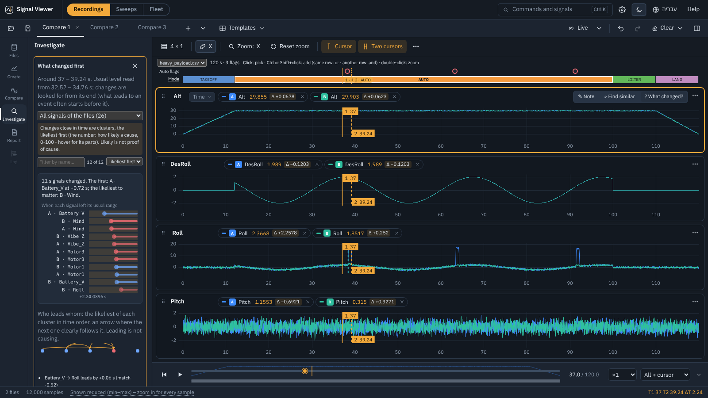
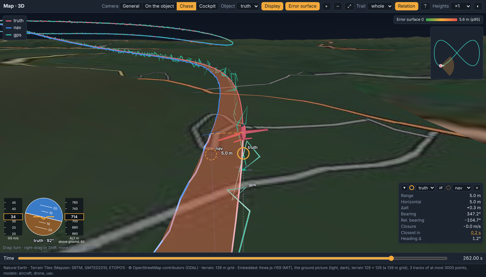
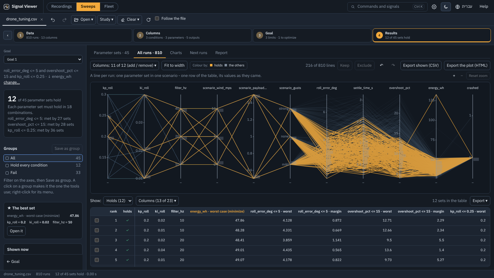
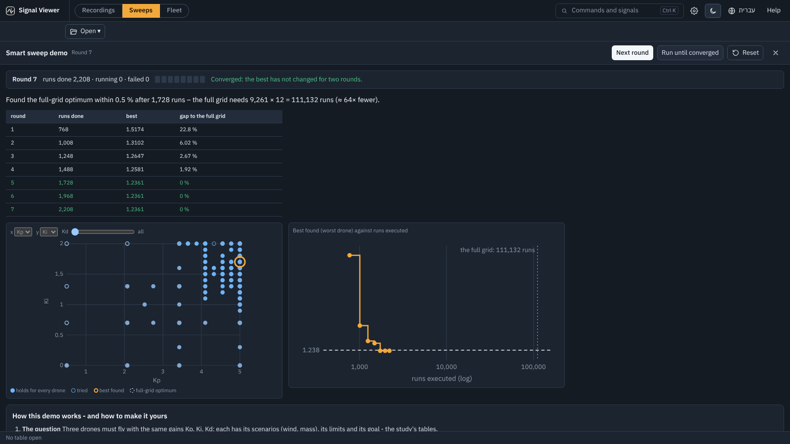
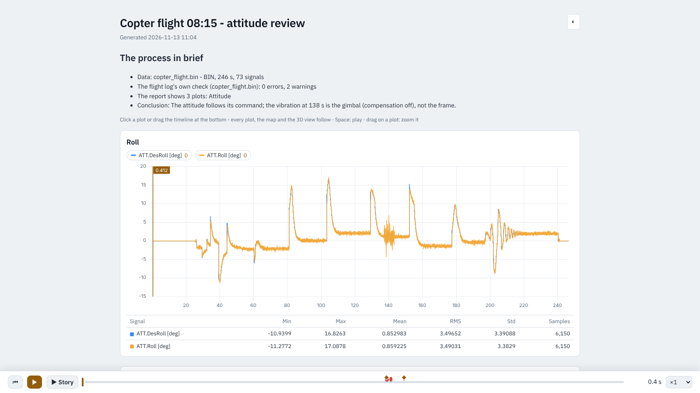

<p align="center">
  
</p>

<h1 align="center">Signal Viewer</h1>

<p align="center">
  <b>Find what went wrong. Prove what is right. Send the answer.</b><br>
  Offline analysis of flight logs, test runs, simulations and parameter sweeps – on your own machine.
</p>

<p align="center">
  <a href="https://github.com/DavidAlpert11/SignalViewer/actions/workflows/ci.yml"></a>
  
  
  
  
  <a href="https://davidalpert11.github.io/SignalViewer/"></a>
  <a href="LICENSE"></a>
</p>

<p align="center">
  <a href="https://github.com/DavidAlpert11/SignalViewer/releases/latest"><b>⬇ Download for Windows</b></a>
  &nbsp;·&nbsp; <code>pip install signalviewer</code>
  &nbsp;·&nbsp; <a href="https://davidalpert11.github.io/SignalViewer/"><b>Documentation</b></a>
  &nbsp;·&nbsp; <a href="https://davidalpert11.github.io/SignalViewer/GUIDE.he/"><b>מדריך בעברית</b></a>
</p>

<p align="center">
  
</p>

<p align="center">CSV · Parquet · MATLAB .mat · ArduPilot .bin · MAVLink .tlog · PX4 .ulg · ROS 2 .mcap · HDF5 · CAN + .dbc · your own format</p>

## Try it in one minute

Install, start it, and pick a card on the welcome screen. **Every part of the app has a demo with a known
answer** – nothing to prepare, nothing leaves your PC.

<p align="center"></p>

| Card on the welcome screen | What you will see |
|---|---|
| **A drone flight** | The flight on the map and in 3D over real terrain, played back in time with its attitude |
| **An ArduPilot flight log** | A real `.bin` log with its automatic health check: vibration, GPS, battery, EKF, motors |
| **The same mission flown twice** · **Three car runs** | Every shared signal ranked by how different it is |
| **A simulation against its flight** | The model beside the real flight, aligned in time, judged within a tolerance |
| **Find out what went wrong** | A known fault – find which signal changed first, and what led what |
| **A sweep: which settings hold** | 810 runs of a controller sweep – the 12 settings that hold in every wind and payload, the best one |
| **One gain set, three drones** | One set of gains that holds for three different drones – and why the others fail |
| **Smart sweep demo** | The next runs chosen for you, round after round, until it converges – about 64× fewer runs than the full grid |
| **A fleet of flights** | Ten flights of two copters – the one whose vibration grows, flight after flight |

## What it does for you

### 1 · Find what went wrong

Put two cursors around the moment it went wrong and ask **What changed?** – every signal that left its
usual range, in time order, the likeliest cause first, and which one led which. Then name the event
(`abs(Roll - DesRoll) > 5`), find every time it happened, and line them up.

<p align="center"></p>

[Tutorial: what went wrong, in ten minutes](https://davidalpert11.github.io/SignalViewer/investigate-tutorial/)

### 2 · Judge a run against a golden one

A golden run with a tolerance per signal judges the next recording – pass or fail, the worst moment, the
verdict ready for the report. The same check runs in CI.

```bash
signalviewer-cli compare golden.csv runs/*.csv --tol-pct 2 --junit results.xml   # exit 1 when one fails
signalviewer-cli check   runs/*.csv --checks checks.json                         # limits, per flight mode
```

### 3 · See the flight – on the map, in 3D, as a story

Truth, each navigation solution, each GPS and EKF lane – on an offline map or in 3D over real terrain,
compared in position, velocity and attitude. **▶ Story** plays the flight as a short film: the camera
flies to each moment that matters.

<p align="center"></p>

### 4 · Choose parameters that hold everywhere

A results table with a row per run: which parameter sets hold **in every scenario**, the best of them, and
how the runs spread over each scenario. With several systems, **one set for all of them**. Then let the
app **run the loop**: it proposes the next runs, starts your program (or hands them to your farm's
launcher), reads the results and goes on until the best stops changing.

<p align="center"></p>

<p align="center"></p>

[One parameter set for many systems](https://davidalpert11.github.io/SignalViewer/common-gains/) ·
[The smart-sweep demo](https://davidalpert11.github.io/SignalViewer/smart-sweep-demo/) ·
[Your farm as the runner](https://davidalpert11.github.io/SignalViewer/launcher/)

### 5 · Watch the whole fleet

Point it at the folders of logs. Every flight is checked the same way; ask *which flights had errors?* or
*is the vibration growing over the weeks?* – and open the one that needs a look.

<p align="center"></p>

[Tutorial: what the Fleet is for](https://davidalpert11.github.io/SignalViewer/fleet-tutorial/)

### 6 · Send the answer, not a screenshot

One HTML file that **opens with the process in brief** – the data, what was checked, what it shows and the
conclusion – then plots, map and 3D on one time bar with Play. Any browser, no install, no network. PDF and
Word too.

<p align="center"></p>

## Fast on big data – without cutting corners

- A 1.2 GB ArduPilot log opens in seconds; every sample stays available at full resolution, and the display
  keeps every spike.
- A sweep of **a million runs** opens with its answer in about 2 s; switching between parameter sets and
  every run does not work the answer out again.
- Every computation is checked against an independent reference – [29 validation cases](docs/validation.md),
  run them yourself with `signalviewer-cli validate`.

## Get started

- **Windows:** the installer or the portable `.zip` from the [latest release](https://github.com/DavidAlpert11/SignalViewer/releases/latest) – no administrator rights.
- **Linux / macOS:** the `-portable.7z`, or Python 3.9+: `pip install signalviewer`, then `signalviewer`.
- **From source:** `git clone`, `pip install -r requirements.txt`, `python run.py`.

Nothing needs the internet – not the map, not the 3D terrain. No account, no telemetry.

## In your scripts

```python
import signalviewer as sv
rec = sv.load("flight.bin")
sv.scene_html(rec, path="flight-3d.html")      # the flight in 3D, one offline page
```

```bash
python -m signalviewer.study loop drones.svstudy.json      # the sweep loop, from a terminal or a scheduler
```

[Command line and Python](https://davidalpert11.github.io/SignalViewer/command-line/) · [Scripting API](docs/api.md) · [Everything it does](docs/features.md) · [CHANGELOG](CHANGELOG.md)

## Where it fits

| You mostly… | Also used | What Signal Viewer adds |
|---|---|---|
| stream ROS topics live | PlotJuggler, Foxglove | recorded runs compared, pass / fail, live reports |
| work in MATLAB / Simulink | Simulation Data Inspector | no licence; flight logs and CAN next to the `.mat`; sweeps of runs |
| review one flight online | UAV Log Viewer, PX4 Flight Review | offline, many flights side by side, a fleet, your limits in CI |

## בעברית בקצרה

<div dir="rtl">

**Signal Viewer** – מוצאים מה השתבש, מוכיחים מה תקין, ושולחים את התשובה. הכול על המחשב שלכם, בלי אינטרנט.

- **לכל חלק באפליקציה יש הדגמה** במסך הפתיחה – טיסה, לוג ArduPilot, השוואה לסימולציה, חקירת תקלה, סריקת פרמטרים, הלולאה החכמה וצי טיסות.
- **מה השתבש:** שני סמנים סביב הרגע – והאפליקציה מראה מה השתנה ראשון, מה הסיבה הסבירה ומי הוביל את מי.
- **סריקות:** אילו הגדרות עומדות בכל תרחיש, סט אחד לכמה מערכות, ולולאה שמריצה את הקוד שלכם עד התכנסות.
- **דוח:** דף HTML חי שנפתח ב"התהליך בקצרה" – הנתונים, מה נבדק, מה מוצג והמסקנה.

**התקנה:** מ־[השחרור האחרון](https://github.com/DavidAlpert11/SignalViewer/releases/latest), או <code dir="ltr">pip install signalviewer</code>. **מדריך:** [docs/GUIDE.he.md](docs/GUIDE.he.md).

</div>

## License

[MIT](LICENSE) – free to use, change and ship, also commercially. Third-party parts keep their own licences: uPlot (MIT), three.js (MIT), the report fonts (SIL OFL), CesiumJS (Apache-2.0), map data from OpenStreetMap (ODbL), Natural Earth and the AWS Terrain Tiles ([details](docs/maps-and-3d.md#offline-map-data)).
