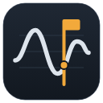
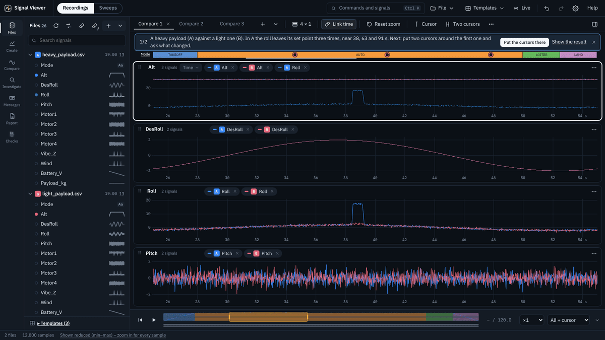
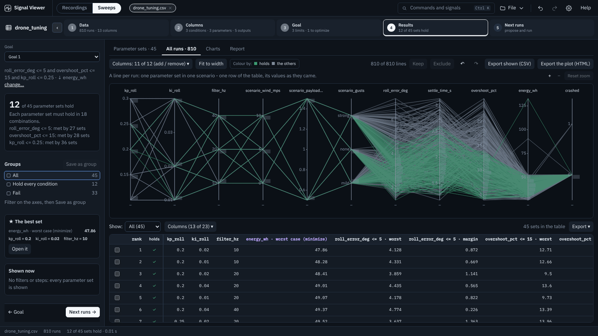
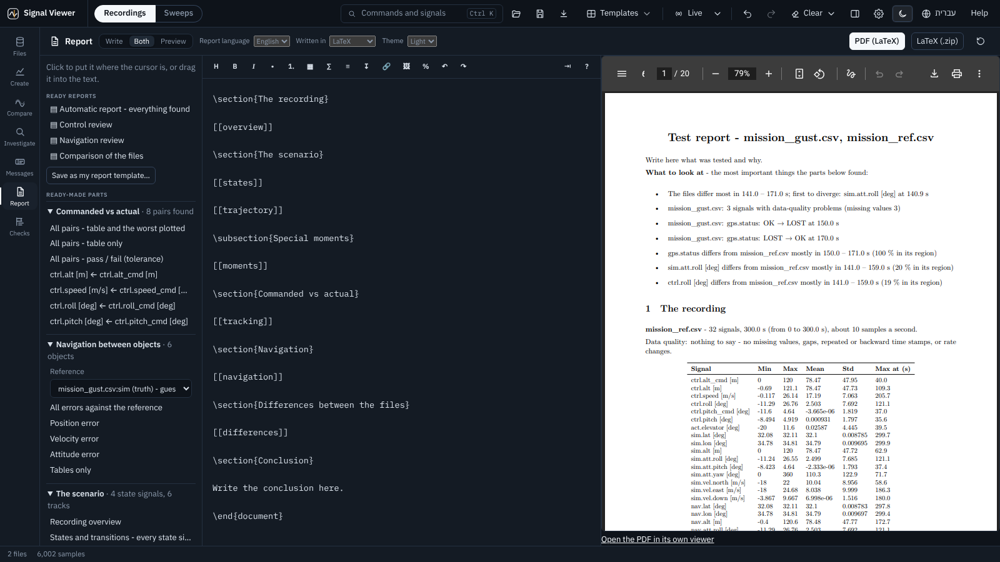
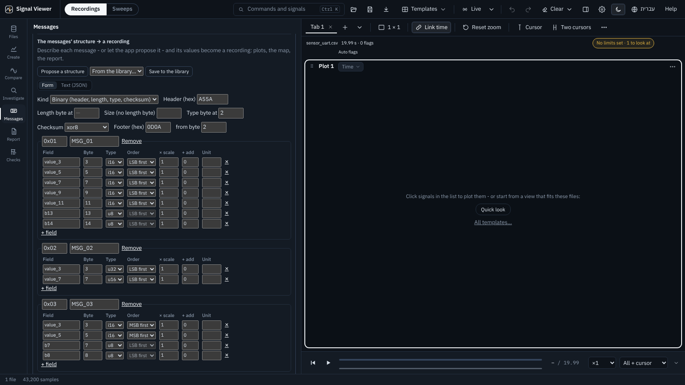
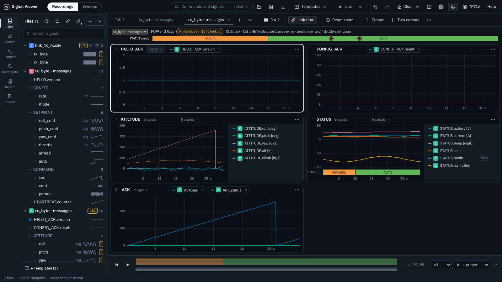
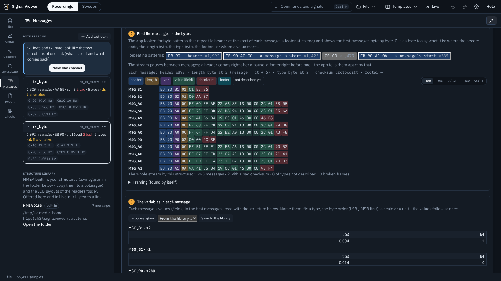
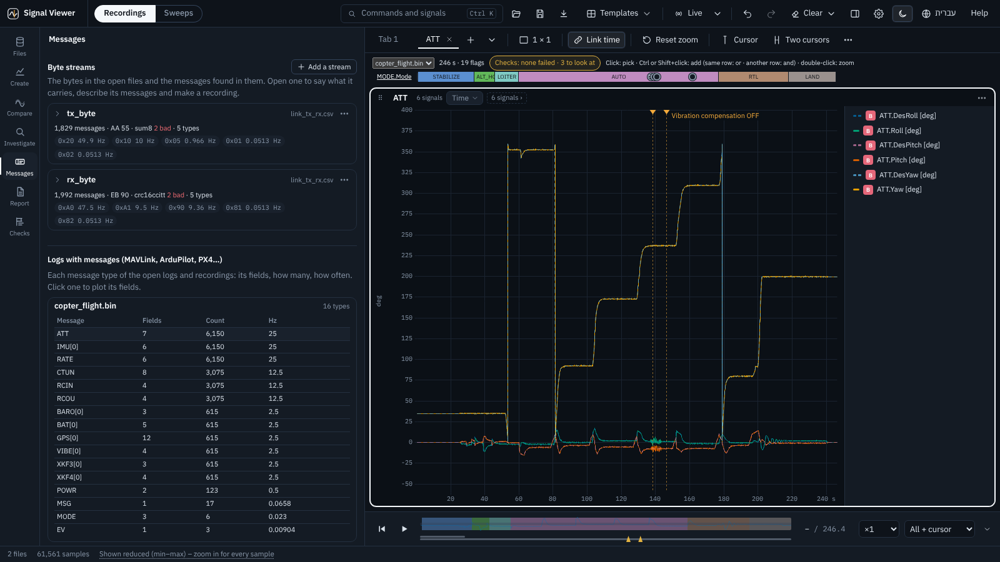

<p align="center">
  
</p>

<h1 align="center">Signal Viewer</h1>

<p align="center">
  <b>Find what went wrong. Prove what is right. Send the answer.</b><br>
  An offline workbench for engineers who analyse and validate time-series and measurement data –<br>
  test runs, simulation output, logs and parameter sweeps – on their own machine.
</p>

<p align="center">
  <a href="https://pypi.org/project/signalviewer/"></a>
  
  <a href="LICENSE"></a>
  <a href="https://davidalpert11.github.io/SignalViewer/"></a>
</p>

<p align="center">
  <a href="https://github.com/DavidAlpert11/SignalViewer/releases/latest"><b>Download</b></a> (Windows, Linux, macOS)
  &nbsp;·&nbsp; <a href="https://davidalpert11.github.io/SignalViewer/"><b>Documentation</b></a>
  &nbsp;·&nbsp; <a href="https://davidalpert11.github.io/SignalViewer/GUIDE.he/"><b>מדריך בעברית</b></a>
  &nbsp;·&nbsp; 🎬 <a href="docs/media/demo_simulation.mp4">90-second demo</a>
</p>

```bash
pip install signalviewer && signalviewer        # the app, with its examples - nothing else to prepare
```

<p align="center">
  
</p>

## Why Signal Viewer

Open a recording or a simulation's output and see every signal on one time axis. Compare it with the run it
should match, find what changed and why, check it against your limits, choose parameters from a sweep of
runs – and send a report anyone can open. It is made for test engineers (flight, vehicle, bench) and
simulation engineers, and it runs entirely on your machine: no account, no cloud, no telemetry, no internet.

- **Any time-series data** – CSV, Parquet, HDF5, MATLAB `.mat`, CAN + `.dbc`, ROS 2 `.mcap`, flight logs, or your
  own format through a short Python reader ([formats](#supported-formats)).
- **Bytes to signals** – a serial link, a radio or a bus recorded byte by byte, or a receiver's raw NMEA: the
  messages found by themselves (the byte patterns that repeat: header, footer; length, type, checksum), the template
  proposed – 16-bit LSB or MSB first, signed, 32-bit, floats – or defined by clicking the bytes in four guided steps,
  and the values become a recording you can save as CSV; or listen live to a serial port, UDP or TCP.
- **Runs side by side** – different clocks and rates aligned; every shared signal ranked by how much it differs.
- **What changed?** – the signals that left their usual range, in time order, and which one led which.
- **Pass / fail you can defend** – limits, a golden run with tolerances, data quality; the same checks headless in CI.
- **Sweeps** – the parameter sets that hold in every scenario, and a loop that runs your simulation until the best
  stops changing.
- **No point left out** – numbers always use all the data; plots are reduced only so that every spike is still drawn.
- **One file to send** – one click writes a ready report made of parts (commanded vs actual, navigation errors between objects, the scenario and its special moments, and the main differences between files with the central region of the change), or write it like Markdown, with `[[tab.plot]]` for a plot and `{{ max(Roll) }}` for a value of every sample, a live preview beside it; an offline HTML page that opens with how the conclusion was reached, PDF and Word from the same text - or **in LaTeX, as in Overleaf, offline** (a PDF preview from your own TeX, a project for Overleaf); a plot or a tab sent live onto a Confluence page (every sample, one click).
- **English and Hebrew** (right to left), light and dark themes.

## Quick start

| | |
|---|---|
| **Windows** | `SignalViewer-Setup-X.Y.Z.exe` or the portable `.zip` from the [latest release](https://github.com/DavidAlpert11/SignalViewer/releases/latest) – no administrator rights |
| **Linux / macOS** | the portable `.7z` from the [latest release](https://github.com/DavidAlpert11/SignalViewer/releases/latest) (macOS: Apple silicon), or Python below |
| **Python 3.9+** | `pip install signalviewer`, then `signalviewer` (the app) or `signalviewer-cli` (the command line) |
| **From source** | `git clone`, `pip install -r requirements.txt`, `python run.py` – the first start builds the UI (Node.js LTS, about half a minute) |

Then pick an example on the welcome screen – an ArduPilot log, a fault to find, a simulation against its
flight, the same mission flown twice, a folder of recordings, a smart sweep. Each has a known answer and says
what to do next; more (a car, a pump on a test bench, a results table, three drones) are in *Help → Examples*.
The packages are not code-signed yet – [what to do the first time](docs/install.md#first-start-windows-and-macos-warnings).

## A tour

<table>
<tr>
<td width="50%" valign="top">
<b>Find what went wrong</b><br>
Two cursors around the moment, then <i>What changed?</i> – who moved first and who led whom.
<a href="https://davidalpert11.github.io/SignalViewer/investigate-tutorial/">Tutorial</a><br><br>
<a href="docs/images/47_what_changed.gif"></a>
</td>
<td width="50%" valign="top">
<b>One verdict per file</b><br>
Your limits per phase or mode, the data's quality and a log's health check – each a click from its moment.
<a href="https://davidalpert11.github.io/SignalViewer/sim-vs-flight/">Sim vs. flight</a><br><br>
<a href="docs/images/09_health_check.png"></a>
</td>
</tr>
<tr>
<td width="50%" valign="top">
<b>Plots that read like instruments</b><br>
Values at the cursor with their units, statistics of what is on screen, modes as a band.
<a href="https://davidalpert11.github.io/SignalViewer/GUIDE/">User guide</a><br><br>
<a href="docs/images/01_overview.png"></a>
</td>
<td width="50%" valign="top">
<b>Choose parameters that hold everywhere</b><br>
Filter on any axis – the count and the table follow; which sets hold in every scenario, the next runs to make.
<a href="https://davidalpert11.github.io/SignalViewer/smart-sweep-demo/">Smart-sweep demo</a><br><br>
<a href="docs/images/45_sweeps_filter.gif"></a>
</td>
</tr>
</table>

**See it in space.** Any recording with positions, on satellite photos or an offline map, in 3D over the real
terrain – the cursor's moment on the track and in every plot at once. Online maps are opt-in; offline is the
default. [Map and 3D](https://davidalpert11.github.io/SignalViewer/maps-and-3d/)

<p align="center"><a href="docs/images/46_satellite_replay.gif"></a></p>

**Send the answer.** One HTML file that opens with the process in brief – the data, what was checked, what it
shows, the conclusion – then the plots, map and 3D on one time bar, the time plots zooming together. Any browser, no
install. Or a plot or a tab **sent straight onto a Confluence page** – paste the page's link, done; it goes where the
page says `[[signalviewer]]` or under the heading you pick – still live: zoom to every sample, the cursor, the
statistics and the notes. Or drag it out of the window: a folder gets the interactive page, Word a sharp picture.
*Automatic report* looks at what the files have and writes a report of ready-made parts you then edit - with
several files, the signals that differ most and the central region of the change, zoomed. Write it in Markdown or
in **LaTeX**, in an editor with its own undo and comments – your preamble, `align`, `tabular`, with the app's plots, parts and values still in it – previewed as a
PDF, offline, with nothing to install (the app carries its own LaTeX), or sent as a project to Overleaf.
[Writing a report](https://davidalpert11.github.io/SignalViewer/reports/)

<p align="center"><a href="docs/images/57_report_latex.png"></a></p>
A folder of recordings becomes one table too: the same numbers measured in each, one row per recording.

**Bytes to signals.** A link recorded byte by byte – or heard live on a serial port, UDP or TCP – is decoded by
itself: the messages, their types and order, the checksum errors, which message answers which and how fast. Four
steps take you from the raw signal to its variables: what it carries (TX, RX, both with a direction signal), the
byte patterns that repeat and the first messages byte by byte – as hex, numbers or ASCII; click a byte to say what it
is – each message's values as you define them (16-bit LSB / MSB first, a double, text, a conversion formula), every
message counted and in its order, and a recording of its own, saved as CSV like any input; a raw NMEA file opens as a track on the map at once. One *Messages* panel holds it all: the byte streams,
the message types of the logs (MAVLink included), the links running now and a library of structures.
[Messages: from bytes to signals](https://davidalpert11.github.io/SignalViewer/messages/)

<table>
<tr>
<td width="50%" valign="top"><a href="docs/images/53_messages_structure.png"></a></td>
<td width="50%" valign="top"><a href="docs/images/52_messages_recording.png"></a></td>
</tr>
</table>

<p align="center"><a href="docs/images/56_messages_steps.png"></a></p>

<p align="center"><a href="docs/images/55_messages_panel.png"></a></p>

<p align="center"><a href="docs/images/42_report_process.png"></a></p>

## Supported formats

| Data | Files | Notes |
|---|---|---|
| Tables | `.csv` / text, `.parquet`, `.h5` / `.hdf5` | the time column found by itself; in CSV and Parquet you can choose another |
| MATLAB / Simulink | `.mat` (v5 and v7.3) | |
| CAN | candump, Vector `.asc`, CAN tables in CSV + `.dbc` | |
| Flight logs | ArduPilot `.bin`, MAVLink `.tlog`, PX4 `.ulg` | automatic health check; live MAVLink |
| Robotics | ROS 2 / Foxglove `.mcap` | no ROS installation needed |
| Binary packets | a layout (ICD) you describe | |
| Byte streams | a signal of bytes, byte columns, `.svraw` link recordings, raw NMEA `.nmea` | messages found by themselves; a structure (proposed or yours, `.svmsg.json`) makes them signals; live from serial / UDP / TCP |
| Anything else | a Python reader of a few lines | `signalviewer-cli readers --example` writes one to start from |

`pip install signalviewer` reads all of them; `signalviewer-lite` is the core, with extras for the rest
([install](docs/install.md)).

## In scripts and CI

```python
import signalviewer as sv
rec = sv.load("examples/bench/pump_run_07.parquet")   # any supported format
t, p = rec.signal("Pressure")                          # numpy arrays; the unit may be left out of the name
df = rec.to_dataframe(["Pressure", "MotorTemp"], t0=100, t1=500)
```

```bash
signalviewer-cli check   runs/*.parquet --checks checks.json --junit results.xml   # limits, per phase
signalviewer-cli compare golden.csv runs/*.csv --tol-pct 2                          # against a golden run
signalviewer-cli validate                                                           # 29 passed, 0 failed
```

Exit codes and JUnit XML for CI; also export, a Sweeps table from a folder of recordings and a sweep's answer.
[Command line and Python](https://davidalpert11.github.io/SignalViewer/command-line/)

## Numbers you can trust

- Every computation is checked against an independent reference – [29 validation cases](docs/validation.md)
  with expected and measured values; run them yourself with `signalviewer-cli validate`.
- Numbers – counts, statistics, checks, exports – are always computed on all the data, never on what is drawn.
- Raw data is never changed: derived signals, offsets and alignments are recorded and undoable.
- Formulas run through a whitelist, never `eval`. The app listens on `127.0.0.1` only.
- What it does not do yet is written down: [known limitations](docs/limitations.md).

## Where it fits

| You mostly… | Also used | What Signal Viewer adds |
|---|---|---|
| stream ROS topics live | PlotJuggler, Foxglove | recorded runs compared and judged, pass / fail in CI, offline reports |
| work in MATLAB / Simulink | Simulation Data Inspector | no licence; test data, logs and CAN beside the `.mat`; sweeps of runs |
| review one flight log online | UAV Log Viewer, PX4 Flight Review | offline, many runs side by side, a folder of logs at once, your own limits |

## Documentation

[User guide](https://davidalpert11.github.io/SignalViewer/GUIDE/) ·
[Everything it does](docs/features.md) ·
[Install and build](docs/install.md) ·
[Command line and Python](docs/command-line.md) ·
[Validation](docs/validation.md) ·
[Known limitations](docs/limitations.md) ·
[What's new](CHANGELOG.md) ·
🎓 [Training film with narration, ten short chapters](docs/media/training.mp4)

## בעברית בקצרה

<div dir="rtl">

**Signal Viewer** – סביבת עבודה הנדסית לניתוח ואימות של נתוני מדידה וסדרות זמן מכל מקור: ניסויי טיסה, רכב וספסל, פלט סימולציות, ROS 2 ו־CAN, וסריקות פרמטרים. הכול על המחשב שלכם, בלי חשבון ובלי אינטרנט.

- **מוצאים מה השתבש:** שני סמנים סביב הרגע ו*מה השתנה?* – מה זז ראשון ומי הוביל את מי.
- **שופטים ריצה:** מגבלות, טולרנסים מול ריצת ייחוס ואיכות נתונים – פסיקה אחת לכל קובץ, ואותן בדיקות גם ב־CI.
- **בוחרים פרמטרים (Sweeps):** אילו סטים עומדים בכל תרחיש, סט אחד לכמה מערכות, ולולאה שמריצה את הקוד שלכם עד התכנסות.
- **אף נקודה לא נעלמת:** המספרים תמיד על כל הנתונים, והגרף מוקטן רק כך שכל קפיצה עדיין מצוירת.
- **מבתים לסיגנלים:** קו תקשורת שהוקלט בית אחר בית, או NMEA גולמי של מקלט: ההודעות נמצאות לבד (כותרת, אורך, סוג, checksum, סיומת), האפליקציה מציעה מבנה – 16 ביט LSB או MSB קודם, עם סימן, 32 ביט, float, double, טקסט – או שמגדירים אותו בארבעה שלבים מודרכים – הבתים כ־hex, מספרים או ASCII, ולחיצה על בית אומרת מה הוא (כותרת, אורך, סוג, ערך), עם נוסחת המרה – כל הודעה נספרת ומוצגת לפי הסדר, והערכים הופכים להקלטה שנשמרת גם ל־CSV. אפשר גם להאזין חי לפורט טורי, UDP או TCP. חלונית *הודעות* אחת מרכזת הכול: זרמי הבתים, סוגי ההודעות של הלוגים (גם MAVLink), הקווים הפעילים וספריית מבנים.
- **מפה ותלת־ממד:** תצלומי לוויין או מפה לא מקוונת, מעל פני השטח האמיתיים – הרגע של הסמן על המסלול ובכל הגרפים יחד.
- **שולחים את התשובה:** לחיצה אחת כותבת דוח מוכן מחלקים (פקודה מול ביצוע, שגיאות ניווט בין אובייקטים, התרחיש והרגעים המיוחדים, וההבדלים העיקריים בין קבצים עם האזור המרכזי של השינוי), או כותבים את הדוח כמו Markdown, או ב־LaTeX כמו ב־Overleaf – בלי אינטרנט ובלי להתקין דבר, בעורך עם ביטול והערות משלו – עם גרפים וערכים מהנתונים ותצוגה חיה; דוח HTML אחד שנפתח ב"התהליך בקצרה", וגם PDF ו־Word, או גרף ולשונית שנשלחים חיים ישר לדף Confluence – מדביקים את הקישור לדף וזהו (למקום שבו כתוב בדף <code dir="ltr">[[signalviewer]]</code> או מתחת לכותרת שבוחרים); או גוררים אותם אל מחוץ לחלון – לתיקייה דף אינטראקטיבי, ל־Word תמונה חדה. תיקייה של הקלטות – טבלה אחת, שורה לכל הקלטה.

**התקנה:** מ־[השחרור האחרון](https://github.com/DavidAlpert11/SignalViewer/releases/latest) (Windows, Linux, macOS), או <code dir="ltr">pip install signalviewer</code>. **מדריך:** [docs/GUIDE.he.md](docs/GUIDE.he.md).

</div>

## Contributing

Bug reports with a file that shows the problem, readers for new formats and pull requests are welcome – see
[CONTRIBUTING.md](CONTRIBUTING.md). Security issues: [SECURITY.md](SECURITY.md).

## Citation

If you use Signal Viewer in published work, please cite it – GitHub's *Cite this repository* reads
[CITATION.cff](CITATION.cff).

## License

[MIT](LICENSE) – free to use, change and ship, also commercially. Third-party parts keep their own licences:
uPlot (MIT), three.js (MIT), the report fonts (SIL OFL), CesiumJS (Apache-2.0), map data from OpenStreetMap
(ODbL), Natural Earth and the AWS Terrain Tiles; the satellite photos are Esri's, fetched only when you choose
them ([details](docs/maps-and-3d.md#offline-map-data)).
