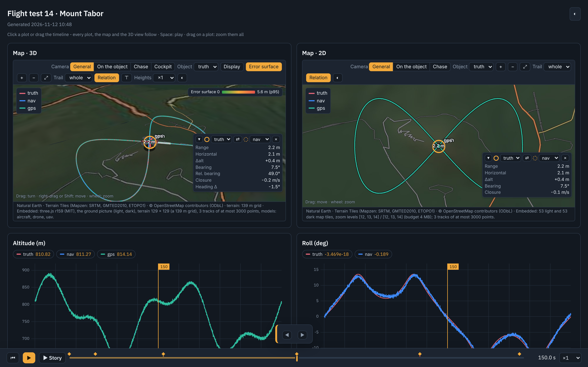
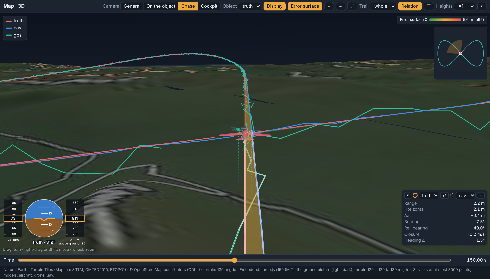
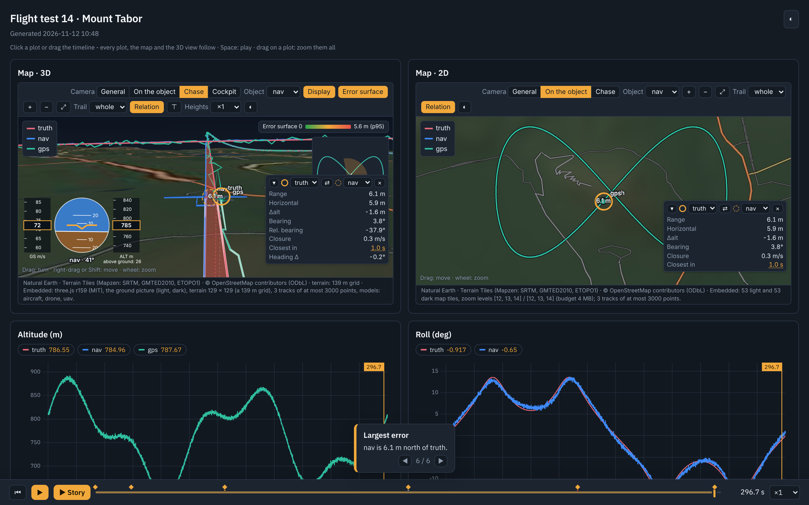
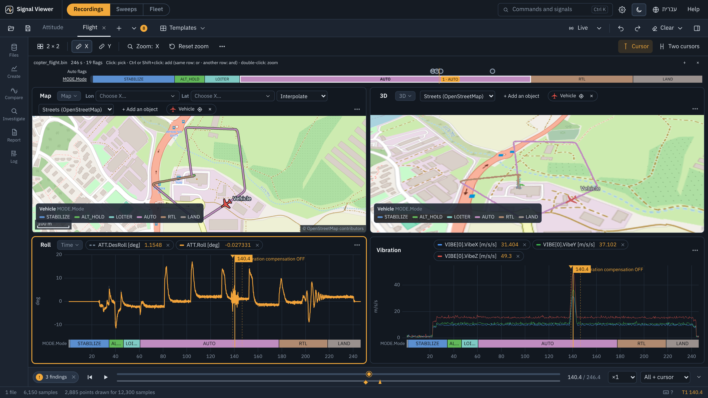

<p align="center">
  
</p>

<h1 align="center">Signal Viewer</h1>

<p align="center">
  <b>Signal Viewer – offline flight log &amp; test data analysis</b><br>
  CSV · Parquet · MATLAB .mat · ArduPilot .bin · MAVLink .tlog · PX4 .ulg · ROS 2 .mcap · HDF5 · CAN + .dbc
</p>

<p align="center">
  <a href="https://github.com/DavidAlpert11/SignalViewer/actions/workflows/ci.yml"></a>
  
  
  
  
  
  <a href="https://davidalpert11.github.io/SignalViewer/"></a>
  <a href="LICENSE"></a>
</p>

<p align="center">
  <a href="https://github.com/DavidAlpert11/SignalViewer/releases/latest"><b>⬇ Download for Windows</b></a>
  &nbsp;·&nbsp; <code>pip install signalviewer</code>
  &nbsp;·&nbsp; <a href="https://davidalpert11.github.io/SignalViewer/"><b>Documentation</b></a>
  &nbsp;·&nbsp; <a href="https://davidalpert11.github.io/SignalViewer/GUIDE.he/"><b>מדריך בעברית</b></a>
</p>

<p align="center">
  
</p>

<p align="center"><b>Open a flight log or a test run, see what went wrong, judge it against a golden run – and send the answer as one live page. All offline.</b></p>

## Why engineers use it

- **Opens anything, fast.** A 1.2 GB ArduPilot log in seconds, every sample at full resolution – CSV, MATLAB, `.bin`, `.tlog`, `.ulg`, ROS 2, HDF5, Parquet, CAN + `.dbc`, or your own format in a few lines of Python.
- **Points at the problem.** An ArduPilot log gets a health check as it opens – vibration, GPS, battery, EKF, motors – and each finding takes you to its moment.
- **Pass or fail, not "looks about right".** A golden run with a tolerance per signal judges the next recording – and gives CI the same answer.
- **Every object on the map and in 3D.** Truth, each navigation solution, each GPS, each EKF lane – found by name, added in one click, compared in position, velocity and attitude.
- **Send the answer, not a screenshot.** One HTML file: plots, map and 3D on one time bar, with Play. Opens in any browser – no install, no network.
- **Nothing leaves the PC.** No account, no telemetry; maps and terrain built in. English and Hebrew.

## New in 1.26 – the report is alive

- **One live page.** An HTML report's time bar moves every plot and the Map together – Play, ×0.5 – ×30, and the log's errors, warnings and your notes as marks to jump to.
- **3D in the report.** Turn, zoom and follow any object over the real terrain, with its model's heading, pitch and roll. PDF and Word get the same view as a picture.
- **One Map, in 3D.** The earth with its terrain; *From above* is the old 2D view. *3D (XYZ)* is the plot for any three signals.
- **A Map worth stopping for.** The sun where it was, drop lines, a cockpit camera, a flight display, and the error between truth and the navigation solution drawn as a coloured surface.
- **Story mode.** *▶ Story* plays the flight as a short guided film – the camera flies to each moment that matters, and a card says what happened.

<p align="center"></p>

<p align="center"></p>

<p align="center"></p>

<p align="center"> </p>

<p align="center"></p>

## Get started

- **Windows:** the installer or the portable `.zip` from the [latest release](https://github.com/DavidAlpert11/SignalViewer/releases/latest) – no administrator rights. **Linux / macOS:** the `-portable.7z`.
- **Python 3.9+:** `pip install signalviewer`, then `signalviewer`.

Six examples open in one click from the welcome screen.

## In CI and in your scripts

```bash
signalviewer-cli check   runs/*.csv --checks checks.json --junit results.xml      # limits: exit 1 when one breaks
signalviewer-cli compare-objects flight.bin --ref POS --tolerance position=2m     # every EKF lane against POS
signalviewer-cli map     flight.bin --3d --out flight.html                        # the flight in 3D, one offline page
```

```python
import signalviewer as sv
rec = sv.load("flight.bin")
sv.scene_html(rec, path="flight-3d.html")      # the live 3D page
```

[Command line and Python](https://davidalpert11.github.io/SignalViewer/command-line/) · [Scripting API](docs/api.md) · [Everything it does](docs/features.md) · [CHANGELOG](CHANGELOG.md)

## Where it fits

| You mostly… | Also used | What Signal Viewer adds |
|---|---|---|
| stream ROS topics live | PlotJuggler, Foxglove | recorded runs compared, pass / fail, live reports |
| work in MATLAB / Simulink | Simulation Data Inspector | no licence; flight logs and CAN next to the `.mat` |
| review one flight online | UAV Log Viewer, PX4 Flight Review | offline, many flights side by side, your limits in CI |

## בעברית בקצרה

<div dir="rtl">

**Signal Viewer** – פותחים לוג טיסה או ריצת ניסוי, רואים מה השתבש, בודקים מול ריצת ייחוס, ושולחים את התשובה כדף חי אחד. הכול בלי אינטרנט.

- **חדש ב־1.26:** דוח HTML הוא דף חי – סרגל זמן אחד מזיז את כל הגרפים, את המפה ואת התלת־ממד יחד, עם ניגון. התלת־ממד בתוך הדוח: סיבוב, זום ומעקב אחרי אובייקט מעל פני השטח. ב־PDF וב־Word – תמונה.
- **מפה אחת, דו־ממד או תלת־ממד** – מתג אחד. *תלת־ממד (XYZ)* הוא הגרף לכל שלושה סיגנלים.
- **פותח הכול, מהר:** ‏ArduPilot, ‏PX4, ‏MAVLink, ‏MATLAB, ‏CSV, ‏ROS 2, ‏CAN. בדיקת תקינות ללוג, עבר / נכשל מול ריצת ייחוס, ו־CI עם אותה תשובה.

**התקנה:** מ־[השחרור האחרון](https://github.com/DavidAlpert11/SignalViewer/releases/latest), או <code dir="ltr">pip install signalviewer</code>. **מדריך:** [docs/GUIDE.he.md](docs/GUIDE.he.md).

</div>

## License

[MIT](LICENSE) – free to use, change and ship, also commercially. Third-party parts keep their own licences: uPlot (MIT), three.js (MIT), the report fonts (SIL OFL), CesiumJS (Apache-2.0), map data from OpenStreetMap (ODbL), Natural Earth and the AWS Terrain Tiles ([details](docs/maps-and-3d.md#offline-map-data)).
