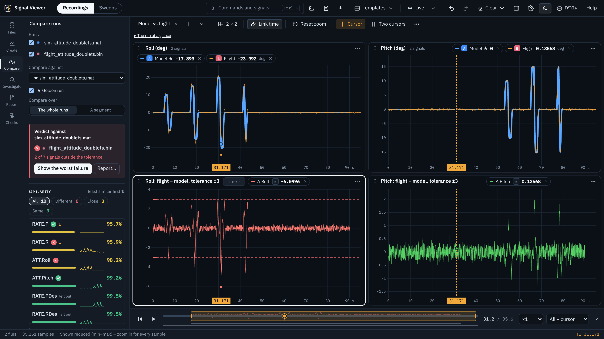
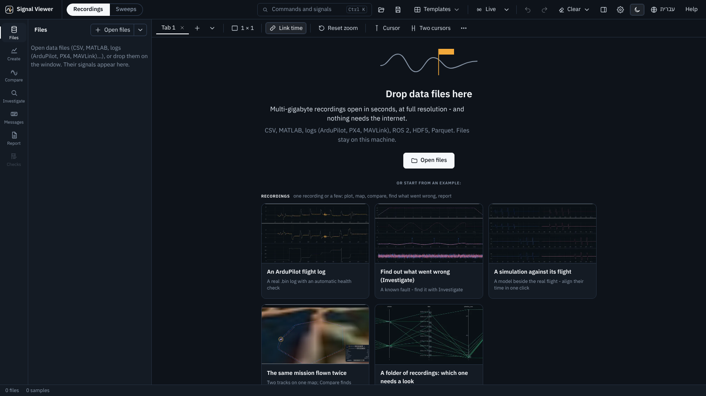
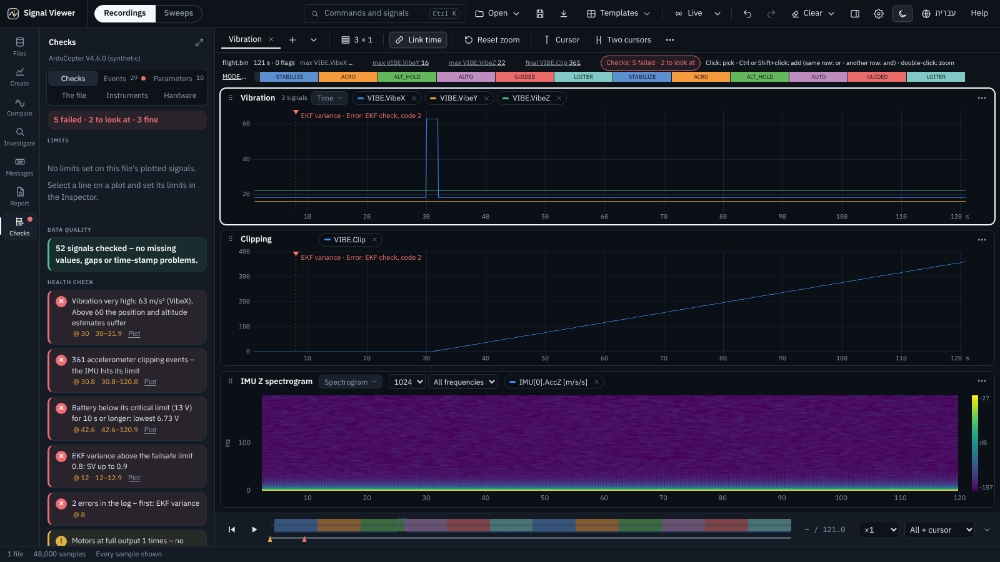
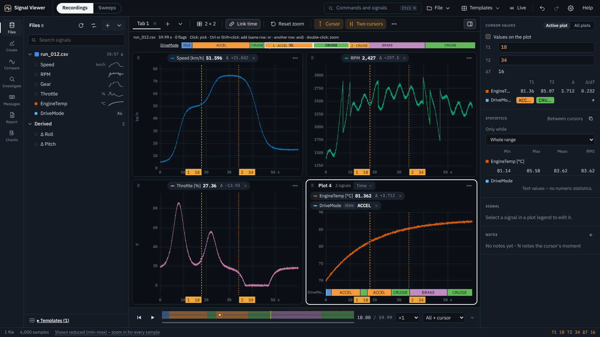
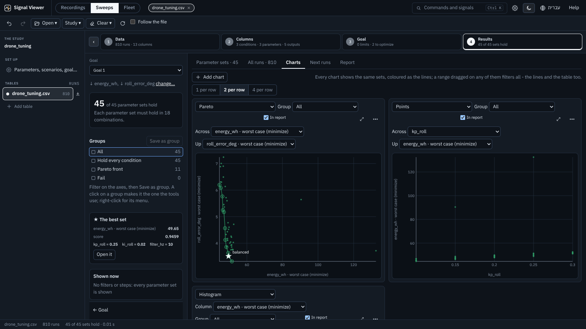
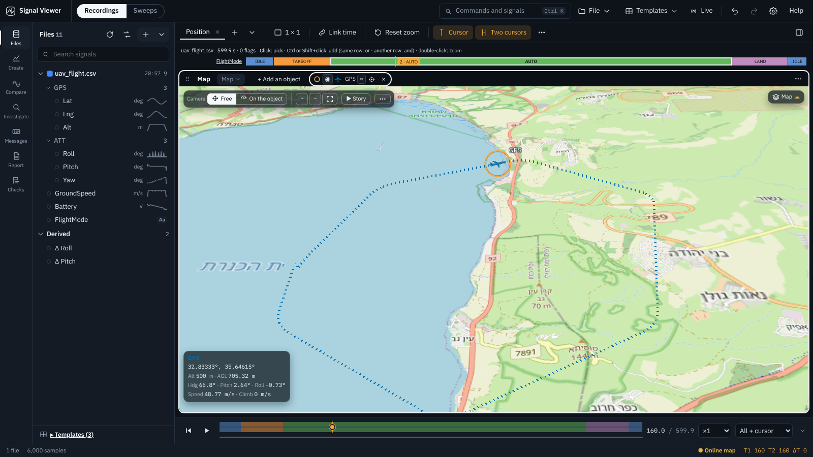
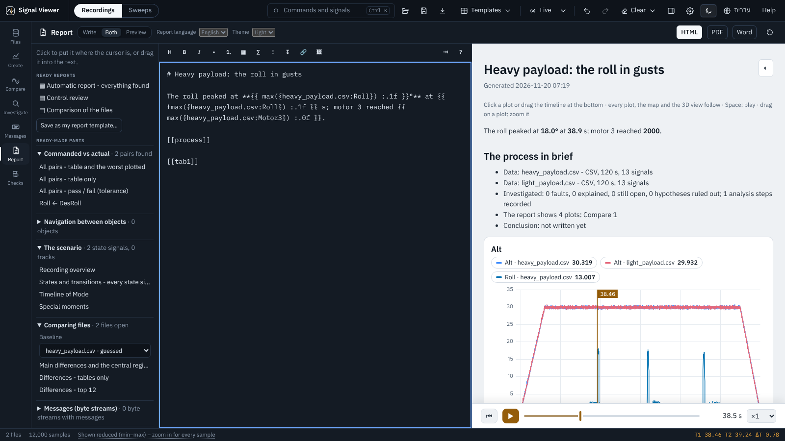

<p align="center">
  
</p>

<h1 align="center">Signal Viewer</h1>

<p align="center">
  <b>Find what went wrong. Prove what is right. Send the answer.</b><br>
  An offline engineering data analysis &amp; validation workbench for any time-series data –<br>
  flight, vehicle and bench tests, simulation output, ROS 2 and CAN, parameter sweeps – on your own machine.
</p>

<p align="center">
  <a href="https://github.com/DavidAlpert11/SignalViewer/actions/workflows/ci.yml"></a>
  
  
  
  
  <a href="https://davidalpert11.github.io/SignalViewer/"></a>
  <a href="LICENSE"></a>
</p>

<p align="center">
  <a href="https://github.com/DavidAlpert11/SignalViewer/releases/latest"><b>⬇ Download for Windows</b></a>
  &nbsp;·&nbsp; <code>pip install signalviewer</code>
  &nbsp;·&nbsp; <a href="https://davidalpert11.github.io/SignalViewer/"><b>Documentation</b></a>
  &nbsp;·&nbsp; <a href="https://davidalpert11.github.io/SignalViewer/GUIDE.he/"><b>מדריך בעברית</b></a>
</p>

<p align="center">
  
</p>

<p align="center"><sub>CSV · Parquet · HDF5 · MATLAB .mat · ArduPilot .bin · MAVLink .tlog · PX4 .ulg · ROS 2 .mcap · CAN + .dbc · your own reader in a few lines of Python</sub></p>

---

**Signal Viewer turns raw measurements into engineering answers you can defend.** Open a run, see every
signal on one time axis, compare it with the run it should match, find what changed and why, check it
against your limits – and hand over a report anyone can open. Everything runs on your machine: no account,
no cloud, no telemetry, no internet needed.

<table>
<tr>
<td width="33%" valign="top"><b>🔍 Compare and understand</b><br>Runs on different clocks and rates, aligned. Every shared signal ranked by how much it differs; <i>What changed?</i> names what moved first and what led what.</td>
<td width="33%" valign="top"><b>✅ Investigate and validate</b><br>Limits, tolerances, a golden run, data quality – one <i>Checks</i> verdict per file. The same checks run headless in CI and return pass / fail.</td>
<td width="33%" valign="top"><b>📄 Reproduce and report</b><br>Sessions and templates bring back the same view on the next run. One offline HTML report opens with how the conclusion was reached.</td>
</tr>
</table>

## Try it in one minute

Install, start, and pick a card on the welcome screen. **Every part of the app has a demo with a known
answer** – nothing to prepare, nothing leaves your PC.

<p align="center"></p>

| Demo | What it shows |
|---|---|
| **A pump on a test bench** | A Parquet bench run – phases, units, a 0.2 s pressure spike, a gap, a temperature creeping over its limit. Its `checks.json` runs in CI too |
| **Three car runs** · **The same mission flown twice** | Every shared signal ranked by how different it is |
| **A simulation against its flight** | The model beside the real run, aligned in time, judged within a tolerance |
| **Find out what went wrong** | A known fault – which signal changed first, and what led what |
| **A drone flight** · **An ArduPilot log** | The path on a map and in 3D, played back; a real `.bin` log with its health check |
| **A sweep: which settings hold** | 810 runs of a controller sweep – the settings that hold in every scenario, and the best one |
| **One gain set, three systems** · **Smart sweep** | One parameter set for several systems; the next runs chosen for you until it converges – about 64× fewer runs than the full grid |
| **A fleet** | Ten recordings of two machines – the one whose vibration grows, run after run |

## What it does for you

### Find what went wrong

Put two cursors around the moment and ask **What changed?** – every signal that left its usual range, in
time order, the likeliest cause first, and which one led which. Name the event
(`abs(Roll - DesRoll) > 5`), find every time it happened, and line them up.

[Tutorial: what went wrong, in ten minutes](https://davidalpert11.github.io/SignalViewer/investigate-tutorial/)

### Judge a run against its limits and a golden run

One verdict per file – your limits (per phase or mode), the data's own quality (gaps, stuck values, spikes),
and a log's health check. A golden run with a tolerance per signal judges the next one. The same checks run
in CI:

```bash
signalviewer-cli check   runs/*.parquet --checks checks.json --junit results.xml   # limits, per phase
signalviewer-cli compare golden.csv runs/*.csv --tol-pct 2                          # against a golden run
```

<p align="center"></p>

### Plots that read like instruments

Cursor values in the legend with their units, the change between two cursors, the statistics of what is on
screen, modes as a colour band in the plot. Long recordings stay fast – and the display never hides a spike.

<p align="center"></p>

### Choose parameters that hold everywhere

**Sweeps** is one study, whatever you start from: a table of results, or nothing but the parameters and
their ranges. It finds the sets that hold **in every scenario**, one set for several systems, and can run
the loop for you – propose the next runs, start your program or your farm's launcher, read the results,
until the best stops changing. A million runs open with their answer in about 2 s.

<p align="center"></p>

### See it in space

Any recording with positions – on an offline map or in 3D over real terrain: tracks compared, a height
profile along the distance, wind or velocity as arrows along the path. Online maps, your own MBTiles or
tile server, and areas kept for the field are opt-in; offline is the default.

<p align="center"></p>

### Watch the fleet, send the answer

Point it at folders of recordings: every one checked the same way, trends over weeks. Then send one HTML
file that **opens with the process in brief** – the data, what was checked, what it shows, the conclusion –
with plots, map and 3D on one time bar. Any browser, no install. PDF and Word too.

<p align="center"></p>

## Trust the numbers

- Every computation is checked against an independent reference – [the validation cases](docs/validation.md);
  run them yourself with `signalviewer-cli validate`.
- Raw data is never changed: derived signals, offsets and alignments are recorded and undoable.
- Formulas run through a whitelist, never `eval`. The app listens on `127.0.0.1` only.

## Get started

- **Windows:** the installer or the portable `.zip` from the [latest release](https://github.com/DavidAlpert11/SignalViewer/releases/latest) – no administrator rights.
- **Linux / macOS:** `pip install signalviewer`, then `signalviewer` (Python 3.9+).
- **From source:** `git clone`, `pip install -r requirements.txt`, `python run.py`.

```python
import signalviewer as sv
rec = sv.load("examples/bench/pump_run_07.parquet")   # any supported format
t, p = rec.signal("Pressure")                          # numpy arrays, the unit may be left out
df = rec.to_dataframe(["Pressure", "MotorTemp"], t0=100, t1=500)
```

[User guide](https://davidalpert11.github.io/SignalViewer/GUIDE/) · [Command line and Python](https://davidalpert11.github.io/SignalViewer/command-line/) · [Everything it does](docs/features.md) · [What's new](CHANGELOG.md)

## Where it fits

| You mostly… | Also used | What Signal Viewer adds |
|---|---|---|
| stream ROS topics live | PlotJuggler, Foxglove | recorded runs compared and judged, pass / fail in CI, offline reports |
| work in MATLAB / Simulink | Simulation Data Inspector | no licence; test data, logs and CAN beside the `.mat`; sweeps of runs |
| review one flight log online | UAV Log Viewer, PX4 Flight Review | offline, many runs side by side, a fleet, your own limits |

## בעברית בקצרה

<div dir="rtl">

**Signal Viewer** – סביבת עבודה הנדסית לניתוח ואימות של נתוני מדידה מכל מקור: ניסויי טיסה, רכב וספסל, סימולציות, ROS 2 ו־CAN. הכול על המחשב שלכם, בלי חשבון ובלי אינטרנט.

- **משווים ומבינים:** ריצות בשעונים ובקצבים שונים מיושרות זו לזו; *מה השתנה?* מראה מה זז ראשון ומי הוביל את מי.
- **בודקים ומאמתים:** מגבלות, טולרנסים, ריצת ייחוס ואיכות נתונים – פסיקה אחת לכל קובץ, ואותן בדיקות גם ב־CI.
- **משחזרים ומדווחים:** תבניות ו־sessions מחזירים את אותה תצוגה, ודוח HTML אחד שנפתח ב"התהליך בקצרה".
- **Sweeps:** אילו פרמטרים עומדים בכל תרחיש, סט אחד לכמה מערכות, ולולאה שמריצה את הקוד שלכם עד התכנסות.

**התקנה:** מ־[השחרור האחרון](https://github.com/DavidAlpert11/SignalViewer/releases/latest), או <code dir="ltr">pip install signalviewer</code>. **מדריך:** [docs/GUIDE.he.md](docs/GUIDE.he.md).

</div>

## License

[MIT](LICENSE) – free to use, change and ship, also commercially. Third-party parts keep their own licences: uPlot (MIT), three.js (MIT), the report fonts (SIL OFL), CesiumJS (Apache-2.0), map data from OpenStreetMap (ODbL), Natural Earth and the AWS Terrain Tiles ([details](docs/maps-and-3d.md#offline-map-data)).
