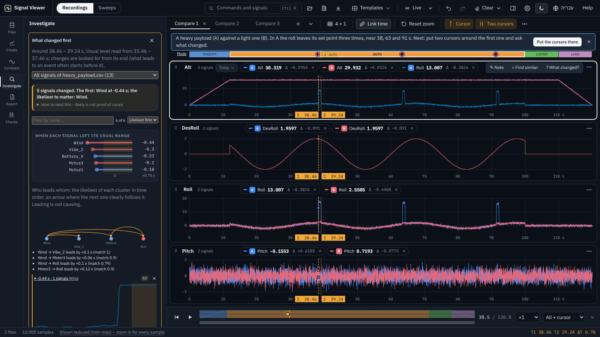
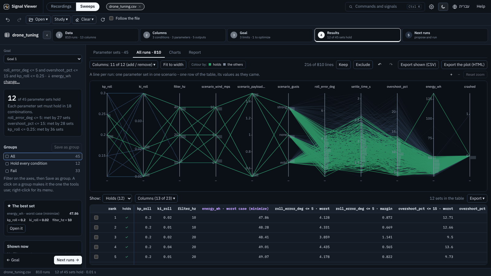

<p align="center">
  
</p>

<h1 align="center">Signal Viewer</h1>

<p align="center">
  <b>Find what went wrong. Prove what is right. Send the answer.</b><br>
  An offline workbench for engineers who analyse and validate time-series and measurement data –<br>
  test runs, simulation output, logs and parameter sweeps – on their own machine.
</p>

<p align="center">
  <a href="https://pypi.org/project/signalviewer/"></a>
  
  <a href="LICENSE"></a>
  <a href="https://davidalpert11.github.io/SignalViewer/"></a>
</p>

<p align="center">
  <a href="https://github.com/DavidAlpert11/SignalViewer/releases/latest"><b>Download</b></a>
  &nbsp;·&nbsp; <a href="#quick-start"><b>Quick start</b></a>
  &nbsp;·&nbsp; <a href="https://davidalpert11.github.io/SignalViewer/"><b>Documentation</b></a>
  &nbsp;·&nbsp; <a href="https://davidalpert11.github.io/SignalViewer/GUIDE.he/"><b>מדריך בעברית</b></a>
</p>

<p align="center">
  
</p>

**Signal Viewer** is a desktop app for test engineers (flight, vehicle, bench) and simulation engineers. Open a
recording or a simulation's output, see every signal on one time axis, compare it with the run it should match,
find what changed and why, check it against your limits, choose parameters from a sweep of runs – and send a
report anyone can open. It runs entirely on your machine: no account, no cloud, no telemetry, no internet needed.

- **Any time-series data** – CSV, Parquet, HDF5, MATLAB `.mat`, CAN + `.dbc`, ROS 2 `.mcap`, flight logs
  (ArduPilot, PX4, MAVLink), or your own format through a short Python reader.
- **Windows, Linux and macOS** – an installer or a portable package, or `pip install signalviewer`.
- **English and Hebrew** (right to left), light and dark themes.

🎬 [Simulation vs. reality – 90-second demo](docs/media/demo_simulation.mp4) · 🎓 [Training film – nine short chapters](docs/media/training.mp4)

## Quick start

| | |
|---|---|
| **Windows** | `SignalViewer-Setup-X.Y.Z.exe` or the portable `.zip` from the [latest release](https://github.com/DavidAlpert11/SignalViewer/releases/latest) – no administrator rights |
| **Linux / macOS** | the portable `.7z` from the [latest release](https://github.com/DavidAlpert11/SignalViewer/releases/latest) (macOS: Apple silicon), or with Python below |
| **Python 3.9+** | `pip install signalviewer`, then `signalviewer` (the app) or `signalviewer-cli` (the command line) |
| **From source** | `git clone`, `pip install -r requirements.txt`, `python run.py` – the first start builds the UI (Node.js LTS, about half a minute) |

Then pick an example on the welcome screen – an ArduPilot log, a fault to find, a simulation against its
flight, the same mission flown twice, a folder of recordings, a smart sweep. Each has a known answer and says
what to do next; more (a car, a pump on a test bench, a results table, three drones) are in *Help → Examples*.
The packages are not code-signed yet – [what to do the first time](docs/install.md#first-start-windows-and-macos-warnings).

## What you can do

### Find what went wrong

Put two cursors around the moment and ask **What changed?** – every signal that left its usual range, in
time order, the likeliest cause first, and which one led which. Name the event (`abs(Roll - DesRoll) > 5`),
find every time it happened and line them up. [Tutorial: what went wrong, in ten minutes](https://davidalpert11.github.io/SignalViewer/investigate-tutorial/)

<p align="center"></p>

### Judge a run against its limits and a golden run

One verdict per file: your limits (per phase or mode), the data's own quality (gaps, stuck values, spikes) and
a log's health check. A golden run with a tolerance per signal judges the next one – runs on different clocks
and rates are aligned first. The same checks run headless in CI:

```bash
signalviewer-cli check   runs/*.parquet --checks checks.json --junit results.xml   # limits, per phase
signalviewer-cli compare golden.csv runs/*.csv --tol-pct 2                          # against a golden run
```

<p align="center"></p>

### Plots that read like instruments

Cursor values in the legend with their units, the change between two cursors, the statistics of what is on
screen, modes as a colour band in the plot. Multi-gigabyte recordings open in seconds, and the display never
leaves a point out: it is reduced min/max per pixel, so a single spike is always drawn.

<p align="center"></p>

### Choose parameters that hold in every scenario

**Sweeps** starts from a table of results, from a folder of recordings, or from nothing but the parameters and
their ranges. It finds the parameter sets that hold in every scenario, one set for several systems, the Pareto
front – and can run the loop for you: propose the next runs, start your program or your farm's launcher, read
the results, until the best stops changing. Every run of a big table is drawn, and Keep, Exclude, counts and
exports use the whole table. [The smart-sweep demo](https://davidalpert11.github.io/SignalViewer/smart-sweep-demo/)

<p align="center"></p>

### A folder of recordings, one table

Point it at a folder: the same numbers measured in every recording (the highest vibration, the lowest battery
voltage…) and parameters read from the file names, one row per recording – the trend over weeks, the one that
needs a look, opened with a click.

### See it in space

Any recording with positions – on an offline map or in 3D over real terrain: tracks compared, a height profile
along the distance, wind or velocity as arrows along the path. Online maps and your own tiles are opt-in;
offline is the default. [Map and 3D](https://davidalpert11.github.io/SignalViewer/maps-and-3d/)

<p align="center"></p>

### Send the answer

One HTML file that **opens with the process in brief** – the data, what was checked, what it shows, the
conclusion – then the plots, map and 3D on one time bar. Any browser, no install; PDF and Word too. Sessions
and templates bring the same view back on the next run.

<p align="center"></p>

## Supported formats

| Data | Files | Notes |
|---|---|---|
| Tables | `.csv` / text, `.parquet`, `.h5` / `.hdf5` | the time column found by itself; in CSV and Parquet you can choose another |
| MATLAB / Simulink | `.mat` (v5 and v7.3) | |
| CAN | candump, Vector `.asc`, CAN tables in CSV + `.dbc` | |
| Flight logs | ArduPilot `.bin`, MAVLink `.tlog`, PX4 `.ulg` | automatic health check; live MAVLink |
| Robotics | ROS 2 / Foxglove `.mcap` | no ROS installation needed |
| Binary packets | a layout (ICD) you describe | |
| Anything else | a Python reader of a few lines | `signalviewer-cli readers --example` writes one to start from |

`pip install signalviewer` reads all of them; `signalviewer-lite` is the core, with extras for the rest
([install](docs/install.md)). What is not read yet is in [known limitations](docs/limitations.md).

## From Python and the command line

```python
import signalviewer as sv
rec = sv.load("examples/bench/pump_run_07.parquet")   # any supported format
t, p = rec.signal("Pressure")                          # numpy arrays; the unit may be left out of the name
df = rec.to_dataframe(["Pressure", "MotorTemp"], t0=100, t1=500)
```

`signalviewer-cli` checks, compares, exports, summarises a sweep and validates the app's own computations –
with exit codes and JUnit XML for CI. [Command line and Python](https://davidalpert11.github.io/SignalViewer/command-line/)

## Numbers you can trust

- Every computation is checked against an independent reference – [29 validation cases](docs/validation.md)
  with expected and measured values; run them yourself with `signalviewer-cli validate`.
- Numbers – counts, statistics, checks, exports – are always computed on all the data, never on what is drawn.
- Raw data is never changed: derived signals, offsets and alignments are recorded and undoable.
- Formulas run through a whitelist, never `eval`. The app listens on `127.0.0.1` only.

## Where it fits

| You mostly… | Also used | What Signal Viewer adds |
|---|---|---|
| stream ROS topics live | PlotJuggler, Foxglove | recorded runs compared and judged, pass / fail in CI, offline reports |
| work in MATLAB / Simulink | Simulation Data Inspector | no licence; test data, logs and CAN beside the `.mat`; sweeps of runs |
| review one flight log online | UAV Log Viewer, PX4 Flight Review | offline, many runs side by side, a folder of logs at once, your own limits |

## Documentation

[User guide](https://davidalpert11.github.io/SignalViewer/GUIDE/) ·
[Everything it does](docs/features.md) ·
[Install and build](docs/install.md) ·
[Command line and Python](docs/command-line.md) ·
[Validation](docs/validation.md) ·
[Known limitations](docs/limitations.md) ·
[What's new](CHANGELOG.md)

## בעברית בקצרה

<div dir="rtl">

**Signal Viewer** – סביבת עבודה הנדסית לניתוח ואימות של נתוני מדידה וסדרות זמן מכל מקור: ניסויי טיסה, רכב וספסל, פלט סימולציות, ROS 2 ו־CAN, וסריקות פרמטרים. הכול על המחשב שלכם, בלי חשבון ובלי אינטרנט.

- **מוצאים מה השתבש:** שני סמנים סביב הרגע ו*מה השתנה?* – מה זז ראשון ומי הוביל את מי.
- **שופטים ריצה:** מגבלות, טולרנסים מול ריצת ייחוס ואיכות נתונים – פסיקה אחת לכל קובץ, ואותן בדיקות גם ב־CI.
- **בוחרים פרמטרים (Sweeps):** אילו סטים עומדים בכל תרחיש, סט אחד לכמה מערכות, ולולאה שמריצה את הקוד שלכם עד התכנסות.
- **תיקייה של הקלטות:** אותם מדדים מכל הקלטה, שורה לכל הקלטה – מה הולך ומשתנה לאורך שבועות.
- **מפה ותלת־ממד:** מפה ותלת־ממד לא מקוונים מעל פני שטח אמיתיים.
- **שולחים את התשובה:** דוח HTML אחד שנפתח ב"התהליך בקצרה", וגם PDF ו־Word.

**התקנה:** מ־[השחרור האחרון](https://github.com/DavidAlpert11/SignalViewer/releases/latest) (Windows, Linux, macOS), או <code dir="ltr">pip install signalviewer</code>. **מדריך:** [docs/GUIDE.he.md](docs/GUIDE.he.md).

</div>

## Contributing

Bug reports with a file that shows the problem, readers for new formats and pull requests are welcome – see
[CONTRIBUTING.md](CONTRIBUTING.md). Security issues: [SECURITY.md](SECURITY.md).

## Citation

If you use Signal Viewer in published work, please cite it – GitHub's *Cite this repository* reads
[CITATION.cff](CITATION.cff).

## License

[MIT](LICENSE) – free to use, change and ship, also commercially. Third-party parts keep their own licences:
uPlot (MIT), three.js (MIT), the report fonts (SIL OFL), CesiumJS (Apache-2.0), map data from OpenStreetMap
(ODbL), Natural Earth and the AWS Terrain Tiles ([details](docs/maps-and-3d.md#offline-map-data)).
