<p align="center">
  
</p>

<h1 align="center">Signal Viewer</h1>

<p align="center">
  <b>A fast, offline desktop app for exploring, comparing and reporting on time-series data</b><br>
  CSV · MATLAB .mat · ArduPilot .bin · MAVLink .tlog · PX4 .ulg
</p>

<p align="center">
  
  
  
  
  
</p>

<p align="center">
  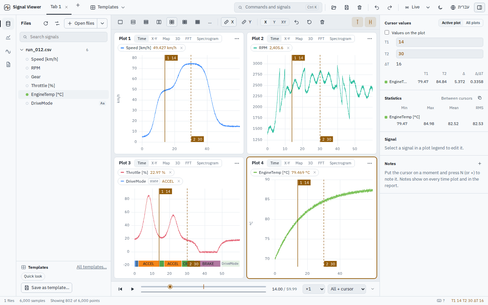
</p>

Signal Viewer is a Python computation core (FastAPI + NumPy) with a React/TypeScript UI, in one
native desktop window. It opens multi-gigabyte recordings in seconds, keeps every sample available
at full resolution, and works with **no internet connection at all** – including the map and the
3D globe.

- **Plot anything quickly** – up to 9 linked plots per tab, Time / X-Y / FFT / Spectrogram / Map / 3D modes, two cursors with Δ and statistics, zoom history, notes.
- **Compare runs** – every shared signal ranked by similarity, automatic time alignment, a full comparison table, CSV export.
- **Understand flight logs** – ArduPilot, MAVLink and PX4 logs read directly: flight modes, events, parameters and an automatic **health check**.
- **See where it happened** – an offline map and a 3D terrain view with the vehicle model, its attitude and its track, synchronised with the timeline.
- **Do the math** – formulas such as `2*Speed - RPM/95` with autocomplete, filters, derivatives and integrals that update when the data changes.
- **Share the result** – interactive offline HTML, PDF and Word reports; sessions and reusable templates.

---

## See it in action

### Open a file and build a view

Open a file, choose a layout, click signals into plots, then zoom and read values with two cursors.

<p align="center"></p>

### A flight on the map and in 3D

One template turns latitude / longitude / altitude / attitude signals into a map and a 3D view. Press
play and both follow the timeline; *Up to the time* draws the track as it is flown.

<p align="center">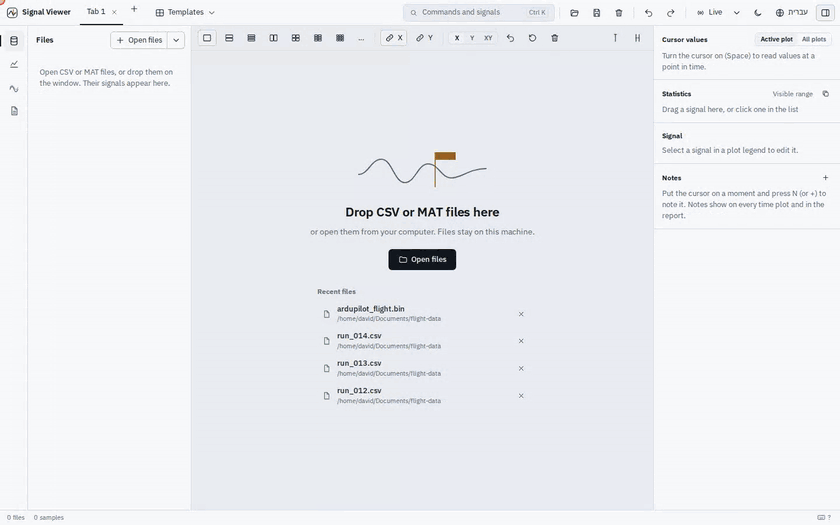</p>

### Compare runs

Pick several files: every shared signal is ranked from least to most similar. Click a row to overlay
it, align the runs in time automatically, or open the table of all signals.

<p align="center">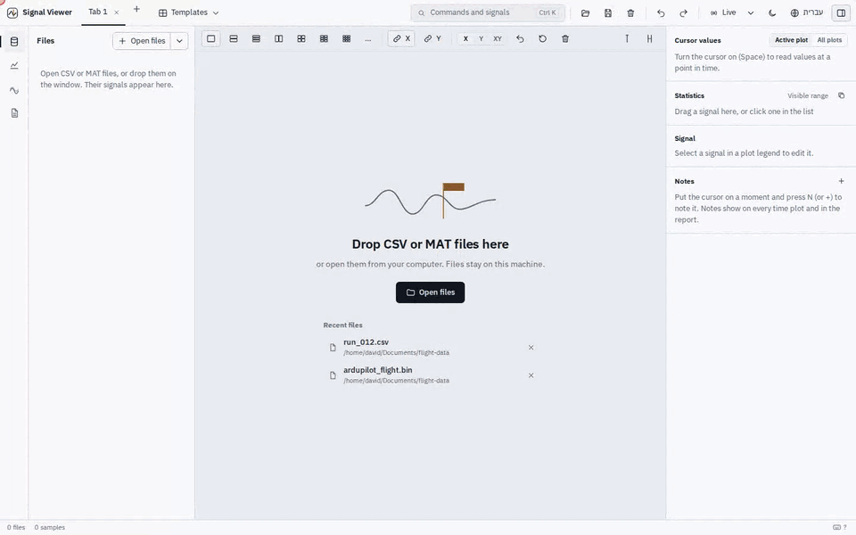</p>

### Flight-log health check

Open an ArduPilot `.bin` and the **Log** panel finds vibration, clipping, battery, EKF and motor
problems. Click a finding to jump to it; click an event to move the cursor there.

<p align="center"></p>

> Higher-quality MP4 versions of these clips are in [`docs/media/`](docs/media).

---

## Gallery

| | |
|---|---|
| 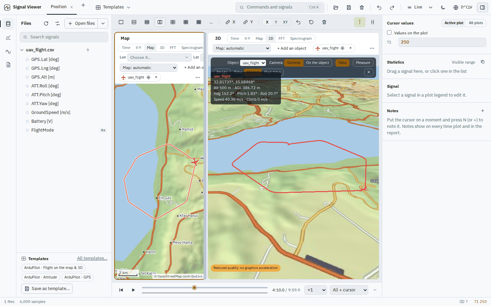<br>**Map + 3D** – offline map with terrain, roads and place names; 3D view with the vehicle and a live data box | 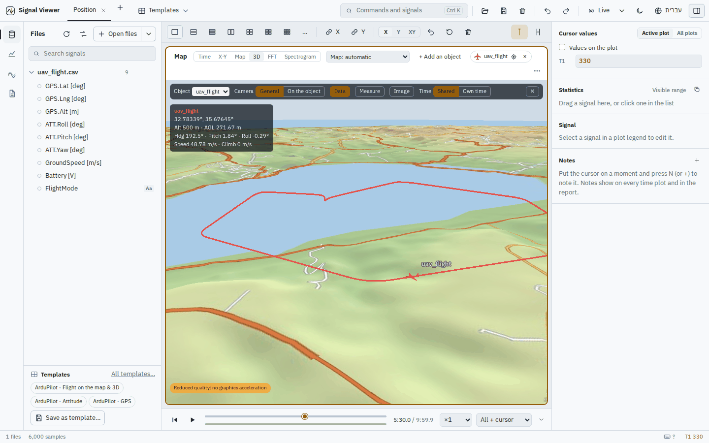<br>**3D terrain** – the bundled elevation (the Jordan rift really is below sea level) |
| 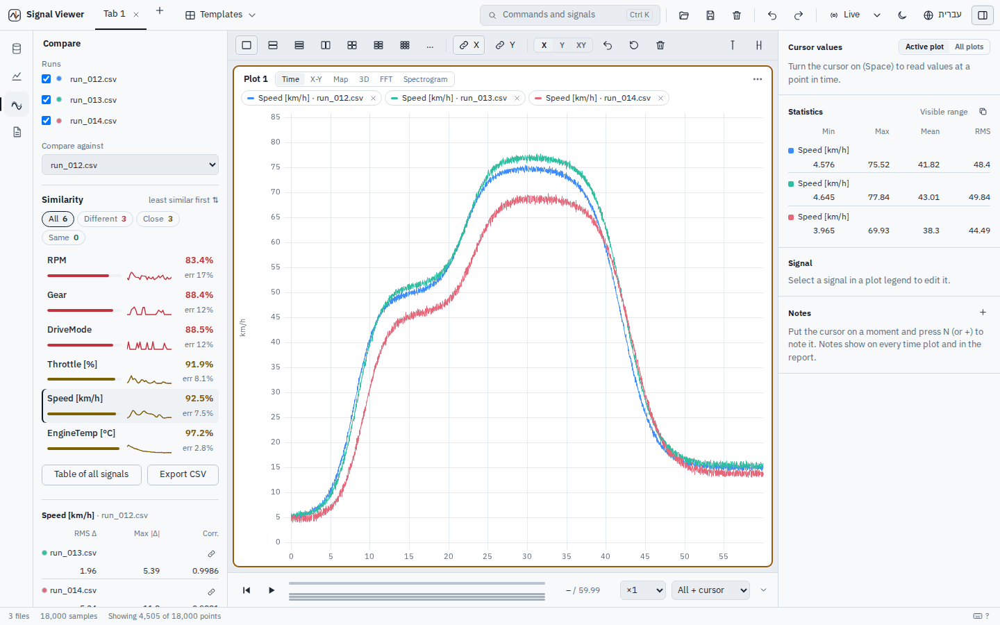<br>**Compare** – similarity list, overlay of every run, RMS Δ / max Δ / correlation per run | 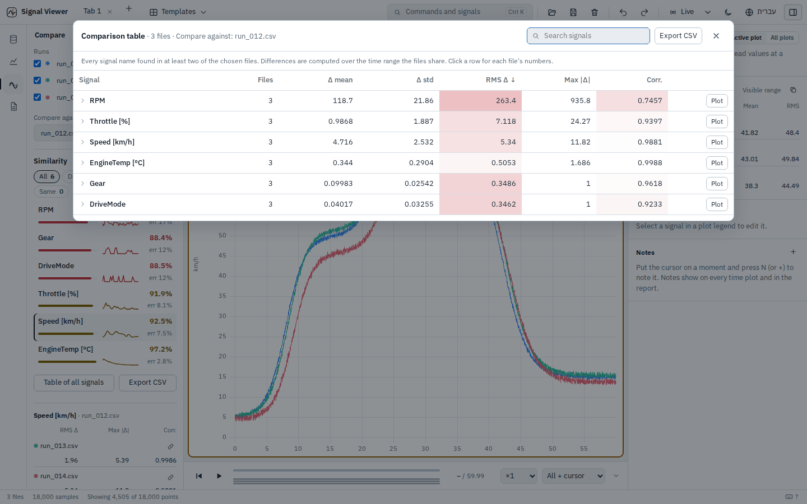<br>**Comparison table** – every shared signal, coloured by how different it is |
| 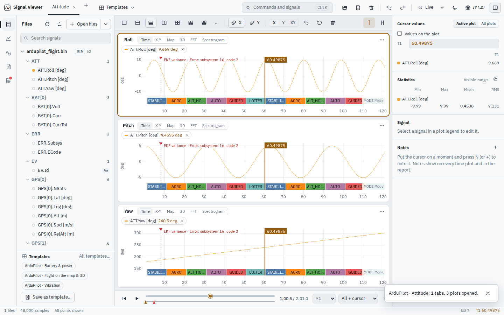<br>**Built-in views** – ArduPilot attitude with the flight mode drawn on every plot | 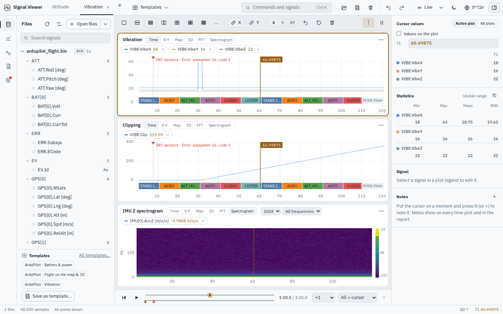<br>**Vibration** – VIBE levels, clipping and an IMU spectrogram |
| 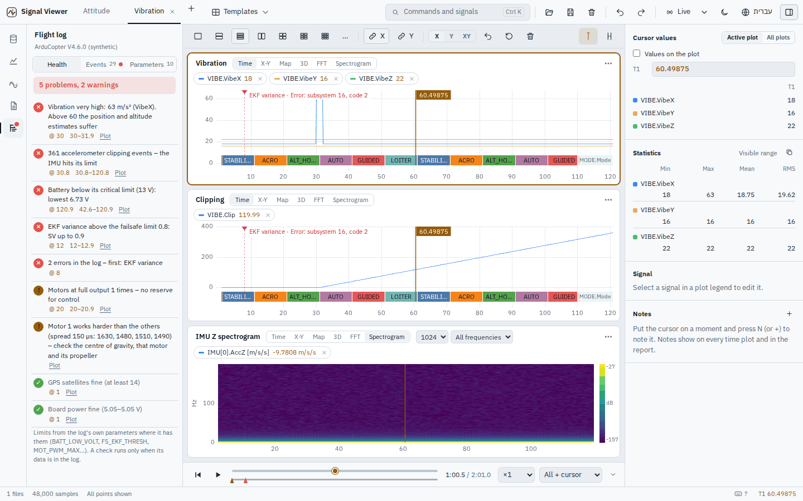<br>**Health check** – each finding with its moment, its stretches and a *Plot* button | 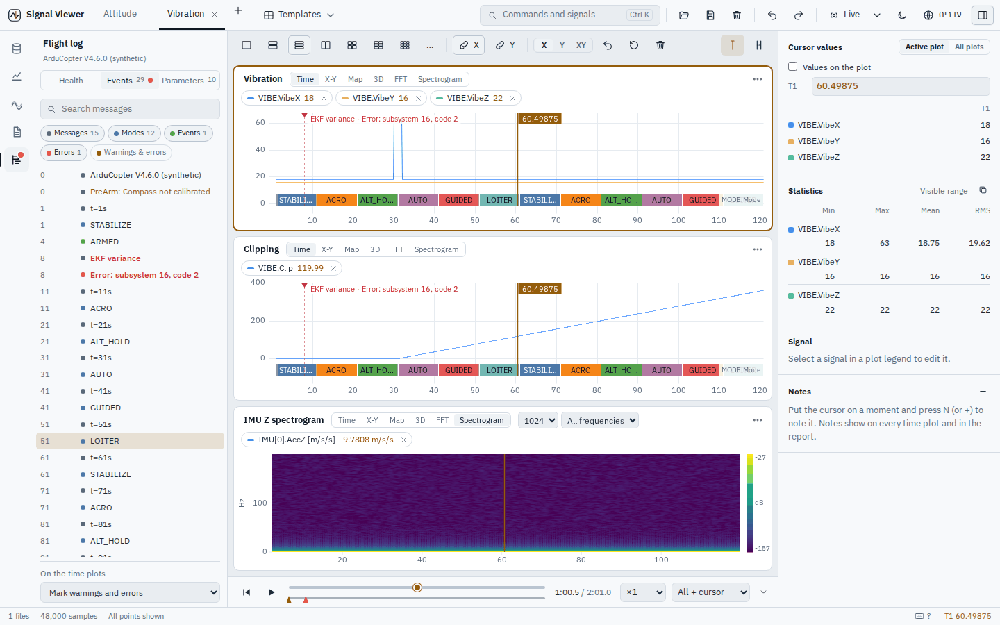<br>**Events** – messages, modes and errors; click one to put the cursor there |
| 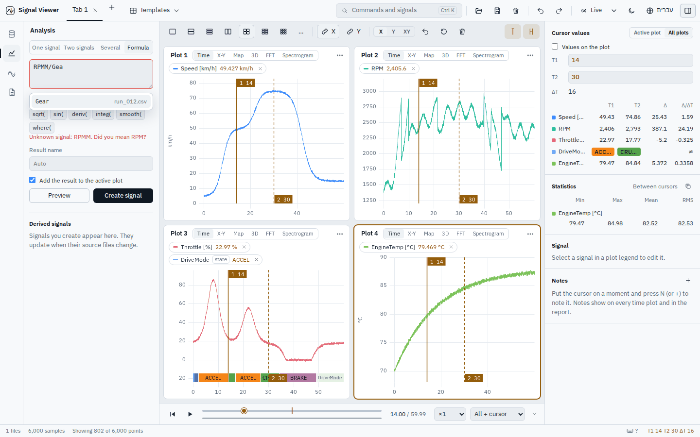<br>**Formulas** – autocomplete, argument help and *did you mean…?* | 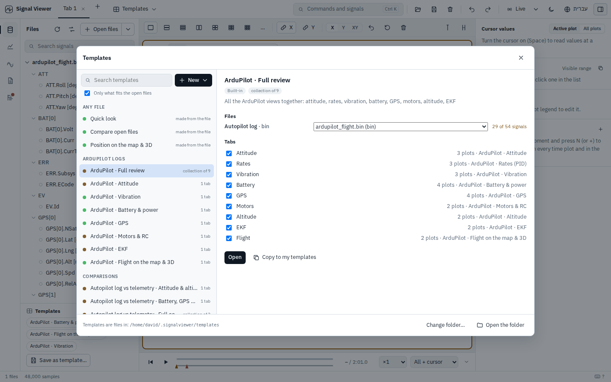<br>**Templates** – built-in and your own, matched to the open files |
| 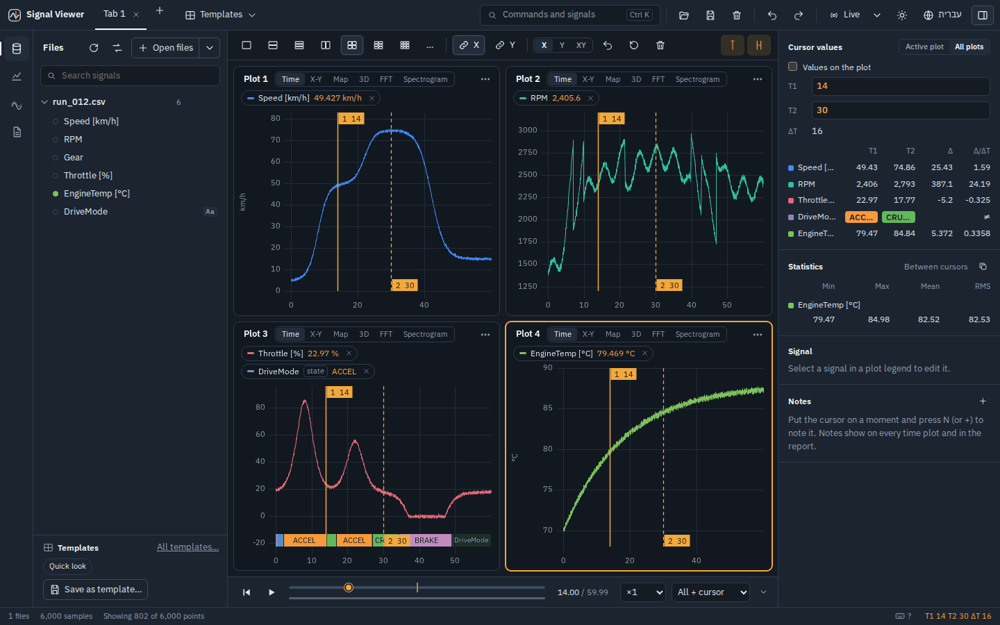<br>**Dark theme** | 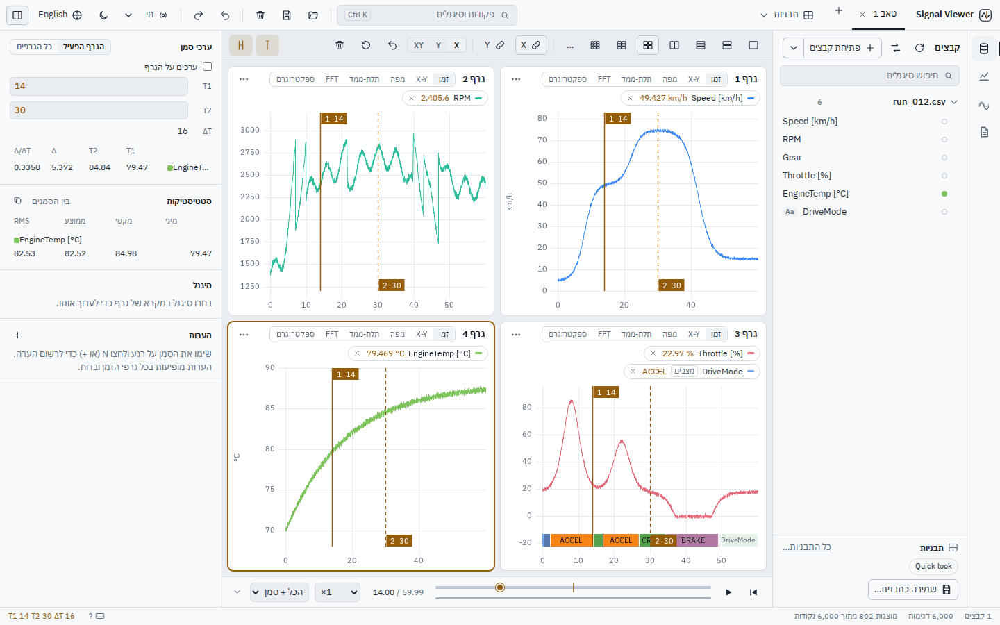<br>**עברית** – full Hebrew interface, right to left |

---

## Quick start

```bash
git clone https://github.com/DavidAlpert11/SignalViewer.git
cd SignalViewer
pip install -r requirements.txt
python run.py                      # opens the desktop window (or the browser)
```

Then press **Ctrl+O** and open one of the demo files in [`examples/`](examples):

| File | Try |
|---|---|
| `examples/run_012.csv` | click *Speed*, *RPM*, *Throttle*, *DriveMode* into a 2 × 2 layout; press **Space** and **D** for two cursors |
| `examples/run_012.csv` + `run_013.csv` + `run_014.csv` | open all three, then **Compare** in the side rail |
| `examples/uav_flight.csv` | **Templates ▾ → Position on the map & 3D**, then press **P** to play |
| an ArduPilot log | `python tools/make_test_bin.py flight.bin --seconds 120`, open it, then the **Log** button |

The demo files are synthetic and are regenerated by `python tools/make_demo_data.py`.

---

## Contents

- [Download / build](#download--build)
- [Run from source](#run-from-source)
- [What works](#what-works) – the full feature list
- [Keyboard](#keyboard)
- [Performance](#performance)
- [Known limitations](#known-limitations)
- [Structure](#structure)
- [בעברית בקצרה](#בעברית-בקצרה)
- [Offline map data](#offline-map-data)
- [3D view](#3d-view)
- [Changelog](CHANGELOG.md)


## About

Signal Viewer is a Python computation core and a React/TypeScript UI, in one desktop window.

## Download / build

**Nothing needs the internet at run time.** The installer, the portable folder and the single
file contain Python, every library, the UI with its fonts, the report assets and the icon.
Verified by running the built app with no network interface at all.

| Build command (Windows) | Result | When |
|---|---|---|
| `build.bat installer` | `dist\SignalViewer-Setup-1.0.0.exe` | **Recommended.** One file; installs for the current user (no admin), Start-menu and desktop icons, uninstaller |
| `build.bat portable` | `dist\SignalViewer-portable.zip` | Unzip anywhere and run `SignalViewer.exe` (fast start) |
| `build.bat onefile` | `dist\SignalViewer.exe` | A single file to copy; starts a few seconds slower (it unpacks itself each time) |
| `build_windows_portable.bat` (**Windows**) / `python tools/make_windows_portable.py` | `dist\SignalViewer-Windows-portable.7z` | **Windows portable build on a Windows PC**: double-click the `.bat` (needs Python 3.8+ with pip and internet, once, only to build). Downloads the official embeddable Python + the Windows builds of the libraries; the result needs no Python and no internet. **7z** (about 80 MB instead of 126 MB as zip): made with 7-Zip when installed, else with the py7zr library fetched once; Windows 11 opens .7z in Explorer, Windows 10 needs 7-Zip. `--format zip` for a zip, `--keep-folder` keeps the assembled folder, `--clean` forces a fresh download, `--build-ui` rebuilds the web UI first (Node.js; done automatically when the UI sources are newer than the built UI) |
| `tools/make_windows_portable.sh` (Linux/macOS) | `dist/SignalViewer-Windows-portable.7z` | Builds the same Windows package **without a Windows PC** (runs the same Python builder; options are passed on) |
| `build.bat wheels` | `wheels\` | On a connected PC: downloads the libraries once, so the build itself can run on an offline PC |

The installer needs Inno Setup 6 on the BUILD PC only (free). The GitHub Actions workflow builds all
three for Windows automatically.

**Windows window engine.** The app window uses Microsoft Edge WebView2 (built into Windows 11 and
updated Windows 10). If it is missing (e.g. an old offline Windows 10 LTSC), the app opens in the local
browser instead — still with no internet — and stops by itself when no tab has been open for 30 s.


Ready-made executables (one file, no Python needed) are produced by the GitHub Actions
workflow in `.github/workflows/build.yml` for Windows, macOS and Linux: push a tag such as
`v1.0.0` (or run the workflow manually) and download them from the run's artifacts.

Build it yourself: `build.bat` (Windows) or `./build.sh` (Linux / macOS) → `dist/SignalViewer[.exe]`.

## Run from source

```bash
pip install -r requirements.txt
python run.py              # native window (pywebview), or the browser if pywebview is missing
python run.py --browser    # always use the browser
```

The UI is already built (`frontend/dist`), so Node.js is only needed to change the UI:

```bash
python run.py --port 8765 --no-open   # backend
cd frontend
npm install
npm run dev      # dev server with hot reload, proxies /api to port 8765
npm run build    # rebuilds frontend/dist
```

Tests:

```bash
python -m pytest backend/tests          # 19 server tests
pip install -r requirements-dev.txt && python -m playwright install chromium
python -m pytest tests/e2e/test_workflows.py   # 5 end-to-end tests, one per workflow
python -m pytest tests/e2e/test_features.py    # 76 conformance tests, one per catalog feature
python tools/benchmark.py big.csv       # performance against the targets (results in docs/)
```

## What works

Every feature of the requirements catalog is covered by an automated test that drives the
real UI: `tests/e2e/test_features.py` (76 tests, named by feature id).

| Area | Status |
|---|---|
| Files | the file dialog sorts by **last modified** (newest first, the default) or by name, with a date column · a file dragged in opens from its **original** (desktop window: the real path; otherwise found by name + size + modified time, one exact match only), so refresh and live mode follow it; only when it cannot be found is a copy used (marked "copy", with *Choose the original file…*) · CSV (auto-detect delimiter/header/time column, Excel BOM, text columns skipped, unsorted time sorted) and MATLAB .mat v5 / v7.3 · built-in file browser · drag & drop onto the window · import options with live preview · load report after opening (what was skipped and why) · rename, description, reload, **replace with another file** (plots keep their signals) · **time offset per file** (badge in the list) · **link files**: a signal is added to and removed from the plot together with the same-named signals of every other file (toggle in the file panel, saved with the workspace) · opening a file does not plot anything until you choose |
| Signals | virtualized list (thousands of signals) · grouping by name prefix · **smart search**: substrings, letters in order (“spd” → Speed), one typo (“sepeed” → Speed); exact matches win · right-click: add, new plot, use as X, derivative, integral |
| Legend names | one data file → signal name only · several files → “signal · file” · same file name in different folders → as many parent folders as needed (“A/test.csv”, “x/A/test.csv”) |
| Plots | tabs (rename, duplicate, close, **close others**, drag to reorder) · **any layout up to 9 plots** (3×3, 1×9, 2×3, …; grid picker or type rows × columns) · shrinking the layout removes the extra plots (Undo) · **drag the gaps between plots to resize** · Time / X-Y / FFT / **Map** per plot (longitude + latitude signals; wheel = zoom, drag = pan, double-click = fit; online map layers, or the **offline map** that ships with the app – terrain shading and colour by height, water, rivers, roads and runways, place and airport names in Hebrew or English; detailed for **Israel and its surroundings** (elevation ~130 m, roads down to regional roads, villages), the rest of the world coarser; it also fills in for online tiles that cannot be had without internet) · **objects** on the map: an aircraft, UAV, drone, missile, ship or vehicle whose latitude / longitude (and altitude, heading, pitch, roll) come from signals – from any open files, filled in from their names (GPS.Lat / Lng / Alt, ATT.Yaw…; MAVLink 1e7 degrees handled) – drawn as an icon at the **timeline's time**, pointing along its heading or, without one, where it moves; its track follows the timeline's mode; **follow** keeps it in the middle; edit / remove from its chip (Undo) · **3D view** (a plot mode): the earth with the bundled terrain and the same map tiles, the plot's objects as **3D models** (aircraft, UAV, drone, missile, ship, vehicle) at the timeline's time with heading, pitch and roll, their tracks, names, and a readout (altitude, **height above ground**, attitude); altitude given above sea level, above the take-off point or above the ground; a bar to choose the **object** (its values in a **data box** that can be hidden: position, altitude, height above ground, heading, pitch, roll, ground speed, climb), the **camera** – general, or **on the object** (turning goes around it, zooming goes towards it) – and a **second / third** object: a dashed line to each with the distance, and in the box the horizontal distance, height difference, slant range and bearing (on the WGS84 ellipsoid); works with no internet (CesiumJS ships with the app, no Cesium ion); on a computer without graphics acceleration it switches to lighter settings and says so · **own time**: a 3D plot can leave the timeline and get its own bar, play and speed (the other plots keep the timeline's; framed so it shows), and go back · **events**: the log's errors, warnings and mode changes as marks on the tracks · **measure**: two clicks on the ground give the distance over the ground, straight and the height difference · **image**: the view as a PNG · **manual axis limits** · link X and **link Y** · drag-zoom, wheel-zoom, **pan** (Shift+drag or middle button), **zoom history** (Backspace) · min/max decimation that follows the zoom down to raw samples · **clear plot / clear all** (Undo) |
| Legend chips | click: properties · **Ctrl+click: select several and edit them together** (scale, offset, time offset, width, display, remove) · **drag to reorder or to another plot** (Ctrl: copy) · right-click: properties, states, **states only (hide the line, keep the markers)**, move up/down, copy to new plot, use as X, derivative, integral, remove |
| Cursor | Space on/off · click / drag · two cursors with ΔT, Δ and **Δ/ΔT** · values at full resolution · **values drawn on the plot** (optional) |
| Timeline | a bar under the plots for the **whole recording** (all open files, time offsets included); its handle **is the cursor** – drag or click it, arrows move 1 %, **Home / End** jump to the start / end · a row per file showing when it has data, log errors / warnings and your notes as marks to jump to · **play / pause** (P) at **× real time** (×0.25 … ×60), a zoomed time plot follows the time · the plots show **all + cursor**, **up to the time** (they draw themselves) or **the last N seconds** – time plots, X-Y plots (by each point's time), maps (the whole track faint, the part shown in full colour) and spectrograms · can be made small (a thin bar that still drags) · saved in sessions |
| Inspector | cursor values (active plot / all) · statistics for the visible range or between cursors, **copy as a table** · signal properties incl. **time offset per signal** |
| Formulas | write a new signal as an equation, e.g. `2*Speed - RPM/95 + where(Gear > 2, 1, 0)` · signal names as they are, `{file.csv:Speed}` when a name is in several files · autocomplete while typing (Tab / Enter) · `+ - * / ^ %`, comparisons (1 / 0), `abs sqrt exp log log10 sin cos tan asin acos atan atan2 sign floor ceil round min max clip where deriv integ smooth`, `t`, `pi`, `e` · signals from different files are aligned in time · clear errors (“Unknown signal: Spede. Did you mean Speed?”) · evaluated safely on the server (a closed list of operations, no code execution) · saved as a formula, updates when sources change |
| Choosing many signals | in *Analysis*, “each of several” and “several signals” use a picker: type part of a name and *select all N matching*, or tick one by one — the signals do not need to be in a plot. Shortcuts: from the active plot, from the legend selection. Bulk selection uses exact matches only; approximate names are offered one by one |
| Analysis | one signal (derivative, integral, abs, negate, normalize, **k·x + c**, smoothing, RMS, low/high-pass), two signals, several signals · **apply to the selected signals** or to the whole plot · **preview** (dashed) before creating · derived signals keep their formula and update when sources change |
| Similarity list | choose two or more files in *Compare*: every shared signal is listed at once, ranked by similarity (least similar first, one click to reverse) · **match %** = 100 − error %, **error %** = RMS of the difference relative to the baseline's range · colour bar (same ≥ 99 % / close 90–99 % / different < 90 %) and filter pills with counts · a small curve shows **where in time** the difference is (flat = uniform) · click a row: the signal from every file in the active plot, with the details below (Shift+click: new plot) · computed in the background with quiet progress; changing the choice **cancels the running computation on the server**, waits 0.35 s for further changes, and earlier choices are cached · the first chosen file is the baseline by default (against the mean, two files would each show half their real difference) |
| Compare | the table colours the RMS Δ and correlation cells by how bad they are, for quick scanning · any number of files · baseline run or mean · one signal: RMS / max / mean Δ, correlation, tolerance, automatic time alignment (Undo), plot runs / differences · **comparison table**: every signal name found in at least two of the chosen files, with Δ mean and Δ std between files, worst RMS / max Δ, lowest correlation, pass/fail; sort, search, expand a row for each file's mean / std / min / max and its differences from the baseline, plot a row, export everything to CSV |
| Reports | **preview in the app** · interactive offline HTML · PDF · Word · per-plot captions, include/exclude, report language |
| Sessions | save / open, autosave and restore · **locate missing files** when a session is opened |
| Reading values | hover over a plot (no cursor needed): the legend shows each signal's value under the pointer, from the points already drawn (no server round-trip) · units taken from names such as `Speed [km/h]` or `Temp (°C)` are shown with values and on the value axis (`imu[1]` is not a unit) |
| New runs, same work | **Replace the input files…** (file panel, command palette) or **Open a session with new files…** (command palette, or the icon next to a recent session on the welcome screen): the same layout, formulas, edits (ƒ), axes and cursors with new input files · for each file the newest file in the same folder with the same name pattern is suggested (run_012 → run_013), or choose any other · before opening, each new file is checked for the signals the work uses (missing ones are listed) · replacing the current files offers *Back to the previous files* |
| Templates | for **any file type**: the **file panel** shows the templates that fit the open files, *All templates…* and *Save as template…*; the top bar's **Templates ▾** menu opens a template or collection, saves one, or starts a collection (also in the command palette and a tab's right-click menu). The layout and its signals are stored by **name**; opening a template applies one to the open files in a new tab — to one file, or to every file that has the signals · missing signals are listed |
| Welcome screen | recent files and recent sessions, one click to reopen; missing ones are marked and can be forgotten |
| Import settings | settings chosen in *Import options* are remembered for that folder. Auto-detection still comes first; the remembered settings are used only when auto-detection does not recognise a file (so other files in the folder are never misread). A note says when they were used, with *Forget* |
| Start over | **Clear everything** (top bar, with confirmation): closes all files, deletes derived signals, one empty tab — files on disk are not touched |
| ArduPilot logs (.bin) | DataFlash logs read directly (no pymavlink): about 50 MB/s · **every message type keeps its own time** (TimeUS), so IMU at 400 Hz and GPS at 5 Hz are not resampled onto each other · sensors with several instances split (`IMU[0].AccX`, `IMU[1].AccX`) · units and multipliers from the log's FMTU/UNIT/MULT (`GPS[0].Alt [m]`, cm → m) · **flight modes by name** (Copter / Plane / Rover / Sub, detected from the log) and EV events by name · text fields (MSG…) as state signals · PARM values and MSG texts in the load report · damaged blocks skipped (resync) · live mode reads only the newly written messages. Checked value-by-value against pymavlink. Test log generator: `python tools/make_test_bin.py out.bin [--live 30]` |
| MAVLink telemetry (.tlog) | what Mission Planner / QGroundControl / MAVProxy record from the radio link. Message definitions from pymavlink (ArduPilot dialect), decoded per message type with numpy (a 3.5 MB log in about 0.4 s; values identical to pymavlink). Units converted (degE7 → deg, mV → V, cm → m, cdeg → deg…), enums by name, flight mode by name (ArduPilot per vehicle type; PX4 main/sub modes), HEARTBEAT.armed; arrays per element, unused battery cells → empty; the ground station's own messages left out, other components / vehicles tagged (`ATTITUDE[c154].roll`). **Messages that carry the autopilot's clock (time_boot_ms, or time_usec when it is boot time) are placed at their own time, not at their receive time** - no radio delay in them. Log panel: STATUSTEXT with its real severity, mode changes, arm / disarm, PARAM_VALUE. Live mode reads only new packets |
| PX4 logs (.ulg) | read with pyulog: one signal per topic field (`vehicle_attitude.q[0]`, `sensor_gps[1].…` when a topic has several instances), each topic with its own time; navigation state and arming by name; topics without time stamps skipped (reported); Log panel: logged messages by level, parameters with changes and defaults |
| Map | the Geo plot (longitude × latitude) on real maps: **streets** (OpenStreetMap, or Esri), **light / dark grey** (Esri, with labels; *automatic* follows the theme), **satellite** (Esri World Imagery), **topographic** (OpenTopoMap). Tiles come through the app and are **kept on disk** (`~/.signalviewer/tiles`), so places already seen work without internet; **without internet** the map shows country borders and names (Natural Earth, English / Hebrew). Track with a halo, start (green) / end (red), the cursor's position, scale bar in metres, the provider's attribution. Wheel = zoom at the pointer, drag = pan, double-click = fit |
| Shared state lanes | a state (the flight mode…) drawn at the bottom of **every** time plot of a tab: right-click its chip → *Show this state on every plot of the tab*. The built-in views do it for the flight mode; saved templates keep it |
| Compare views | with an autopilot log and a telemetry log of the same flight open: *Autopilot log vs telemetry* views (roll / pitch in degrees from both, altitude, battery, satellites, ground speed, radio link) with both flight modes on every plot - choose which two files when more are open. Align their time first (it is offered automatically) |
| Align any two files | right-click a file → *Align time with another file* works for **every file type** (CSV, MAT, logs): **automatically** by signals with the same name in both files (normalised correlation of the overlapping part, judged together with how much overlaps, so a short accidental match does not win); **by two signals you pick** (any names, any units), optionally only within ±N s of the current alignment (periodic signals); **by a moment** in a signal of each file - rises / falls through a level (a share of each signal's own range, so units do not matter), the biggest jump, the first change of value, the highest / lowest point, the start of the recording, first / second / third / last occurrence; **by the cursors** - cursor 1 on a moment in the reference, cursor 2 on the same moment in this file, then right-click the file → *Shift this file so T2 falls on T1*. Undo |
| Align two recordings | **an autopilot log (.bin / .ulg) and a telemetry log (.tlog) of the same flight**: noticed automatically ("looks like the same flight – Align"), or right-click a file → *Align time with another file*. Three independent methods, shown with how reliable they are and whether they agree: **autopilot boot clock** (the .tlog carries it - exact for every message that has it), **matching events** (the same texts, mode changes, arm / disarm), **signal correlation** (ATT.Roll ~ ATTITUDE.roll… or two signals you pick; units do not matter). *Apply & check* opens a tab with the same quantity and both flight modes on top of each other. Undo. Test pair: `python tools/make_same_flight.py out_dir` |
| Health check | Log panel → **Health**: vibration, accelerometer clipping, GPS satellites / HDop / fix, battery (against BATT_LOW_VOLT / BATT_CRT_VOLT from the log), EKF variances (FS_EKF_THRESH), motors at full output and motor imbalance, board power, errors / warnings in the log. Each finding: a sentence, the moment (click → cursor), the stretches (click → zoom with both cursors on it), *Plot* (its signals in a new tab). Works for .bin, .tlog and .ulg |
| Templates | **a template is a set of tabs** (one tab, or many); **a collection** includes other templates by reference (opening it opens all their tabs, and it follows their changes; loops are refused). Signals are stored by name with the **file** they come from: the files a template uses are found from its tabs when it is saved (one per source file, named after it; shown as a read-only list). When a template is opened, an open file **with the same name** is used; if it is not open, the open file with most of its signals is suggested (*12 of 14 signals*) - or choose another, *all files that fit* (overlaid), or *Open run_a.csv* when the original still exists. Choose which tabs to open; plots the files cannot fill are left out and named. **Library** (top bar → Templates): grouped list (my templates, any file, ArduPilot, MAVLink, PX4, comparisons) with how well the open files fit, search, details; **New** from the current tab, from all open tabs, or as a collection; **edit** name, description, group, tabs (a new template starts with the current tab under a relevant name; *+ Add a tab…* lists the open tabs, those already in the template marked *added*, plus *all remaining tabs*; rename, reorder, remove) and included templates; built-in templates are copied to *my templates* to change them; **delete** your own templates (the trash icon in the list, right-click, the details or the editor; built-in ones cannot be deleted); **export / import** (.json) and **open the folder**: map / 3D objects are kept in templates by signal names like the plots' signals; built-in **Flight on the map & 3D** templates for ArduPilot, MAVLink and PX4 (PX4's attitude from its quaternion), and **Position on the map & 3D** for any file with latitude / longitude (found by their names; suggested only then); every template is its own JSON file, by default in `~/.signalviewer/templates` – **Change folder…** keeps them in any folder you choose (a shared drive, say; the current templates are copied there, and the app looks for templates there from then on), *Default folder* goes back (the old `templates.json` is converted). For any file: *Quick look* (each signal in its own plot, 4 per tab) and *Compare open files* (every signal two or more files share, overlaid) |
| Built-in views | Templates (file panel or top bar): ArduPilot (attitude, rates, vibration + IMU spectrogram, battery & power, GPS with the track on a map, motors & RC, altitude, EKF), MAVLink and PX4 views. Signals matched without units / instance numbers, with alternatives (EKF3 / EKF2); plots the log cannot fill are left out. User templates match the same flexible way |
| Spectrogram | plot mode next to FFT: frequency over time of the plot's first signal, over the tab's time window (zoom, link, cursor as usual); window length and highest frequency selectable; time / frequency / dB on hover; in reports too |
| States | click a block of a state lane → both cursors on that stretch (statistics cover exactly it); Shift+click → zoom to it. Statistics **only while** a state has a value ("while MODE = LOITER": time in that state, number of stretches) |
| Notes | N (or + in the Inspector) notes the moment at the cursor; notes show on every time plot, are listed in the Inspector (go to / edit / remove), saved with the session, undoable, and listed in reports (with markers on the PDF / Word plots) |
| `param()` in formulas | `x / param("BATT_CAPACITY")` - a parameter's value from the open flight log, with suggestions of the names and their values; `param("flight.bin:NAME")` when several logs differ |
| Flight log (ArduPilot) | a **Log** button appears in the side rail only while a `.bin` is open (red dot when the log has errors); nothing changes for CSV / MAT. **Events**: messages, flight-mode changes, events (ARMED…) and errors in time order, coloured by severity (from the text: PreArm / low / glitch → warning; fail / crash / EKF variance → error), search and filters; **click an event → the cursor goes there** and every plot scrolls to it; the row in force at the cursor is highlighted. **On the plots**: warnings and errors (or every message, or none) as markers along the top, text when there is room, full text on hover; events at the same moment are merged. **Parameters**: search (prefix in bold), **changed in flight** with each change clickable (`20 → 25 @ 11 s`), **not default** (when the log records defaults; the default is shown crossed out), **differences** against another open log; **copy** or **save as .param** (`NAME,VALUE`, for Mission Planner / MAVProxy) exactly the rows shown |
| Formula help | while typing a formula (*Analysis → Formula*, and *Change the variable…* on a signal's right-click): suggestions for functions **with what each one does**, variables (x = the signal, t = time, pi, e) and signals; a function goes in with its parentheses and the caret inside; **the arguments of the function the caret is in** are shown with the current one highlighted (`smooth(x, n=10)`); Ctrl+Space lists everything. Checked while typing: unclosed brackets, unknown names with *did you mean…?*, and a signal name typed where only `x` is allowed is explained (combine signals in *Analysis → Formula*) |
| Text values | a CSV column of text (`IDLE` / `ARMED` / `FLYING`…) becomes a **state signal** with its texts (up to 1000 different; more → skipped, e.g. IDs). Shown as text everywhere: cursor, legend, hover, value axis. Live mode adds new texts as they appear. Sparse columns (blank cells) keep the last value. The cursor shows the value **in force** for states (never an interpolation) |
| State display | a **state lane** per signal: a coloured block per state with its text inside (same state = same colour everywhere). Lanes alone fill the plot one under the other with their names; next to lines they sit along the bottom and the value axis makes room. Stretches with too many changes to draw are hatched (zoom in). Text signals start as lanes; *Line* shows them as steps with the texts on the value axis |
| Zoom | **X / Y / XY** (stage bar, `Z` cycles): drag zooms time, values, or a box (a nearly flat drag in XY zooms one axis) · wheel over the value axis zooms values only, over the time axis time only; **Ctrl+wheel** values only, **Alt+wheel** time only · pan follows the mode · Backspace undoes one zoom step of both axes · R / double-click reset both |
| Refresh & live | **Refresh all files** (file panel ⟳, F5 / Ctrl+R): files unchanged on disk are not read again. **Live**: refreshes every file first, then once a second reads only what was added (CSV rows, .bin messages; a MAT file is reloaded once it stops changing). A green dot marks files that are still being written; the status bar shows "2 of 5 updating". Settings (▾ next to Live): **stop after N s without new data** (10 s – 15 min, or never; default 1 min), **new files** in the same folders with the same name pattern (run_013.csv after run_012.csv, 00000043.BIN): ask / open automatically / ignore, follow last N seconds. Files opened during live mode are followed too |
| General | progress + cancel for long operations · Undo/Redo · command palette · Hebrew/English with RTL · light/dark · WCAG AA contrast · text size 100–125 % · live mode with **follow last N seconds** |

## Keyboard

| Key | Action |
|---|---|
| Ctrl+K | Command palette (commands and signals) |
| Ctrl+O | Open files |
| Ctrl+S / Ctrl+Shift+O | Save / open session |
| Ctrl+Z / Ctrl+Y | Undo / Redo |
| Space | Cursor on/off |
| D | Two cursors |
| ← → (Shift = ×10) | Move the cursor from one recorded sample to the next (no interpolation; only the mouse interpolates) |
| 1–9 | Select plot |
| R | Reset zoom (to the axis limits, if set) |
| Z | Zoom mode X → Y → XY |
| N | Note at the cursor |
| F5 / Ctrl+R | Refresh all files |
| Backspace | Previous zoom |
| P | Play / pause (the timeline) |
| Home / End | The timeline: start / end of the recording |
| Ctrl + / Ctrl − / Ctrl 0 | Text size |
| ? | Keyboard shortcuts |
| Delete | Remove the selected signal from its plot |

## Performance

Measured with `tools/benchmark.py` on a 1-CPU, 4 GB test machine (full results in `docs/`).
The first-open target is scaled by the number of values (5 s per 40 M values, the reference file).

| | 5 M rows × 7 (730 MB) | 20 M rows × 4 (1.7 GB) | 5,000 rows × 5,000 columns (262 MB) |
|---|---|---|---|
| Open, first time | 4.2 – 4.8 s (target 5.0) | 12.2 s (target 12.5) | 3.6 s (target 3.1) |
| Open again (cache) | 0.07 s | 0.06 s | 0.44 s |
| Memory for the data | 1.07× binary size | 1.03× | 0.12× (only shown columns are read) |
| Redraw full / zoom / deep zoom | 6 / 9 / 5 ms | 6 / 11 / 6 ms | 5 / 4 / 4 ms |
| Cursor values | 1 ms | 1 ms | 1 ms |
| Live mode, 1,000 new rows | 149 ms | 295 ms | 741 ms |

Parsing runs at about 8.5 M values per second per CPU core for both long and wide files and scales
with cores (64 MB parts are parsed in parallel). Redraw time does not grow with file size: min/max
summaries per 1,024-sample block are computed once per signal. Wide files: the cache is one
column-major matrix (not one file per column), discrete-signal detection runs on demand, the signal
list is virtualized, and signal choosers are searchable instead of long dropdowns.

## Icon

`assets/icon.svg` (full) and `assets/icon-small.svg` (simplified for 16–32 px), rendered to
`assets/png/`, `assets/icon.ico` (Windows) and `assets/icon.icns` (macOS). Used for the executable,
the window and the browser tab. A signal trace read by the amber measurement cursor, the same
visual language as the app.

## Known limitations

* Interactive HTML reports embed signals longer than 150,000 samples as three min/max levels, so very deep zoom inside the report shows less detail than the app.
* Copying an image to the clipboard depends on the window's clipboard support; Save image always works.
* A derived signal whose source file was closed stays in the list, marked, until you remove it.
* Only the Linux executable was built and tested here; Windows and macOS builds come from the CI workflow.
* Without `pyarrow` the pandas parser keeps a malformed row that has too few fields (missing values become empty), while `pyarrow` skips it.
* The timeline's modes apply to time, X-Y, map and spectrogram plots, not to FFT.
* The browser test suite occasionally fails one test when the whole suite runs in sequence (the same
  test passes when run alone); probably tests sharing one server's state — not yet resolved.

## Structure

```
run.py                 launcher (server + window)
SignalViewer.spec     PyInstaller build definition (build.bat / build.sh)
tools/benchmark.py     performance benchmark
tests/e2e/             end-to-end browser tests
backend/app/main.py    local API, 127.0.0.1 only
backend/app/store.py   loaded files with stable ids
backend/svcore/        computation core: loaders, decimation, analysis, compare, sync
backend/tests/         pytest suite
frontend/src/          React + TypeScript UI (uPlot, zustand)
frontend/dist/         built UI served by the backend
examples/              demo files (tools/make_demo_data.py)
docs/images, docs/media  screenshots and clips used in this README
```

Environment variables: `SV_FLOAT32`, `SV_CACHE`, `SV_CACHE_MIN_MB`, `SV_MAX_POINTS`.
Workspace autosave and the binary cache live in `~/.signalviewer/`.

---

## בעברית בקצרה

הפעלה: `pip install -r requirements.txt` ואז `python run.py`.
האפליקציה נפתחת בחלון משלה (או בדפדפן), והקבצים לא יוצאים מהמחשב.
גררו קבצי CSV, MAT או לוגים של ArduPilot (‎.bin) לחלון, לחצו על סיגנל כדי להוסיף אותו לגרף, ורווח מפעיל את הסמן.
זום: X / Y / XY בסרגל (המקש Z מחליף). גלגלת מעל ציר עושה זום רק בו, Ctrl+גלגלת בערכים בלבד.
רענון כל הקבצים: הכפתור ⟳ בפאנל הקבצים או F5. "חי" מרענן הכל ואז עוקב אחרי הקבצים שממשיכים לגדול;
בחץ שליד הכפתור: עצירה אוטומטית אחרי זמן ללא נתונים, ומה לעשות עם קבצים חדשים באותה תיקייה.
עמודות טקסט (מצבים) ומצבי טיסה מוצגים כרצועות צבעוניות עם שם המצב.
לוג של ArduPilot: כפתור "לוג טיסה" מופיע בסרגל הצד רק כשפתוח קובץ ‎.bin – אירועים והודעות (לחיצה מזיזה את הסמן לרגע),
סימון אזהרות ושגיאות על הגרפים, ופרמטרים: חיפוש, שונו בטיסה, לא ברירת מחדל, השוואה מול לוג אחר ושמירה כ־‎.param.
לוגים: ‎.bin (ArduPilot), ‎.tlog (טלמטריית MAVLink) ו־‎.ulg (PX4). לוג של הבקר וטלמטריה של אותה טיסה מזוהים ומיושרים בזמן –
הודעות שנושאות את שעון הבקר ממוקמות בזמן המדויק שלהן. בפאנל הלוג: תקינות, אירועים, פרמטרים ותצוגות מוכנות. ספקטרוגרם כמצב גרף,
הערות (N), סטטיסטיקה "רק בזמן ש…", ו־param("NAME") בנוסחאות.
מפה: רחובות, לוויין, טופוגרפית ואפורה בהירה/כהה – נשמרות בדיסק לעבודה בלי אינטרנט; בלי אינטרנט: גבולות ושמות מדינות.
מצב הטיסה יכול להופיע בכל הגרפים בלשונית (קליק ימני על המצב). תצוגות השוואה של לוג הבקר מול הטלמטריה.
תבניות: תבנית היא אוסף לשוניות, ואוסף יכול לכלול תבניות אחרות. כל סיגנל שייך ל"משבצת קובץ", וכשפותחים תבנית
בוחרים קובץ לכל משבצת (עם הצעה אוטומטית). כל תבנית היא קובץ JSON בתיקייה ~/.signalviewer/templates –
עריכה, ייצוא וייבוא מתוך ספריית התבניות. "מבט מהיר" ו"השוואת קבצים פתוחים" מתאימות לכל קובץ.
יישור זמן בין כל שני קבצים (CSV, ‏MAT, לוגים): אוטומטית לפי סיגנלים באותו שם, לפי שני סיגנלים לבחירה, לפי רגע בסיגנל
(עלייה דרך רמה, קפיצה, שינוי מצב…) או לפי שני הסמנים – קליק ימני על הקובץ ← יישור זמן מול קובץ אחר.
בנייה לחלונות: הפעילו `build_windows_portable.bat` – נוצר `dist\SignalViewer-Windows-portable.7z` שלא צריך התקנה
(Windows 11 פותח 7z ישירות; ב־Windows 10 צריך 7-Zip. לקובץ zip: ‎`--format zip`).
בנוסחאות: השלמה אוטומטית של פונקציות (עם הסבר), משתנים וסיגנלים, והצגת הארגומנטים של הפונקציה שבה נמצא הסמן.
Ctrl+K פותח חיפוש של כל הפקודות והסיגנלים. בורר השפה נמצא בסרגל העליון.


## Offline map data

`backend/app/basemap_data/` (17 MB) is built by `python tools/make_basemap.py --all` on a machine
with internet (needs `pyshp` and `osmium` besides the app's libraries) and ships with the app:
elevation grids (world ~11 km, Israel and surroundings ~500 m, Israel ~130 m) from the AWS
"Terrain Tiles" (Mapzen / Tilezen: SRTM, GMTED2010, ETOPO1), Natural Earth (public domain), and
OpenStreetMap from Geofabrik extracts (© OpenStreetMap contributors, ODbL). The app draws map tiles
from them (`backend/app/basemap.py`, cached in `~/.signalviewer/tiles`); the map shows the
attribution. To refresh the data, run the tool again.

**More detailed areas (packs).** Any area can get the same detail as Israel: elevation (~130 m),
OpenStreetMap roads down to regional ones, places down to villages, airports and runways:

    python tools/make_basemap.py --pack cyprus --bbox 34.5,32.2,35.75,34.65 --countries europe/cyprus

`--bbox` is south,west,north,east; `--countries` the Geofabrik extracts covering it (comma-separated);
`--zoom 9` or `8` for coarser (smaller) elevation. The pack is written to
`backend/app/basemap_data/packs/<name>/` (`pack.json`, `dem.npz`, `vectors.json.gz`; ~1.4 MB for
Cyprus) and the app uses every pack in that folder - copy a pack folder there on an offline machine.


## 3D view

CesiumJS (pinned, `frontend/package.json`) is loaded only when a plot is switched to 3D; its web
workers and data files are copied into the UI build under `/cesium/` (`frontend/vite.config.ts`),
nothing comes from the internet. Terrain heights come from `/api/terrain/{z}/{x}/{y}` (the same
bundled elevation grids as the offline map: sea at 0 m, the Jordan rift really below it). The
object models are built by `python tools/make_models.py` into `frontend/public/models/`.
Graphics: with a graphics card Cesium draws at the display's frame rate; drawn in software (virtual
machines, remote desktop) it is slow - the app then uses one sample per pixel and less terrain
detail (about 3x faster) and shows a note. Not in reports.
