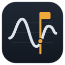
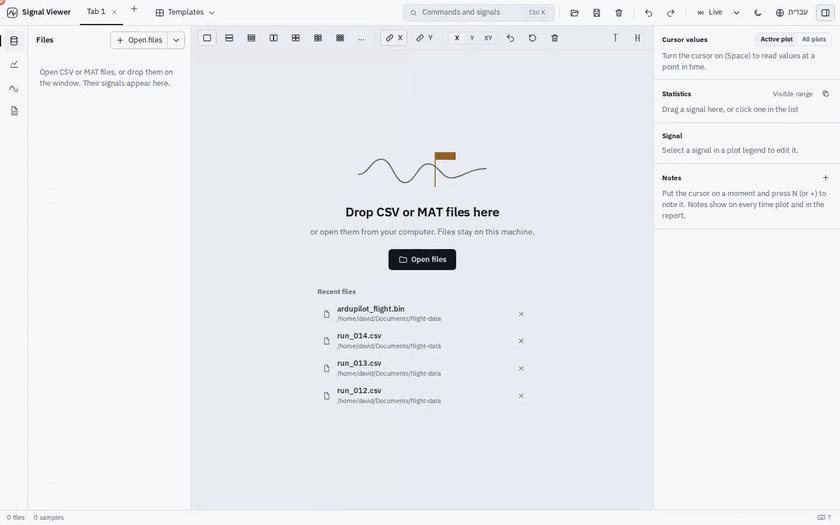

<p align="center">
  
</p>

<h1 align="center">Signal Viewer</h1>

<p align="center">
  <b>Signal Viewer – offline flight log &amp; test data analysis</b><br>
  CSV · Parquet · MATLAB .mat · ArduPilot .bin · MAVLink .tlog · PX4 .ulg · ROS 2 .mcap · HDF5 · CAN + .dbc
</p>

<p align="center">
  <a href="https://github.com/DavidAlpert11/SignalViewer/actions/workflows/ci.yml"></a>
  
  
  
  
  
  <a href="https://davidalpert11.github.io/SignalViewer/"></a>
  <a href="LICENSE"></a>
</p>

<p align="center">
  <a href="https://github.com/DavidAlpert11/SignalViewer/releases/latest"><b>⬇ Download for Windows</b></a>
  &nbsp;·&nbsp; <code>pip install signalviewer</code>
  &nbsp;·&nbsp; <a href="https://davidalpert11.github.io/SignalViewer/"><b>Documentation</b></a>
  &nbsp;·&nbsp; <a href="https://davidalpert11.github.io/SignalViewer/GUIDE.he/"><b>מדריך בעברית</b></a>
</p>

<p align="center">
  
</p>

<p align="center"><b>Open a flight log or a test run, see what went wrong, judge it against a golden run and send the answer – all offline.</b></p>

## Why engineers use it

- **Opens anything, fast.** A 1.2 GB ArduPilot log in seconds, every sample at full resolution – CSV, MATLAB, `.bin`, `.tlog`, `.ulg`, ROS 2, HDF5, Parquet, CAN with a `.dbc`, or your own format in a few lines of Python.
- **Points at the problem.** An ArduPilot log gets a health check as it opens – vibration, clipping, GPS, battery, EKF, motors – and each finding takes you to its moment.
- **Pass or fail, not "looks about right".** Mark a golden run (a simulation, a good flight) with a tolerance per signal: the next recording is judged against it, and the same file of tolerances gives CI the same answer.
- **Every object on the map and in 3D.** Truth, each navigation solution, each GPS, each EKF lane – found by their names and added in one click; compare their positions, velocities and attitudes with RMS, 95 % and the worst moment.
- **Send the answer, not a screenshot.** *Send it as a replay* saves the tab as one HTML page: your colleague opens it in any browser – no install, no network – on the moment you were looking at, with the plots and the map moving together and Play. Reports in HTML, PDF and Word too.
- **Nothing leaves the PC.** No account, no telemetry, the map and the 3D terrain built in; every computation checked against a reference ([validation](docs/validation.md)). English and Hebrew.

## New in 1.25

- **Replay pages** – the tab as one page to send: one cursor for every plot and the map, Play, the log's events as marks, and a link that keeps the moment (`#t=`).
- **A timeline that maps the recording** – the active line drawn along it, and what the plots show as a window you drag along or pull at an edge to zoom.
- **Δ in the legend** – with two cursors each line shows how much it changed between them.
- **Positions in metres** – NED, ENU and ECEF objects, every ArduPilot EKF lane beside `POS` through the EKF origin; **Compare objects…** and **Compare with similar…** in one dialog each.
- **Plots move between tabs**, a map saves as PNG or offline HTML, and the whole process has a [Python / CLI / REST API](docs/api.md).

All changes: [CHANGELOG](CHANGELOG.md).

<p align="center"></p>

<p align="center"><sub>The replay page a colleague receives – one file, any browser, no install. Below: making it in the app, with two cursors (Δ in every chip) and the plots' window on the timeline.</sub></p>

<p align="center"></p>

<p align="center"></p>

<p align="center"></p>

## Get started

- **Windows:** the installer or the portable `.zip` from the [latest release](https://github.com/DavidAlpert11/SignalViewer/releases/latest) – no administrator rights. **Linux / macOS:** the `-portable.7z`.
- **Python 3.9+:** `pip install signalviewer`, then `signalviewer` (`signalviewer[desktop]` for its own window; `signalviewer-lite` is the smaller core).
- **From source:** `pip install -r requirements.txt` and `python run.py`.

The welcome screen opens six examples in one click – a drone flight on the map, the same mission flown twice, three car runs to compare, an ArduPilot log with its health check, a simulation against its flight, and a fault to find. The packages are not code-signed yet: [first start on Windows and macOS](https://davidalpert11.github.io/SignalViewer/install/#first-start-windows-and-macos-warnings).

## In CI and in your scripts

```bash
signalviewer-cli check   runs/*.csv --checks checks.json --junit results.xml      # limits: exit 1 when one breaks
signalviewer-cli compare golden.csv new/*.csv --tol-pct 2                         # against a golden run
signalviewer-cli compare-objects flight.bin --ref POS --tolerance position=2m     # every EKF lane against POS
signalviewer-cli report  --template "ArduPilot · Full review" --out reports/ logs/*.bin
```

```python
import signalviewer as sv
t, roll = sv.load("flight.bin").signal("ATT.Roll")
sv.show(t, {"roll x2": 2 * roll})          # into the open app
```

[Command line, Python and formats](https://davidalpert11.github.io/SignalViewer/command-line/) · [Scripting API](docs/api.md)

## Where it fits

| You mostly… | A good fit | Where Signal Viewer adds |
|---|---|---|
| judge test runs, flight logs and simulation output, often offline | **Signal Viewer** | – |
| stream ROS topics live | PlotJuggler, Foxglove | comparing recorded runs, pass / fail, reports (it reads their `.mcap`, `.ulg`) |
| work inside MATLAB / Simulink | Simulation Data Inspector | no MATLAB licence, flight logs and CAN next to the `.mat` ([a worked example](docs/sim-vs-flight.md)) |
| review one ArduPilot / PX4 flight online | UAV Log Viewer, PX4 Flight Review | offline, several flights side by side, your own limits in CI |
| write the final analysis as a script | Python / MATLAB | a quick look first; `sv.load()` / `sv.show()` go both ways |

Also in the app: live MAVLink, a fleet of logs in a folder, run-envelope **Sweeps** with Pareto fronts, an investigation workflow with a worked example, formulas, filters and frames – [everything it does](docs/features.md).

## Documentation

[The documentation site](https://davidalpert11.github.io/SignalViewer/) – the [user guide](docs/GUIDE.md) ([עברית](docs/GUIDE.he.md)), [what works](docs/features.md), [install](docs/install.md), [map and 3D](docs/maps-and-3d.md), [performance](docs/performance.md), [limitations](docs/limitations.md), [validation](docs/validation.md), [gallery](docs/gallery.md). In the app: *Help → User guide* (F1). Found a problem? *Help → Report a problem…* or [CONTRIBUTING](CONTRIBUTING.md).

## בעברית בקצרה

<div dir="rtl">

**Signal Viewer** – פותחים לוג טיסה או ריצת ניסוי, רואים מה השתבש, בודקים מול ריצת ייחוס ושולחים את התשובה. הכול בלי אינטרנט, והקבצים לא יוצאים מהמחשב.

- **פותח הכול, מהר:** לוג ArduPilot של 1.2GB נפתח בשניות; CSV, ‏MATLAB, ‏PX4, ‏MAVLink, ‏ROS 2, ‏HDF5, ‏CAN עם ‎.dbc, או פורמט משלכם.
- **מצביע על הבעיה:** בדיקת תקינות ללוג ArduPilot (רעידות, GPS, סוללה, EKF, מנועים), וכל ממצא לוקח לרגע שלו.
- **עבר / נכשל:** מסמנים ריצת ייחוס עם טולרנס לכל סיגנל, ההקלטה הבאה נבדקת מולה, וה־CI נותן אותה תשובה.
- **כל האובייקטים במפה ובתלת־ממד:** אמת, פתרונות ניווט, כל lane של ה־EKF – נמצאים לפי השמות ומושווים במיקום, מהירות וזוויות.
- **שולחים תשובה, לא צילום מסך (חדש ב־1.25):** *לשלוח כשידור חוזר* שומר את הלשונית כדף HTML אחד; עמית פותח אותו בכל דפדפן, בלי התקנה, על הרגע שהסתכלתם עליו – הגרפים והמפה זזים יחד, עם ניגון.
- **חדש ב־1.25 גם:** ציר זמן שמראה את ההקלטה וחלון הזום עליו, הפרש (Δ) בין שני סמנים בתוך המקרא, אובייקטים במטרים (NED / ENU / ECEF), השוואת אובייקטים, ו־API לכל התהליך.

**התקנה:** קובץ ההתקנה מ־[השחרור האחרון](https://github.com/DavidAlpert11/SignalViewer/releases/latest), או <code dir="ltr">pip install signalviewer</code>.
**מדריך מלא:** [docs/GUIDE.he.md](docs/GUIDE.he.md), וגם באפליקציה: עזרה ← מדריך למשתמש (F1).

</div>

## License

[MIT](LICENSE) – free to use, change and ship, also commercially. Third-party parts keep their own licences: uPlot (MIT), the report fonts (SIL OFL), CesiumJS (Apache-2.0), map data from OpenStreetMap (ODbL), Natural Earth and the AWS Terrain Tiles ([details](docs/maps-and-3d.md#offline-map-data)).
