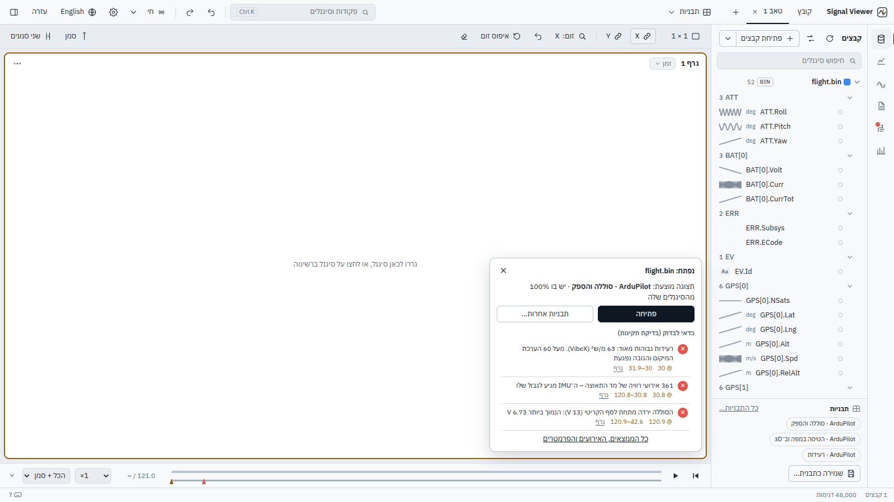

# What works

Every feature, area by area. Each one is covered by an automated test that drives the real UI
(`tests/e2e/`), next to the backend tests, the [numerical validation](validation.md) and the
[checks on logs from real vehicles](development.md#tests-numbers-and-real-logs). New to the app? Start with the
[user guide](GUIDE.md).

- :material-folder-open: [Opening files](#files)
- :material-file-document-multiple: [File formats](#formats)
- :material-chart-line: [Plots and the screen](#plots)
- :material-cursor-default-click: [Reading values](#values)
- :material-function-variant: [Math and analysis](#math)
- :material-compare-horizontal: [Comparing runs](#compare)
- :material-airplane: [Flight logs](#flight)
- :material-map: [Map and 3D](#map)
- :material-file-chart: [Reports, sessions and templates](#reports)
- :material-console: [Command line and automation](#cli)
- :material-cog: [Everything else](#general)
- :material-keyboard: [Keyboard](#keyboard)

## Opening files { #files }

{ .sv-shot loading=lazy }

### Welcome screen

- Recent files and recent sessions, one click to reopen; missing ones are marked and can be forgotten
- Five examples in one click: a drone flight, the same mission flown twice, three car runs to compare, an ArduPilot flight log, a simulation against its flight (offered only when all their files are there)
- An example opens with its view already applied (Undo: an empty plot)

### Files

- The file dialog sorts by last modified (newest first, the default) or by name, with a date column
- A file dragged in opens from its original (desktop window: the real path; otherwise found by name + size + modified time, one exact match only), so refresh and live mode follow it; only when it cannot be found is a copy used (marked "copy", with *Choose the original file…*)
- CSV (auto-detect delimiter/header/time column, Excel BOM, text columns skipped, unsorted time sorted) and MATLAB .mat v5 / v7.3
- Built-in file browser
- Drag & drop onto the window
- Import options with live preview
- Load report after opening (what was skipped and why)
- Rename, description, reload, replace with another file (plots keep their signals)
- Time offset per file (badge in the list)
- Link files: a signal is added to and removed from the plot together with the same-named signals of every other file (toggle in the file panel, saved with the workspace)
- Opening a file does not plot anything until you choose
- Damaged files (cut off by a power loss, bad bytes, a block of zeros) open with what is still readable, with a note; a `.mat` cut off while MATLAB saved it keeps every complete variable
- In the file dialog Shift+click selects a range and Ctrl+A every file shown; each use (open files, save a session, a report, an image) keeps its own last folder, and a first save starts where the data is
- Opening a file that is already open reads it again from the disk (*Open another copy* on request)
- Several files opened together: the start card suggests Compare open files
- Places beside the folder: the folders of the open files, favourite folders (★ next to the path; drag to reorder), recent folders, home / Desktop / Documents / Downloads and the drives
- Ctrl+P: quick open of recent files and folders
- Columns with a time column of their own (found by name: *Speed* + *Speed_time*, *msg.roll* + *msg.time_boot_ms*, or alternating *time, Speed, time, RPM*) are drawn against their own time – CSV / text, MAT, and a *.tlog* that is a text table (*Import options* to turn it off)

### File list

- Every signal with its unit (kept apart from the name, never cut off), its sample rate (wider panel, and the tooltip with the number of samples) and a small picture of the whole signal (spikes included; only the rows on screen fetch theirs)
- Checkboxes only while signals are selected (Ctrl / Shift + click, or *select all* of a search): plot them (one undo step), change them, or make new signals from them

### Import settings

- Settings chosen in *Import options* are remembered for that folder. Auto-detection still comes first; the remembered settings are used only when auto-detection does not recognise a file (so other files in the folder are never misread). A note says when they were used, with *Forget*

### Opening from outside

- Open with in Explorer (the installer offers it for .bin, .tlog, .ulg, .mcap, .mat, .csv, .parquet, .h5 and makes .svsession sessions open with the app; your default programs stay as they are) and `SignalViewer file…` on the command line: when the app is already running the files open in it (its window comes forward) instead of in a second app; several files chosen together end up in one app; `--new-window` for a separate one

### Refresh & live

- Refresh all files (file panel ⟳, F5 / Ctrl+R): files unchanged on disk are not read again. Live: refreshes every file first, then once a second reads only what was added (CSV rows, .bin / .tlog messages; a MAT, ULog, MCAP, HDF5 or Parquet file is read again once it is quiet for a moment, and at least every 2 s while a program keeps saving it). A green dot marks files that are still being written; the status bar shows "2 of 5 updating". Settings (▾ next to Live): stop after N s without new data (10 s – 15 min, or never; default 1 min), new files in the same folders with the same name pattern (run_013.csv after run_012.csv, 00000043.BIN): ask / open automatically / ignore, follow last N seconds. Files opened during live mode are followed too

### New runs, same work

- Replace the input files… (file panel, command palette) or Open a session with new files… (command palette, or the icon next to a recent session on the welcome screen): the same layout, formulas, edits (ƒ), axes and cursors with new input files
- For each file the newest file in the same folder with the same name pattern is suggested (run_012 → run_013), or choose any other
- Before opening, each new file is checked for the signals the work uses (missing ones are listed)
- Replacing the current files offers *Back to the previous files*

### Start over

- Clear ▾ (top bar; Ctrl+K; the eraser above the plots empties this tab): this tab's plots
- The other tabs
- All tabs (one empty tab)
- All tabs + notes + derived signals + in-place edits, the files stay open - each undone by the toast's Undo or Ctrl+Z
- Clear everything (with confirmation): closes all files too — files on disk are never touched

## File formats { #formats }

{ .sv-shot loading=lazy }

### ArduPilot logs (.bin)

- DataFlash logs read directly (no pymavlink): about 50 MB/s
- Every message type keeps its own time (TimeUS), so IMU at 400 Hz and GPS at 5 Hz are not resampled onto each other
- Sensors with several instances split (`IMU[0].AccX`, `IMU[1].AccX`)
- Units and multipliers from the log's FMTU/UNIT/MULT (`GPS[0].Alt [m]`, cm → m)
- Flight modes by name (Copter / Plane / Rover / Sub, detected from the log) and EV events by name
- Text fields (MSG…) as state signals
- PARM values and MSG texts in the load report
- Damaged blocks skipped (resync)
- Live mode reads only the newly written messages. Checked value-by-value against pymavlink. Test log generator: `python tools/make_test_bin.py out.bin [--live 30]`

### MAVLink telemetry (.tlog)

- What Mission Planner / QGroundControl / MAVProxy record from the radio link. Message definitions from pymavlink (ArduPilot dialect), decoded per message type with numpy (a 3.5 MB log in about 0.4 s; values identical to pymavlink). Units converted (degE7 → deg, mV → V, cm → m, cdeg → deg…), enums by name, flight mode by name (ArduPilot per vehicle type; PX4 main/sub modes), HEARTBEAT.armed; arrays per element, unused battery cells → empty; the ground station's own messages left out, other components / vehicles tagged (`ATTITUDE[c154].roll`). Messages that carry the autopilot's clock (time_boot_ms, or time_usec when it is boot time) are placed at their own time, not at their receive time - no radio delay in them. Log panel: STATUSTEXT with its real severity, mode changes, arm / disarm, PARAM_VALUE. Live mode reads only new packets

### PX4 logs (.ulg)

- Read with pyulog: one signal per topic field (`vehicle_attitude.q[0]`, `sensor_gps[1].…` when a topic has several instances), each topic with its own time; navigation state and arming by name; topics without time stamps skipped (reported); Log panel: logged messages by level, parameters with changes and defaults

### ROS 2 / Foxglove (.mcap)

- Every numeric field of every topic becomes a signal (`imu/accel.vector.x`), each topic on its own time (the recording time, seconds from the first message)
- ROS 2 messages (CDR, decoded from the definitions stored in the file – no ROS installation needed) and JSON channels
- A ROS time (`header.stamp`) becomes one value in seconds, text fields become states with their texts, true / false 1 / 0, short arrays one signal per element
- Images, point clouds, maps and other bulk topics are not decoded, arrays over 16 values and byte blobs are left out, other encodings (protobuf…) named – all listed when the file opens
- A recording cut off by a crash opens with everything before the cut

### Parquet (.parquet / .pq)

- Every numeric and true / false column; text and categorical columns become states
- The time: the column you choose, else the pandas index (date-times in seconds from the start), else a column named like a time, else the first date-time column; no time: sample numbers
- Columns of other types (lists, structs) are listed as left out

### HDF5 (.h5 / .hdf5)

- Every numeric dataset (`sensors/imu/ax`), each column of a matrix up to 16 columns (`pos[0]`…), each numeric field of a table (pandas / PyTables / records)
- A group's own `time` / `t` / `timestamp` for its signals, else the file's main time; signals with no time of their length are listed, a file with no time uses sample numbers
- Damaged parts are skipped and counted, the rest opens

### CAN

- Candump `.log`, Vector `.asc` and CAN `.csv` (time, id, data) decoded with the `.dbc` files next to the log or in the readers folder: Intel / Motorola, signed, scale / offset, value names, float, multiplexed, 29-bit ids, CAN FD payloads; unknown ids counted - our own decoder (MIT)

### Your own formats

- A Python file in the readers folder (`~/.signalviewer/readers`) with `@reader(extensions=[".kv"])` returning the time and the signals: those files open like the built-in types (file dialog, drag & drop, Python, command line); re-read when saved; errors name the line
- Binary layouts (ICD): a `*.icd.json` there describes packets (sync, id, length, header time; fields with type, byte order, scale / offset, unit, bits, value names) and raw recordings open as `<packet>.<field> [unit]` - see [Command line and formats](command-line.md)

### Text values

- A CSV column of text (`IDLE` / `ARMED` / `FLYING`…) becomes a state signal with its texts (up to 1000 different; more → skipped, e.g. IDs). Shown as text everywhere: cursor, legend, hover, value axis. Live mode adds new texts as they appear. Sparse columns (blank cells) keep the last value. The cursor shows the value in force for states (never an interpolation)

## Plots and the screen { #plots }

{ .sv-shot loading=lazy }

### Plots

- Tabs (rename, duplicate, close, close others, drag to reorder; many tabs: an *All tabs* list next to +, the active tab always in view, the mouse wheel scrolls them, Ctrl+PageUp / PageDown, *Go to tab* in the command palette)
- Any layout up to 9 plots (one layout button: the common ones, a grid picker or type rows × columns; drop a signal on a plot's right or bottom edge to split it)
- Shrinking the layout removes the extra plots (Undo)
- Drag the gaps between plots to resize
- Time / X-Y / FFT / Map per plot (longitude + latitude signals; wheel = zoom, drag = pan, double-click = fit; online map layers, or the offline map that ships with the app – terrain shading and colour by height, water, rivers, roads and runways, place and airport names in Hebrew or English; detailed for Israel and its surroundings (elevation ~130 m, roads down to regional roads, villages), the rest of the world coarser; it also fills in for online tiles that cannot be had without internet)
- Objects on the map: an aircraft, UAV, drone, missile, ship or vehicle whose latitude / longitude (and altitude, heading, pitch, roll) come from signals – from any open files, filled in from their names (GPS.Lat / Lng / Alt, ATT.Yaw…; MAVLink 1e7 degrees handled) – drawn as an icon at the timeline's time, pointing along its heading or, without one, where it moves; its track follows the timeline's mode; follow keeps it in the middle; edit / remove from its chip (Undo)
- 3D view (a plot mode): the earth with the bundled terrain and the same map tiles, the plot's objects as 3D models (aircraft, UAV, drone, missile, ship, vehicle) at the timeline's time with heading, pitch and roll, their tracks, names, and a readout (altitude, height above ground, attitude); altitude given above sea level, above the take-off point or above the ground; a bar to choose the object (its values in a data box that can be hidden: position, altitude, height above ground, heading, pitch, roll, ground speed, climb), the camera – general, or on the object (turning goes around it, zooming goes towards it) – and a second / third object: a dashed line to each with the distance, and in the box the horizontal distance, height difference, slant range and bearing (on the WGS84 ellipsoid); works with no internet (CesiumJS ships with the app, no Cesium ion); on a computer without graphics acceleration it switches to lighter settings and says so
- Own time: a 3D plot can leave the timeline and get its own bar, play and speed (the other plots keep the timeline's; framed so it shows), and go back
- Events: the log's errors, warnings and mode changes as marks on the tracks
- Measure: two clicks on the ground give the distance over the ground, straight and the height difference
- Image: the view as a PNG
- Manual axis limits
- Link X and link Y (the plots of a column line up: the same moment is at the same place in each, whatever their units; an *Envelope* plot zooms with them)
- Drag-zoom, wheel-zoom, pan (Alt+drag or middle button), zoom history (Backspace)
- Min/max decimation that follows the zoom down to raw samples
- Clear plot / clear all (Undo)

### Signals

- Virtualized list (thousands of signals)
- Grouping by name prefix
- Smart search: substrings, letters in order (“spd” → Speed), one typo (“sepeed” → Speed); exact matches win
- Right-click: add, new plot, use as X, Create signal ▸ (derivative, integral, other operations… – Create signals opens with the signal chosen)

### Legend names

- One data file → signal name only
- Several files → each file has a colour and a short tag (A, B… – rename it in *File options*, click it in the file list to change the colour): the legend, cursor values, statistics and signal pickers show the tag; the tooltip has the full name and path; the same signal from several files in one plot is coloured by file (*Colour by file* in the plot menu for all)
- Exports and reports name the file (“signal · file”), with as many parent folders as needed (“A/test.csv”, “x/A/test.csv”)

### Legend chips

- Click: properties
- Ctrl+click: select several and edit them together (scale, offset, time offset, width, display, remove)
- Drag to reorder or to another plot (Ctrl: copy)
- Right-click: properties, states, states only (hide the line, keep the markers), move up/down, copy to new plot, use as X, Create signal ▸, remove
- Right-click: To the right axis – a second value axis with its own scale and unit for a signal in other units (offered when you add one); reports and images draw both axes

### Plot menus

- The plot's type is one button with its name (*Time ▾*: Time, X-Y, XYZ, Map, 3D, FFT, Spectrogram, Envelope, Video); right-click in a plot: cursor here, second cursor here, note here, previous zoom, show everything, export data, save / copy image, axis limits, clear plot (the ⋯ button has the plot's part)

### Top bar

- Buttons, no File menu (F35): open / save session, Clear ▾ (what to clear, see *Start over*), Settings, day / night (one click), and the Help menu - opening files is in the file list (Ctrl+O), recent files Ctrl+P; Settings (theme, text size, time as seconds or a clock; kept between starts, not changed by sessions) and Help menu (keyboard shortcuts, the examples, copy error details, about)

### Zoom

- X / Y / XY (the zoom menu in the stage bar, `Z` cycles): drag zooms time, values, or a box (a nearly flat drag in XY zooms one axis); for one drag Shift = values, Ctrl = a box, whatever the mode
- Wheel over the value axis zooms values only, over the time axis time only; Shift+wheel values only, Ctrl+wheel both, Alt+wheel time only
- Alt+drag pans (follows the mode)
- The wheel follows the size of the scroll (a trackpad zooms smoothly; a sideways swipe moves along the time) and one gesture is one step back
- Backspace undoes one zoom step of both axes
- R / double-click reset both

### Timeline

- A bar under the plots for the whole recording (all open files, time offsets included); its handle is the cursor – drag or click it, arrows move 1 %, Home / End jump to the start / end
- A row per file showing when it has data, log errors / warnings and your notes as marks to jump to
- Play / pause (P) at × real time (×0.25 … ×60), a zoomed time plot follows the time
- The plots show all + cursor, up to the time (they draw themselves) or the last N seconds – time plots, X-Y plots (by each point's time), maps (the whole track faint, the part shown in full colour) and spectrograms
- Can be made small (a thin bar that still drags)
- Time written in seconds as recorded (the axes' number) or, in Settings, a clock from the start
- Saved in sessions

### Video

- A plot in Video mode plays a local video (mp4, webm, mov…) with the timeline: moving the cursor moves the video, play plays both, and playing or seeking in the video moves the cursor
- Line up… then Lock here: put the video and the cursor on the same moment (take-off, a step) and they stay together (the offset can also be typed)
- Saved with the session, part of Undo
- "No video at this time" outside the clip

### State display

- A state lane per signal: a coloured block per state with its text inside (same state = same colour everywhere). Lanes alone fill the plot one under the other with their names; next to lines they sit along the bottom and the value axis makes room. Stretches with too many changes to draw are hatched (zoom in). Text signals start as lanes; *Line* shows them as steps with the texts on the value axis

### Shared state lanes

- A state (the flight mode…) drawn at the bottom of every time plot of a tab: right-click its chip → *Show this state on every plot of the tab*. The built-in views do it for the flight mode; saved templates keep it

### States

- Click a block of a state lane → both cursors on that stretch (statistics cover exactly it); Shift+click → zoom to it. Statistics only while a state has a value ("while MODE = LOITER": time in that state, number of stretches)

## Reading values { #values }

{ .sv-shot loading=lazy }

### Cursor

- Space on/off
- Click / drag
- Two cursors with ΔT, Δ and Δ/ΔT
- Values at full resolution
- Values drawn on the plot (optional)

### Values under the pointer

- Hover over a plot (no cursor needed): the legend shows each signal's value under the pointer, from the points already drawn (no server round-trip)
- Units taken from names such as `Speed [km/h]` or `Temp (°C)` are shown with values and on the value axis (`imu[1]` is not a unit)

### Inspector

- Cursor values (active plot / all)
- Statistics for the visible range or between cursors (on uneven sampling – a variable-step solver, a changing logging rate – mean, RMS and std are weighted by time, marked ⏱; dropouts are not given the samples around them), copy as a table
- Signal properties incl. time offset per signal

### Notes

- N (or + in the Inspector) notes the moment at the cursor - with two cursors, the time between them (a shaded span); notes show on every time plot, are listed in the Inspector (go to / edit / remove), saved with the session, undoable, and listed in reports (with markers on the PDF / Word plots)

## Math and analysis { #math }

{ .sv-shot loading=lazy }

### Formulas

- Write a new signal as an equation, e.g. `2*Speed - RPM/95 + where(Gear > 2, 1, 0)`
- Signal names as they are, `{file.csv:Speed}` when a name is in several files
- Autocomplete while typing (Tab / Enter)
- `+ - * / ^ %`, comparisons (1 / 0), `abs sqrt exp log log10 sin cos tan asin acos atan atan2 sign floor ceil round min max clip where deriv integ smooth lowpass highpass` (`lowpass(Speed, 5)`: −3 dB cut-off in Hz), `t`, `pi`, `e`
- Signals from different files are aligned in time
- Clear errors (“Unknown signal: Spede. Did you mean Speed?”)
- Evaluated safely on the server (a closed list of operations, no code execution)
- Saved as a formula, updates when sources change

### Formula help

- While typing a formula (*Analysis → Formula*, and *Change this signal…* on a signal's right-click): suggestions for functions with what each one does, variables (x = the signal, t = time, pi, e) and signals; a function goes in with its parentheses and the caret inside; the arguments of the function the caret is in are shown with the current one highlighted (`smooth(x, n=10)`); Ctrl+Space lists everything. Checked while typing: unclosed brackets, unknown names with *did you mean…?*, and a signal name typed where only `x` is allowed is explained (combine signals in *Analysis → Formula*)

### `param()` in formulas

- `x / param("BATT_CAPACITY")` - a parameter's value from the open flight log, with suggestions of the names and their values; `param("flight.bin:NAME")` when several logs differ

### Analysis

- One signal (derivative, integral, abs, negate, normalize, k·x + c, smoothing, RMS, low/high-pass – 4th-order Butterworth, run both ways so nothing is delayed, with the cut-off at the −3 dB point of the result (the filter is designed for the two passes); a cut-off it cannot use is explained, never the raw signal under the filter's name), two signals, several signals
- Apply to the selected signals or to the whole plot
- Preview (dashed) before creating
- Derived signals keep their formula and update when sources change
- Two signals, A − B: how far apart they are - RMS, mean and largest |A − B| over the time both have and per stretch of a state (each flight mode), the worst stretch marked (a simulation against the flight, a model against the test)

### Spectra

- FFT or Welch, window, log scale
- Signals with gaps or lost samples are put on an even time grid first (the frequencies stay right; the plot shows how many gaps were bridged)
- Motor orders: pick an RPM / ESC signal and the spectrum is marked at 1×, 2×, 3× its mean rotation rate over the same window, plus the blade-pass frequency for 2–5 blades

### Spectrogram

- Plot mode next to FFT: frequency over time of the plot's first signal, over the tab's time window (zoom, link, cursor as usual); window length and highest frequency selectable; time / frequency / dB on hover; in reports too

### Coordinate frames

- *Create signals ▸ Frames*: NED, ENU, body, ECEF, LLA – a vector (rotated; body needs the attitude as Euler angles or a quaternion) or a position (also moves the origin; NED / ENU from a reference point: the first sample, other signals or numbers)
- Suggested from the names (GPS position → NED, a NED velocity → body, an IMU acceleration → NED with the log's attitude)
- The three axes are created as one group (`ned_Pos_lla.N/E/D`), previewed in the active plot or a plot per axis, and go to the active plot, a new plot each, or none
- A plain XYZ plot (any three signals, no earth) can be placed on the map

### Python operations

- *Create signals ▸ Python*: your own operations as Python files in your operations folder (`~/.signalviewer/operations`, or one you choose): every function marked `@operation(name=…, inputs=…, params={…})` is listed with its description and parameters; it gets the time and the signal(s) as numpy arrays (several inputs aligned onto the first one's time) and returns the new values, or new times and values
- Make an example writes a file with three operations to start from; *Reload* after editing; files that do not load are listed with the line
- The result is a derived signal like any other (preview, live updates, sessions, Undo)
- Runs in a process of its own: an error names the line in your file, an endless loop is stopped after 2 minutes, a crash does not take the app down
- Only your folder runs: a session or template keeps just the operation's name

### Send data from Python

- From Jupyter, a simulation or any script: `from signalviewer_push import show; show(t, {"altitude": alt}, name="sim 3")` (also `show(t, y)` and `show(dataframe)` – index = time)
- The client is one file, numpy only (*Create signals ▸ Python ▸ Save the Python client…*)
- A new name goes into the active plot; the same name again updates it in place (plots, cursor values and signals made from it follow) – send every few simulation steps to watch it run
- Binary (.npz, data only), to 127.0.0.1 only, with a token the app writes at every start to `~/.signalviewer/push.json` (readable by you only)
- F5 and live mode leave such data alone (there is no file behind it)

### Choosing many signals

- In *Analysis*, “each of several” and “several signals” use a picker: type part of a name and *select all N matching*, or tick one by one — the signals do not need to be in a plot. Shortcuts: from the active plot, from the legend selection. Bulk selection uses exact matches only; approximate names are offered one by one

## Comparing runs { #compare }

{ .sv-shot loading=lazy }

### Similarity list

- Choose two or more files in *Compare*: every shared signal is listed at once, ranked by similarity (least similar first, one click to reverse)
- Match % = 100 − error %, error % = RMS of the difference relative to the baseline's range
- Colour bar (same ≥ 99 % / close 90–99 % / different < 90 %) and filter pills with counts
- A small curve shows where in time the difference is (flat = uniform)
- Click a row: the signal from every file in the active plot, with the details below (Shift+click: new plot)
- Computed in the background with quiet progress; changing the choice cancels the running computation on the server, waits 0.35 s for further changes, and earlier choices are cached
- The first chosen file is the baseline by default (against the mean, two files would each show half their real difference)
- Angles (yaw, heading, course… in deg / rad) are compared around the circle: 359° and 1° are 2° apart

### Compare

- Signals match across files by name, with or without their unit (a simulation's `ATT.Roll` is the flight log's `ATT.Roll [deg]`) - also in *Align* and on the command line ([a worked example](sim-vs-flight.md))
- The table colours the RMS Δ and correlation cells by how bad they are, for quick scanning
- Any number of files
- Baseline run or mean
- One signal: RMS / max / mean Δ, correlation, tolerance, automatic time alignment (Undo), plot runs / differences
- Comparison table: every signal name found in at least two of the chosen files, with Δ mean and Δ std between files, worst RMS / max Δ, lowest correlation, pass/fail; sort, search, expand a row for each file's mean / std / min / max and its differences from the baseline, plot a row, export everything to CSV

### Compare views

- With an autopilot log and a telemetry log of the same flight open: *Autopilot log vs telemetry* views (roll / pitch in degrees from both, altitude, battery, satellites, ground speed, radio link) with both flight modes on every plot - choose which two files when more are open. Align their time first (it is offered automatically)

### Same segment across runs

- *Compare runs ▸ Compare over: A segment*: a state signal (flight mode, gear, any text column), a value and which occurrence (1st, 2nd… or last); each file is compared from the start of its own segment, the list shows where it is in each file; clicking a signal opens the files over that segment, lined up at 0, in a tab named after it; the comparison table names it too

### Align any two files

- Right-click a file → *Align time with another file* works for every file type (CSV, MAT, logs): automatically by signals with the same name in both files (normalised correlation of the overlapping part, judged together with how much overlaps, so a short accidental match does not win); by two signals you pick (any names, any units), optionally only within ±N s of the current alignment (periodic signals); by a moment in a signal of each file - rises / falls through a level (a share of each signal's own range, so units do not matter), the biggest jump, the first change of value, the highest / lowest point, the start of the recording, first / second / third / last occurrence; by the cursors - cursor 1 on a moment in the reference, cursor 2 on the same moment in this file, then right-click the file → *Shift this file so T2 falls on T1*. Undo

### Align two recordings

- An autopilot log (.bin / .ulg) and a telemetry log (.tlog) of the same flight: noticed automatically ("looks like the same flight – Align"), or right-click a file → *Align time with another file*. Three independent methods, shown with how reliable they are and whether they agree: autopilot boot clock (the .tlog carries it - exact for every message that has it), matching events (the same texts, mode changes, arm / disarm), signal correlation (ATT.Roll ~ ATTITUDE.roll… or two signals you pick; units do not matter). *Apply & check* opens a tab with the same quantity and both flight modes on top of each other. Undo. Test pair: `python tools/make_same_flight.py out_dir`

## Flight logs { #flight }

{ .sv-shot loading=lazy }

### Flight log (ArduPilot)

- A Log button appears in the side rail only while a `.bin` is open (red dot when the log has errors); nothing changes for CSV / MAT. Events: messages, flight-mode changes, events (ARMED…) and errors in time order, coloured by severity (from the text: PreArm / low / glitch → warning; fail / crash / EKF variance → error), search and filters; click an event → the cursor goes there and every plot scrolls to it; the row in force at the cursor is highlighted. On the plots: warnings and errors (or every message, or none) as markers along the top, text when there is room, full text on hover; events at the same moment are merged. Parameters: search (prefix in bold), changed in flight with each change clickable (`20 → 25 @ 11 s`), not default (when the log records defaults; the default is shown crossed out), differences against another open log; copy or save as .param (`NAME,VALUE`, for Mission Planner / MAVProxy) exactly the rows shown

### Health check

- Log panel → Health: vibration, accelerometer clipping, GPS satellites / HDop / fix, battery (against BATT_LOW_VOLT / BATT_CRT_VOLT from the log), EKF variances (FS_EKF_THRESH), motors at full output and motor imbalance, board power, errors / warnings in the log. Each finding: a sentence, the moment (click → cursor), the stretches (click → zoom with both cursors on it), *Plot* (its signals in a new tab). Works for .bin, .tlog and .ulg

### Built-in views

- Templates (file panel or top bar): ArduPilot (attitude, rates, vibration + IMU spectrogram, battery & power, GPS with the track on a map, motors & RC, altitude, EKF), MAVLink and PX4 views. Signals matched without units / instance numbers, with alternatives (EKF3 / EKF2); plots the log cannot fill are left out. User templates match the same flexible way

### Live MAVLink

- *Live ▸ MAVLink*: UDP (`udpin:127.0.0.1:14550` for SITL / MAVProxy / a forwarding ground station, `udpin:0.0.0.0:14550` from another computer), TCP (`tcp:127.0.0.1:5760`) or a serial port (listed, with its baud rate)
- The link is recorded to a `.tlog` in `~/.signalviewer/recordings`, opened like any file and followed by live mode; Disconnect keeps it
- Only listens by default; *Ask the vehicle to send data* acts as a minimal ground station (heartbeat + one request for all streams)
- A pill next to Live shows messages per second and turns red when the link goes quiet

### Fleet

- Rail ▸ Fleet: add folders of flight logs (.bin / .tlog / .ulg, sub-folders too) – each log is read once into a local index (`~/.signalviewer/fleet.sqlite`; Update reads only new and changed logs, drops removed ones, lists unreadable ones with the reason)
- Search all flights at once: name / vehicle / firmware, a finding at a level (error, warning or error), a number above / below a limit (every number the health check measures: vibration max, clipping count, battery min, EKF max…, and the duration)
- The chosen number's trend over the flights' dates, the limit drawn, flights over it in red, click a point to open that flight
- Per flight: vehicle, firmware, duration, time in each flight mode, its findings with Open here (opens the log, cursor at the finding, Log panel)
- The date comes from the log's GPS time (current ArduPilot firmware too, since 1.6.0 – an older index reads those logs again once), else the file's date (marked *)

## Map and 3D { #map }

{ .sv-shot loading=lazy }

### Map

- The Geo plot (longitude × latitude) on real maps: streets (OpenStreetMap, or Esri), light / dark grey (Esri, with labels; *automatic* follows the theme), satellite (Esri World Imagery), topographic (OpenTopoMap). Tiles come through the app and are kept on disk (`~/.signalviewer/tiles`), so places already seen work without internet; without internet the map shows country borders and names (Natural Earth, English / Hebrew). Track with a halo, start (green) / end (red), the cursor's position, scale bar in metres, the provider's attribution. Wheel = zoom at the pointer, drag = pan, double-click = fit

## Reports, sessions and templates { #reports }

{ .sv-shot loading=lazy }

### Reports

- Preview in the app
- Interactive offline HTML
- PDF
- Word
- Per-plot captions, include/exclude, report language

### Batch reports

- `python cli.py report --template T --out DIR files…` – one report per file (HTML, PDF or Word, English or Hebrew) with the same template matching and drawing as the app (the matching lives in one place, `backend/svcore/templates.py`); files that cannot be read or have none of the template's signals are skipped and named; `--template` takes a name, an id or a template `.json`

### Sessions

- Save / open, autosave and restore
- Locate missing files when a session is opened

### Templates

- For any file type: the file panel shows the templates that fit the open files, *All templates…* and *Save as template…*; the top bar's Templates ▾ menu opens a template or collection, saves one, or starts a collection (also in the command palette and a tab's right-click menu). The layout and its signals are stored by name; opening a template applies one to the open files in a new tab — to one file, or to every file that has the signals
- Missing signals are listed
- A chip in the file panel opens its template in one click when it is clear which file goes where (right-click: the library)
- A template is a set of tabs (one tab, or many); a collection includes other templates by reference (opening it opens all their tabs, and it follows their changes; loops are refused). Signals are stored by name with the file they come from: the files a template uses are found from its tabs when it is saved (one per source file, named after it; shown as a read-only list). When a template is opened, an open file with the same name is used; if it is not open, the open file with most of its signals is suggested (*12 of 14 signals*) - or choose another, *all files that fit* (overlaid), or *Open run_a.csv* when the original still exists. Choose which tabs to open; plots the files cannot fill are left out and named. Library (top bar → Templates): grouped list (my templates, any file, ArduPilot, MAVLink, PX4, comparisons) with how well the open files fit, search, details; New from the current tab, from all open tabs, or as a collection; edit name, description, group, tabs (a new template starts with the current tab under a relevant name; *+ Add a tab…* lists the open tabs, those already in the template marked *added*, plus *all remaining tabs*; rename, reorder, remove) and included templates; built-in templates are copied to *my templates* to change them; delete your own templates (the trash icon in the list, right-click, the details or the editor; built-in ones cannot be deleted); export / import (.json) and open the folder: map / 3D objects are kept in templates by signal names like the plots' signals; built-in Flight on the map & 3D templates for ArduPilot, MAVLink and PX4 (PX4's attitude from its quaternion), and Position on the map & 3D for any file with latitude / longitude (found by their names; suggested only then); every template is its own JSON file, by default in `~/.signalviewer/templates` – Change folder… keeps them in any folder you choose (a shared drive, say; the current templates are copied there, and the app looks for templates there from then on), *Default folder* goes back (the old `templates.json` is converted). For any file: *Quick look* (each signal in its own plot, 4 per tab) and *Compare open files* (every signal two or more files share, overlaid)
- A chip in the file panel opens its template in one click when it is clear which file goes where (right-click: the library)

## Command line and automation { #cli }

### Command line

- `info`, `export` (.csv / .mat), `report` (one per file from a template), `check` (limits as pass / fail: whole run, time window or a state's stretches; the limits saved in a template; exit code 0 / 1 / 2; JUnit XML), `compare` (each run against a golden run, tolerances per signal, JUnit XML), `readers`, `templates`

## Everything else { #general }

### General

- Progress + cancel for long operations
- Undo/Redo
- Command palette
- Hebrew/English with RTL
- Light/dark
- WCAG AA contrast
- Text size 100–125 %
- Live mode with follow last N seconds

### Error details

- Help → Copy error details: the version, the system and the end of the app's own log, to paste into a bug report
- Help → Report a problem…: the same details copied, and the bug report form opened in your browser
- Errors in the server, background jobs, threads and the interface are written to `~/.signalviewer/logs/signalviewer.log` (1 MB × 4; `SV_LOG_DIR` moves it)
- An unexpected server error shows a readable message
- Nothing is sent anywhere

## Keyboard { #keyboard }

| Key | Action |
|---|---|
| Ctrl+K | Command palette (commands and signals) |
| Ctrl+O | Open files |
| Ctrl+P | Quick open: recent files, recent and favourite folders |
| Ctrl+S / Ctrl+Shift+O | Save / open session |
| Ctrl+Z / Ctrl+Y | Undo / Redo |
| Ctrl+PageUp / Ctrl+PageDown | Previous / next tab |
| Space | Cursor on/off |
| D | Two cursors |
| ← → (Shift = ×10) | Move the cursor from one recorded sample to the next (no interpolation; only the mouse interpolates) |
| 1–9 | Select plot |
| R | Reset zoom (to the axis limits, if set) |
| Z | Zoom mode X → Y → XY (for one drag: Shift = values, Ctrl = a box, Alt = pan) |
| N | Note at the cursor |
| F5 / Ctrl+R | Refresh all files |
| Backspace | Previous zoom |
| P | Play / pause (the timeline) |
| Home / End | The timeline: start / end of the recording |
| Ctrl + / Ctrl − / Ctrl 0 | Text size |
| ? | Keyboard shortcuts |
| Delete | Remove the selected signal from its plot |
