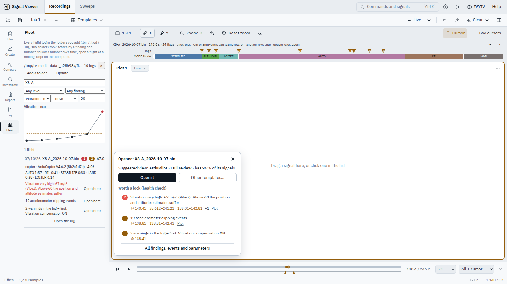

# מדריך: בשביל מה ה-Fleet

חמש דקות עם **Fleet** על עשר טיסות שנבנו לשם כך, עם תשובה ידועה.

לוג של טיסה אחת עונה על *מה קרה בטיסה הזו*. ה-Fleet עונה על מה שלוג אחד לא יכול: **האם זה
מחמיר** (מנוע שנשחק, סוללה שמאבדת קיבולת), **איזו טיסה הייתה הראשונה** שעברה גבול, ו**באילו לוגים
יש ממצא** - על כל הלוגים בתיקייה, עם אותן בדיקות אוטומטיות של פאנל ה-Log. האינדקס נשמר במחשב
הזה; הלוגים נשארים במקומם.

## הדוגמה

`examples/fleet`: שני רחפנים, **X8-A** ו-**X8-B**, עשר טיסות ArduPilot בין 2 בספטמבר ל-17 באוקטובר
2026 (התאריך של כל טיסה נלקח מזמן ה-GPS שלה).

## 1. אינדקס

1. בסרגל הצד ▸ **Fleet** ▸ **נסו את צי הדוגמה** (או *הוספת תיקייה…* ובחירת `examples/fleet`).
   עשרת הלוגים נקראים פעם אחת; *עדכון* קורא אחר כך רק קבצים חדשים ושהשתנו.
2. הוא נפתח עם המספר **Vibration · max** מעל **30** (הגבול של בדיקת התקינות): מגמה של כל הטיסות,
   הגבול כקו מקווקו, והרשימה - **טיסה אחת**, *X8-A_2026-10-07* (‏67 m/s/s, עם clipping).

## 2. לעקוב אחרי רחפן אחד

3. הקלידו `X8-A` בחיפוש: המגמה של הרחפן הזה בלבד - 18, 19, 22, 25, 29, ואז 67. הוויברציה עלתה
   חמישה שבועות לפני הטיסה הרעה: מיסב שנשחק, גלוי הרבה לפני שנכשל. הקלידו `X8-B`: שטוח, בערך 17.
4. לחיצה על הנקודה האחרונה (או על הטיסה ברשימה): הממצאים שלה - *Vibration*, *Clipping*,
   *Log warnings* - כל אחד עם **פתיחה כאן**, שפותח את הלוג ברגע הזה עם פאנל ה-Log.

## 3. חיפוש לפי ממצא

5. נקו את המספר ואת החיפוש, ובחרו רמה **אזהרה או שגיאה**: שלוש טיסות - האחרונה של X8-A, של X8-B
   ב-19 בספטמבר (*5 לוויינים, HDOP 3.2* - קטע של GPS חלש) וב-17 באוקטובר (*הסוללה ירדה מתחת לגבול
   המתח הנמוך* - סוללה שחוקה).
6. *כל ממצא ▾* מצמצם לסוג אחד.

## עם הלוגים שלכם

*הוספת תיקייה…* מקבלת תיקייה של לוגים ‎`.bin` / `.tlog` / `.ulg`, כולל תתי-תיקיות, וממשיכה לעקוב
אחריה: *עדכון* אחרי יום טיסות. לוג בלי זמן GPS מקבל את תאריך הקובץ (מסומן `*`).

## התשובה

הלוגים נוצרו ב-`tools/make_fleet_example.py` מאותה טיסה: הוויברציה של X8-A הוגדלה פי 1.0 עד 1.78
בחמש טיסות ומדחף רופף בשישית; ב-X8-B קטע של חמישה לוויינים (‏118-152 ש׳) בטיסה אחת וסוללה של
‏880 mAh בטיסה אחרת.
