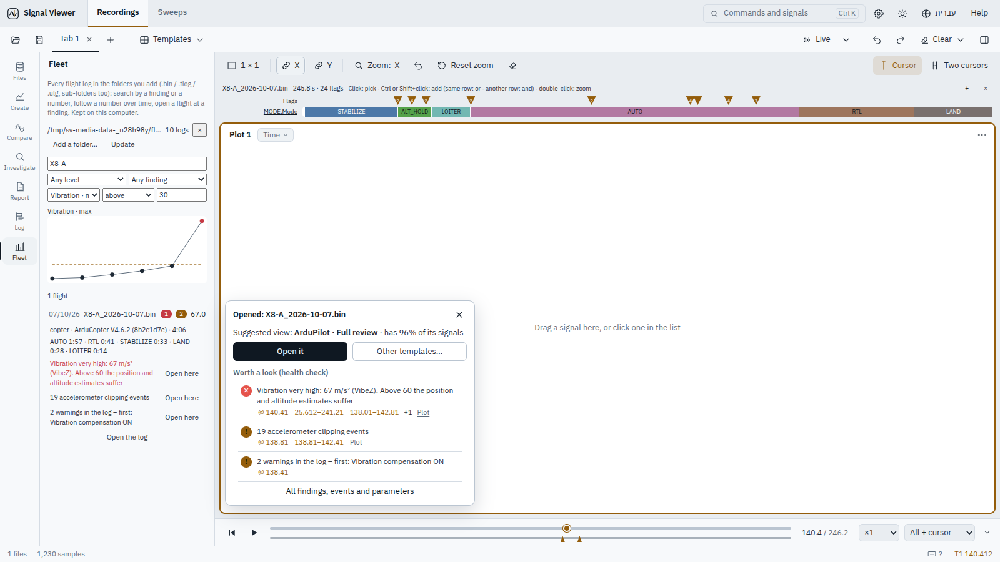

# Tutorial: what the Fleet is for

Five minutes with **Fleet** on ten flights made for it, with a known answer.

One flight log answers *what happened in this flight*. The Fleet answers the questions a single log
cannot: **is it getting worse** (a motor wearing out, a battery losing capacity), **which flight was
the first** to cross a limit, and **which logs have a finding** - across every log in a folder, with
the same automatic checks as the Log panel. It keeps an index on this computer; the logs stay where
they are.

## The example

`examples/fleet`: two quad-copters, **X8-A** and **X8-B**, ten ArduPilot flights between 2 Sep and
17 Oct 2026 (the date of each flight comes from its GPS time).

## 1. Index it

1. The rail ▸ **Fleet** ▸ **Try the example fleet** (or *Add a folder…* and choose `examples/fleet`).
   The ten logs are read once; *Update* later reads only new and changed files.
2. It opens with the number **Vibration · max** above **30** (the limit the health check uses):
   the trend of every flight, the limit as a dashed line, and the list - **one flight**,
   *X8-A_2026-10-07* (67 m/s/s, with clipping).

## 2. Follow one copter

3. Type `X8-A` in the search: the trend is that copter alone - 18, 19, 22, 25, 29, then 67. The
   vibration grew for five weeks before the bad flight: a bearing wearing out, visible long before
   it failed. Type `X8-B`: flat, about 17.
4. Click the last point (or the flight in the list): its findings - *Vibration*, *Clipping*,
   *Log warnings* - each with **Open here**, which opens the log at that moment with the Log panel.

## 3. Search by finding

5. Clear the number (*No number*) and the search, and choose the level **Warning or error**: three
   flights - X8-A's last one, X8-B's flight of 19 Sep (*5 satellites, HDOP 3.2* - a stretch of poor
   GPS) and of 17 Oct (*the battery sagged under its low-voltage limit* - a worn pack).
6. *Any finding ▾* narrows to one kind (only the GPS ones, only the battery ones).

## With your own logs

*Add a folder…* takes a folder of `.bin` / `.tlog` / `.ulg` logs, sub-folders too, and keeps
watching it: *Update* after a day of flying. A log without GPS time gets the file's date (marked
`*`). The numbers you can follow are the health checks' (vibration, clipping, GPS satellites and
HDOP, battery voltage, EKF, motor balance, Vcc...) and the flight's length.

## The answer

The logs were made by `tools/make_fleet_example.py` from the same flight: X8-A's vibration scaled
1.0 → 1.78 over five flights and a loose propeller in the sixth; X8-B with a stretch of five
satellites (118-152 s) in one flight and an 880 mAh battery in another.
