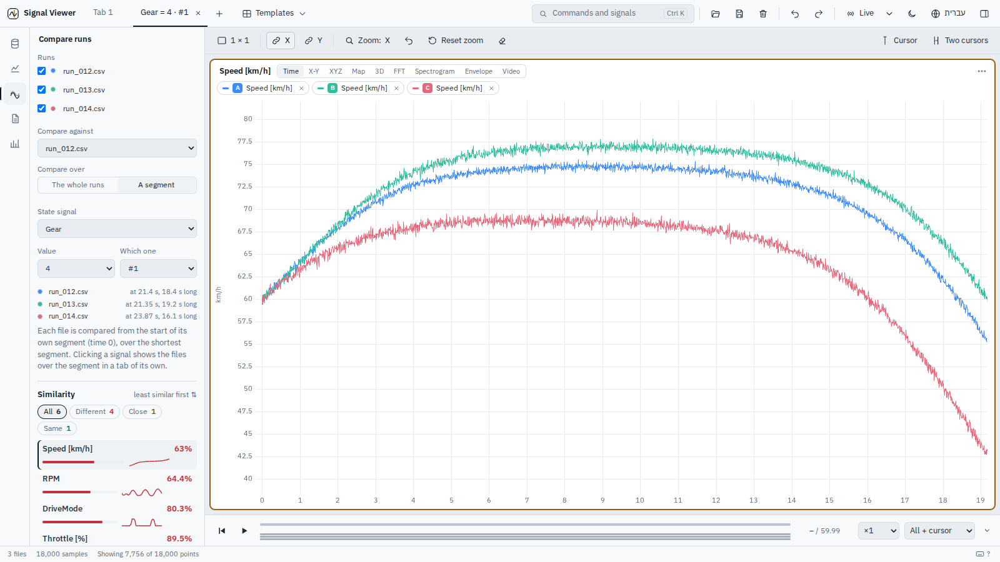
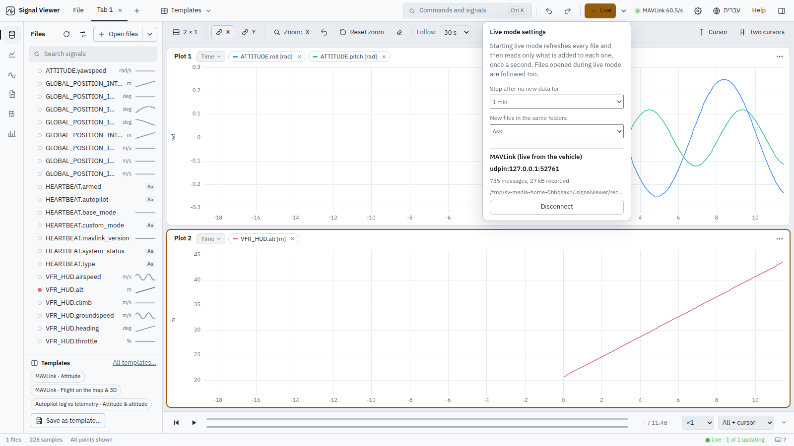
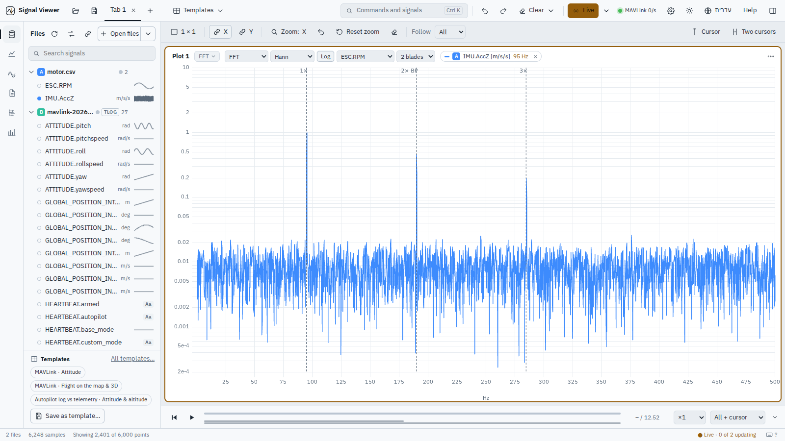
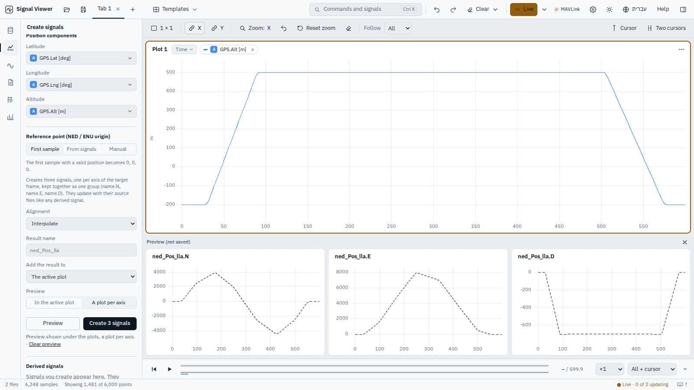

# Gallery

| | |
|---|---|
|  **Map + 3D** – offline map with terrain, roads and place names; 3D view with the vehicle and a live data box |  **3D terrain** – the bundled elevation (the Jordan rift really is below sea level) |
|  **Compare** – similarity list, overlay of every run, RMS Δ / max Δ / correlation per run |  **Comparison table** – every shared signal, coloured by how different it is |
|  **Built-in views** – ArduPilot attitude with the flight mode drawn on every plot |  **Vibration** – VIBE levels, clipping and an IMU spectrogram |
|  **Health check** – each finding with its moment, its stretches and a *Plot* button |  **Events** – messages, modes and errors; click one to put the cursor there |
|  **Formulas** – autocomplete, argument help and *did you mean…?* |  **Templates** – built-in and your own, matched to the open files |
|  **Smart start** – the first log gets a suggested view and its worst findings, each a click from its moment |  **Same segment, every run** – the files' segments lined up at 0, in a tab named after the segment |
|  **Live MAVLink** – UDP / TCP / serial, recorded as it arrives; only listens unless asked |  **Motor orders** – 1×, 2×, 3× the rotation rate and the blade pass, over the spectrum's window |
|  **Coordinate frames** – LLA → NED and more, previewed in a plot per axis, created as one group |  **Every signal at a glance** – its unit, rate and a small picture in the file list |
|  **Dark theme** |  **עברית** – full Hebrew interface, right to left |

---
