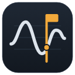

---
hide:
  - navigation
  - toc
---

<div class="sv-hero" markdown>



# Signal Viewer

<p class="sv-tagline">Open a flight log, a test run or a simulation, see what went wrong, compare runs
and write the report – offline, on your own machine, with every computation validated.</p>

[:material-download: Download for Windows](https://github.com/DavidAlpert11/SignalViewer/releases/latest){ .md-button .md-button--primary }
[:material-rocket-launch: Get started](install.md){ .md-button }
[:material-translate: מדריך בעברית](GUIDE.he.md){ .md-button }

<p class="sv-formats">CSV · MATLAB .mat · ArduPilot .bin · MAVLink .tlog · PX4 .ulg · ROS 2 .mcap · HDF5 · Parquet · CAN + .dbc · your own formats</p>

</div>

{ .sv-shot }
{ .sv-shot }

## What you do with it

<div class="grid cards sv-two" markdown>

-   :material-airplane:{ .lg } **Review a flight**

    ---

    ArduPilot, PX4 and MAVLink logs open directly: flight modes, events, parameters and an
    automatic health check (vibration, clipping, GPS, battery, EKF, motors) that points at the moment.

    [:octicons-arrow-right-24: Flight logs in the guide](GUIDE.md)

-   :material-compare-horizontal:{ .lg } **Compare runs**

    ---

    Every signal two or more runs share, ranked by how different it is; automatic time alignment;
    the same segment of each run (the 2nd AUTO of every flight); headings compared around the circle.

    [:octicons-arrow-right-24: What works](features.md)

-   :material-chart-bell-curve:{ .lg } **Simulation against flight**

    ---

    A `.mat` or `.csv` from Simulink or Python next to the flight log: A − B, how far apart they are
    in each flight mode, spectra, filters and coordinate frames (NED, ENU, body, ECEF, LLA).

    [:octicons-arrow-right-24: A worked example, start to finish](sim-vs-flight.md)

-   :material-check-decagram:{ .lg } **Pass / fail in CI**

    ---

    `signalviewer-cli check` (limits, per flight mode) and `compare` (against a golden run) with exit
    codes and JUnit XML - the same numbers as in the app.

    [:octicons-arrow-right-24: Checks and tolerances](command-line.md)

</div>

## Numbers you can trust

Every computation is checked against a reference that does not come from the app – a closed-form
result, a definition (WGS84) or an independent textbook computation – and the readers are checked
against logs from real vehicles, field by field, with their projects' own readers.

<div class="grid cards" markdown>

-   :material-sine-wave: **Validation** – spectra, filters, statistics, Compare and frames, 23 cases,
    with the expected and measured values. Run them yourself: `signalviewer-cli validate`.
    [:octicons-arrow-right-24: Validation](validation.md)

-   :material-speedometer: **Performance** – multi-gigabyte recordings open in seconds; every sample
    stays available at full resolution; display decimation keeps every spike.
    [:octicons-arrow-right-24: Performance](performance.md)

-   :material-alert-circle-outline: **Known limitations** – what it does not do yet, said plainly.
    [:octicons-arrow-right-24: Known limitations](limitations.md)

</div>

## Install

=== "Windows"

    `SignalViewer-Setup-X.Y.Z.exe` from the [latest release](https://github.com/DavidAlpert11/SignalViewer/releases/latest) –
    for your user only, no administrator rights – or the portable `.zip`.

=== "Python (any system)"

    ```bash
    pip install signalviewer        # everything; or signalviewer-lite for the core
    signalviewer                    # the app;  signalviewer-cli for the command line
    ```

=== "From source"

    ```bash
    git clone https://github.com/DavidAlpert11/SignalViewer.git
    cd SignalViewer && pip install -r requirements.txt && python run.py
    ```

Nothing needs the internet at run time – not the map, not the 3D terrain. No account, no telemetry.
[More about installing](install.md).

<p class="sv-small">Source, releases and issues on <a href="https://github.com/DavidAlpert11/SignalViewer">GitHub</a> · MIT License · English and Hebrew.</p>
