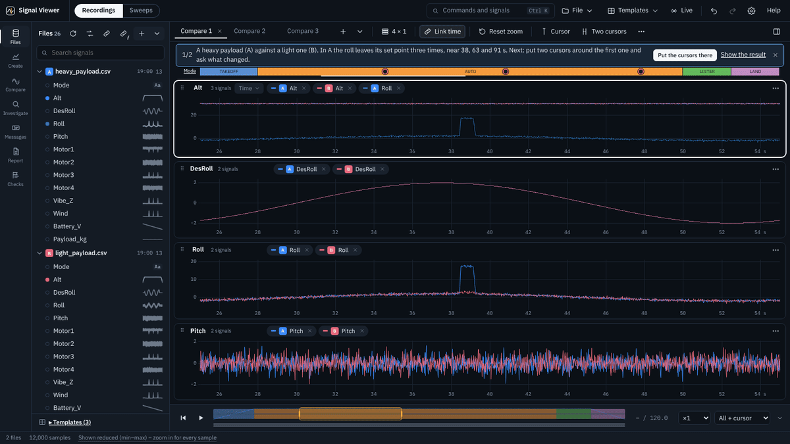
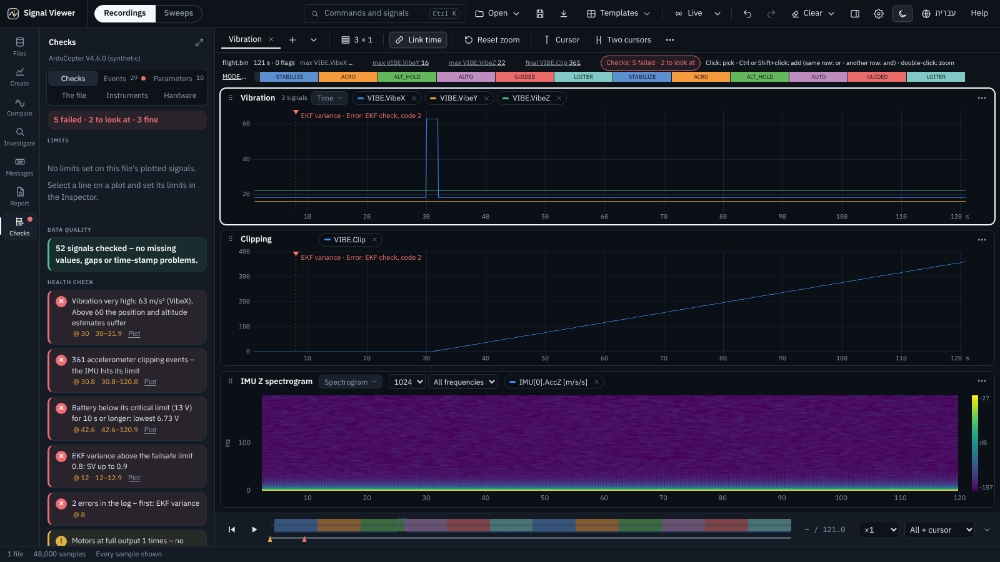
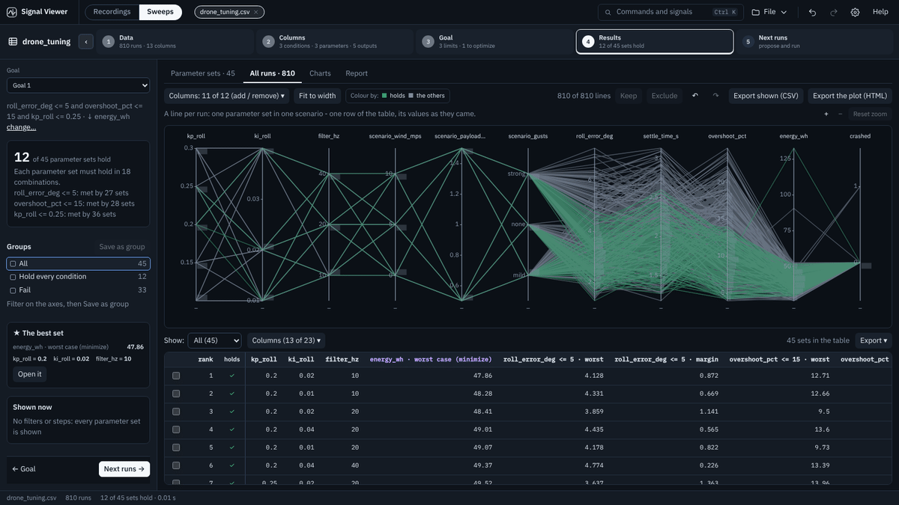
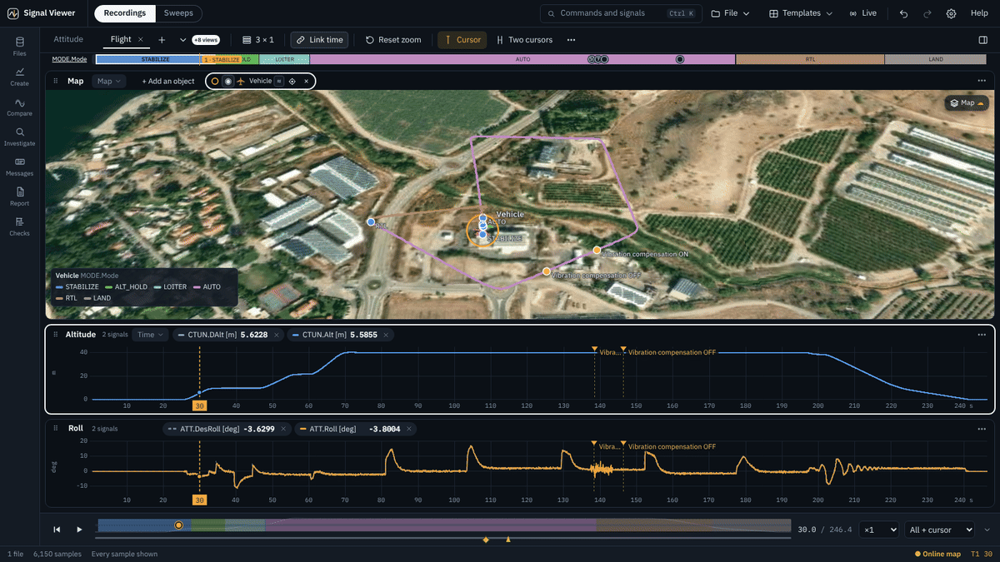
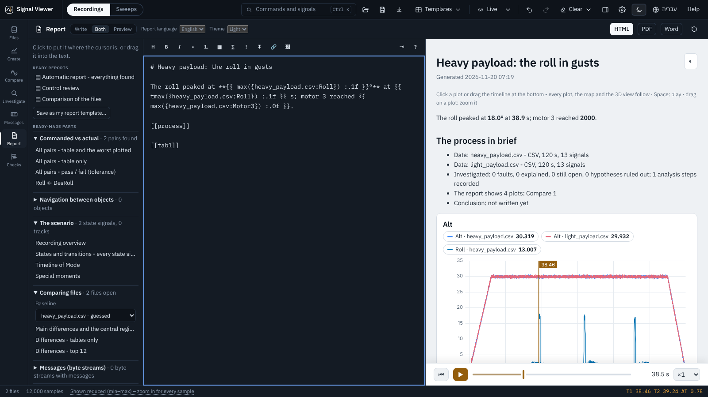

<!-- RD5: the hero (title, buttons, first picture) is in overrides/home.html; this is the rest of the home page. -->

<div class="sv-section" markdown>

<p class="sv-kicker">See it work</p>

## From a question to an answer you can defend

<div class="sv-row" markdown>
<div class="sv-row__text" markdown>

### What changed?

Put two cursors around the moment and ask. Every signal that left its usual range comes back in time order,
the likeliest cause first, with who led whom. Then name the event and find every time it happened.

[:octicons-arrow-right-24: Tutorial: what went wrong, in ten minutes](investigate-tutorial.md)

</div>
<div class="sv-row__media" markdown>
{ loading=lazy }
</div>
</div>

<div class="sv-row" markdown>
<div class="sv-row__text" markdown>

### One verdict per file

Your limits per phase or mode, a golden run with a tolerance per signal, the data's own quality (gaps, stuck
values, spikes) and a log's health check – each finding a click from its moment. The same checks run headless
in CI, with JUnit XML.

[:octicons-arrow-right-24: A simulation against its flight, start to finish](sim-vs-flight.md)

</div>
<div class="sv-row__media" markdown>
{ loading=lazy }
</div>
</div>

<div class="sv-row" markdown>
<div class="sv-row__text" markdown>

### Parameters that hold everywhere

**Sweeps** reads a table of results, a folder of recordings, or just the parameters and their ranges. Filter on
any axis and the count and the table follow; it finds the sets that hold in every scenario, and can run your
simulation round after round until the best stops changing.

[:octicons-arrow-right-24: The smart-sweep demo](smart-sweep-demo.md)

</div>
<div class="sv-row__media" markdown>
{ loading=lazy }
</div>
</div>

<div class="sv-row" markdown>
<div class="sv-row__text" markdown>

### See it in space

Any recording with positions, on satellite photos or the offline map, in 3D over the real terrain. Play it: the
vehicle moves along its track while the cursor moves in every plot. Online maps are opt-in; offline is the default.

[:octicons-arrow-right-24: Map and 3D](maps-and-3d.md)

</div>
<div class="sv-row__media" markdown>
{ loading=lazy }
</div>
</div>

<div class="sv-row" markdown>
<div class="sv-row__text" markdown>

### Send the answer

One HTML file that opens with **the process in brief** – the data, what was checked, what it shows, the
conclusion – then the plots, map and 3D on one time bar. Any browser, no install; PDF and Word too.

[:octicons-arrow-right-24: Gallery](gallery.md)

</div>
<div class="sv-row__media" markdown>
{ loading=lazy }
</div>
</div>

</div>

<div class="sv-section" markdown>

<p class="sv-kicker">And more</p>

## Everything in one place

<div class="grid cards sv-cards" markdown>

-   :material-compare-horizontal: **[Compare runs](features.md#compare)**

    Different clocks and rates aligned; every shared signal ranked by how much it differs.

-   :material-folder-multiple: **[A folder of recordings](GUIDE.md#folder)**

    The same numbers measured in each recording, one row each – the trend over weeks.

-   :material-function-variant: **[Formulas and analysis](features.md#math)**

    Derived signals, filters, spectra and statistics – formulas through a whitelist, never `eval`.

-   :material-access-point: **[Live data](features.md#files)**

    A file that is still being written, or a live MAVLink link, drawn as it arrives.

-   :material-view-dashboard-outline: **[Templates and sessions](features.md#reports)**

    The same view on the next run; the whole workspace saved, every change undoable.

-   :material-console: **[Command line and Python](command-line.md)**

    `signalviewer-cli` for CI and `import signalviewer` for scripts and notebooks.

-   :material-puzzle-outline: **[Your own formats](command-line.md#your-own-formats)**

    A Python reader of a few lines, binary packet layouts (ICD), CAN with `.dbc`.

-   :material-translate: **[English and Hebrew](GUIDE.he.md)**

    The whole app and its guide in both, right to left where it should be; light and dark.

</div>

</div>

<div class="sv-section" markdown>

<p class="sv-kicker">Numbers you can trust</p>

## Checked against references that do not come from the app

<div class="sv-stats" markdown>
<div markdown><b>29</b><span>validation cases with expected and measured values – run them yourself: `signalviewer-cli validate`</span></div>
<div markdown><b>≈ 2 s</b><span>for a sweep of a million runs to open with its answer</span></div>
<div markdown><b>All the data</b><span>in every number; a picture is reduced only so that every spike is still drawn</span></div>
<div markdown><b>Offline</b><span>no account, no telemetry – the map and the 3D terrain too</span></div>
</div>

[:octicons-arrow-right-24: Validation](validation.md) ·
[:octicons-arrow-right-24: Performance](performance.md) ·
[:octicons-arrow-right-24: Known limitations, said plainly](limitations.md)

</div>

<div class="sv-section" markdown>

<p class="sv-kicker">Install</p>

## Running in a minute

=== "Windows"

    `SignalViewer-Setup-X.Y.Z.exe` from the [latest release](https://github.com/DavidAlpert11/SignalViewer/releases/latest) –
    for your user only, no administrator rights – or the portable `.zip`.

=== "Linux / macOS"

    The portable `.7z` from the [latest release](https://github.com/DavidAlpert11/SignalViewer/releases/latest)
    (macOS: Apple silicon), or with Python.

=== "Python (any system)"

    ```bash
    pip install signalviewer        # everything; or signalviewer-lite for the core
    signalviewer                    # the app;  signalviewer-cli for the command line
    ```

=== "From source"

    ```bash
    git clone https://github.com/DavidAlpert11/SignalViewer.git
    cd SignalViewer && pip install -r requirements.txt && python run.py
    ```

Nothing needs the internet at run time; nothing is sent unless you choose an online map background
([what that sends](maps-and-3d.md#the-network)). [More about installing](install.md).

</div>

<div class="sv-end" markdown>

## Try it on a known answer

Six examples on the welcome screen – a flight log, a fault to find, a simulation against its flight, two runs of
one mission, a folder of recordings, a smart sweep – each with its answer and the next step.

[Download](https://github.com/DavidAlpert11/SignalViewer/releases/latest){ .md-button .md-button--primary }
[Read the guide](GUIDE.md){ .md-button }

<p class="sv-small">Source, releases and issues on <a href="https://github.com/DavidAlpert11/SignalViewer">GitHub</a> · MIT License · English and Hebrew.</p>

</div>
