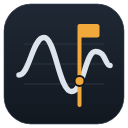
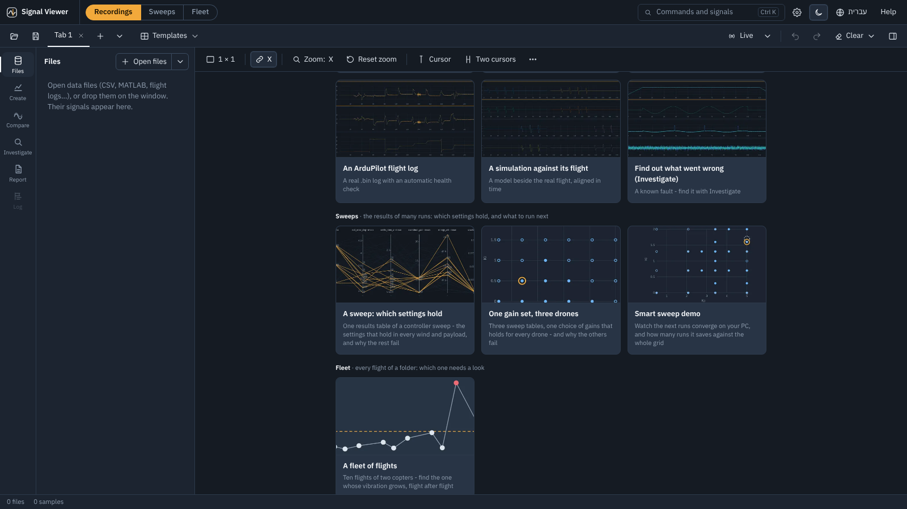

---
hide:
  - navigation
  - toc
---

<div class="sv-hero" markdown>



# Signal Viewer

<p class="sv-tagline"><b>Find what went wrong. Prove what is right. Send the answer.</b> Flight logs, test runs, simulations
and parameter sweeps – offline, on your own machine, with every computation validated.</p>

[:material-download: Download for Windows](https://github.com/DavidAlpert11/SignalViewer/releases/latest){ .md-button .md-button--primary }
[:material-rocket-launch: Get started](install.md){ .md-button }
[:material-translate: מדריך בעברית](GUIDE.he.md){ .md-button }

<p class="sv-formats">CSV · MATLAB .mat · ArduPilot .bin · MAVLink .tlog · PX4 .ulg · ROS 2 .mcap · HDF5 · Parquet · CAN + .dbc · your own formats</p>

</div>

{ .sv-shot }

## Try it in one minute

Every part of the app has a demo with a known answer on the welcome screen – a flight, a flight log's
health check, a simulation against its flight, a fault to find, a parameter sweep, the loop that picks the
next runs, and a fleet of flights. One click each; nothing to prepare.

{ .sv-shot }

## What you do with it

<div class="grid cards sv-two" markdown>

-   :material-magnify:{ .lg } **Find what went wrong**

    ---

    Two cursors around the moment, then **What changed?** – every signal that left its usual range, in
    time order, the likeliest cause first, who led whom. Name the event and find every time it happened.

    [:octicons-arrow-right-24: Tutorial: what went wrong](investigate-tutorial.md)

-   :material-check-decagram:{ .lg } **Judge a run against a golden one**

    ---

    A tolerance per signal, pass or fail, the worst moment and the verdict for the report – and the same
    check in CI (`signalviewer-cli compare`, `check`, JUnit XML).

    [:octicons-arrow-right-24: Simulation against flight, start to finish](sim-vs-flight.md)

-   :material-airplane:{ .lg } **Review a flight – map, 3D, story**

    ---

    ArduPilot, PX4 and MAVLink logs with an automatic health check; every object on an offline map or in 3D
    over real terrain; **▶ Story** flies the camera to each moment that matters.

    [:octicons-arrow-right-24: Offline map and 3D](maps-and-3d.md)

-   :material-tune-variant:{ .lg } **Choose parameters that hold everywhere**

    ---

    Which parameter sets hold in every scenario, how the runs spread over each scenario, one set for several
    systems – and **the loop** that runs your program (or your farm) until the best stops changing.

    [:octicons-arrow-right-24: The smart-sweep demo](smart-sweep-demo.md)

-   :material-folder-multiple:{ .lg } **Watch the whole fleet**

    ---

    Every flight of your folders checked the same way: which had errors, which number is growing over the
    weeks – and open the one that needs a look.

    [:octicons-arrow-right-24: Tutorial: what the Fleet is for](fleet-tutorial.md)

-   :material-file-chart:{ .lg } **Send the answer**

    ---

    One HTML page that opens with **the process in brief** – the data, what was checked, what it shows, the
    conclusion – then every plot, map and 3D view on one time bar. PDF and Word too.

    [:octicons-arrow-right-24: Gallery](gallery.md)

</div>

## Numbers you can trust

Every computation is checked against a reference that does not come from the app – a closed-form
result, a definition (WGS84) or an independent textbook computation – and the readers are checked
against logs from real vehicles, field by field, with their projects' own readers.

<div class="grid cards" markdown>

-   :material-sine-wave: **Validation** – spectra, filters, statistics, Compare, conditions, formulas and frames, plot speed, 29 cases,
    with the expected and measured values. Run them yourself: `signalviewer-cli validate`.
    [:octicons-arrow-right-24: Validation](validation.md)

-   :material-speedometer: **Performance** – multi-gigabyte recordings open in seconds; every sample
    stays available at full resolution; display decimation keeps every spike; a sweep of a million runs
    opens with its answer in about 2 s.
    [:octicons-arrow-right-24: Performance](performance.md)

-   :material-alert-circle-outline: **Known limitations** – what it does not do yet, said plainly.
    [:octicons-arrow-right-24: Known limitations](limitations.md)

</div>

## Install

=== "Windows"

    `SignalViewer-Setup-X.Y.Z.exe` from the [latest release](https://github.com/DavidAlpert11/SignalViewer/releases/latest) –
    for your user only, no administrator rights – or the portable `.zip`.

=== "Python (any system)"

    ```bash
    pip install signalviewer        # everything; or signalviewer-lite for the core
    signalviewer                    # the app;  signalviewer-cli for the command line
    ```

=== "From source"

    ```bash
    git clone https://github.com/DavidAlpert11/SignalViewer.git
    cd SignalViewer && pip install -r requirements.txt && python run.py
    ```

Nothing needs the internet at run time – not the map, not the 3D terrain. No account, no telemetry;
nothing is sent unless you choose an online map layer ([what that sends](maps-and-3d.md#the-network)).
[More about installing](install.md).

<p class="sv-small">Source, releases and issues on <a href="https://github.com/DavidAlpert11/SignalViewer">GitHub</a> · MIT License · English and Hebrew.</p>
