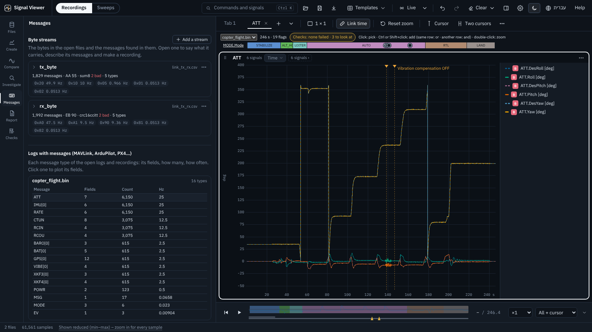
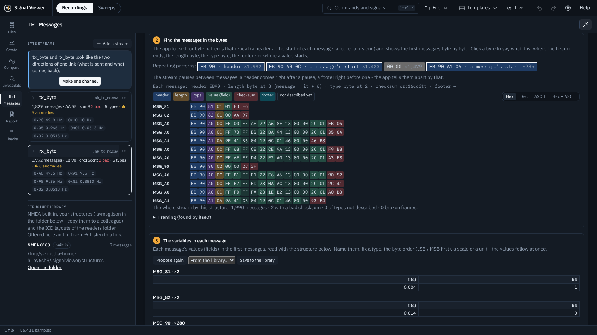

# Messages: from bytes to signals

A serial port, a radio or a bus is often recorded **byte by byte** - one signal of whole numbers 0..255, or a
logger's columns `byte_0 … byte_N` with one message per row - or as a receiver's raw text (`$GPGGA,…`). Signal
Viewer finds the messages in it, says what it found, and - with a **structure** that says what each message
holds - turns them into a **recording**: each value a signal, with its own times, ready for plots, the map, Compare
and the report.

## The Messages panel - one place for all of it

**Messages** on the left (beside *Investigate* and *Report*; Ctrl+K → *Messages*) holds everything about messages:

- **Byte streams** - the bytes in the open files, found by themselves (a signal of bytes, byte columns, a link
  recording) or as you defined them, each with its messages at a glance: how many, the header, the checksum and its
  errors, each message type and its rate. Click one to open it: what it carries, its structure and the actions -
  **Plot the messages**, **Make the recording**, **Add to the report** (`[[messages <its name>]]` at the end of the
  report, the definition kept).
- **Logs with messages** - every message type of the open logs and recordings - MAVLink `.tlog`, ArduPilot `.bin`,
  PX4 `.ulg`, a link's recording, a recording made from messages - with its fields, how many and how often. A click
  plots that message's fields in a new tab.
- **Running now** - a link being listened to, MAVLink being received (started and stopped in *Live ▾*): bytes,
  messages and the rate.
- **Structure library** - NMEA 0183 built in, your structures (`.svmsg.json` files in `~/.signalviewer/structures`;
  *Open the folder* to copy one to a colleague or add one) and the ICD layouts of the readers folder (`.icd.json`,
  the same packets read as a structure). Offered in the panel (*From the library…*) and in *Live ▾ → Listen to a
  link*.

{ .sv-shot loading=lazy }

Right-click a byte signal in the list (or select the byte columns) → **Decode as messages…** opens the panel on it.
A link recording (`.svraw`) opened without its structure says so, with a button to the panel.

## From the raw signal to the variables - four steps

Open the stream in the panel (click it, or right-click the byte signal → **Decode as messages…**). It opens on four
numbered steps; each says what to do, and steps 2 and 3 follow every change at once.

### Step 1 - what the signal carries

| Choice | When | Example |
|---|---|---|
| Only TX / only RX | one direction in one signal | `tx_byte` |
| Both - a column says the direction of each byte | one signal with both ways, and **any column beside it with 2 to 32 values** (`dir` = TX / RX, a node address 5 / 9 / 12, a port...); choose it, then which of its values is TX and which is RX (each value shown with how many samples have it). Bytes with the column's other values are in neither direction - the panel says how many | `byte` + `dir` in `link_mixed.csv` |
| TX and RX - one signal each | two signals selected | `tx_byte` and `rx_byte` in `link_tx_rx.csv` |

With two directions, steps 2-4 are done for each (the TX / RX switch at the top of step 2).

### Step 2 - find the messages in the bytes

The app looks for **byte patterns that repeat** and proposes the message's template by itself - nothing to press:

- **Repeating patterns** - the sequences of 2-4 bytes that recur, with how often: the header (`EB 90 · header`), a
  message's start (the header and the type / length bytes that always follow it), the footer (`0D 0A · footer`) and
  any other. Click one: **Use as the header** or **Use as the footer** - the template is proposed again around it.
- **By the time** - when the stream pauses between messages (the line quiet longer than between a message's own
  bytes, or bytes stamped one time per packet), a header comes right after a pause and a footer right before one. The
  app uses that to tell them apart - from the bytes alone a recording that starts inside a message frames as well from
  its footer as from its header. Each pattern's tooltip says how often it comes right after / right before a pause,
  and a pattern that is not the header or the footer yet is marked *starts a message* / *ends a message (by the
  time)*. A stream sent back to back with no pauses: the time says nothing, and nothing is read from it.
- **The template in one line** - `Each message: header EB90 · length byte at 3 (message = it + 6) · type byte at 2 ·
  checksum crc16ccitt · footer -`.
- **The first messages byte by byte**, each byte coloured by what it is: header, length, type, a value (field),
  checksum, footer - grey: not described yet. **Click a byte to say what it is**: *The header is these bytes*, *The
  length byte*, *The type byte*, *The footer: from here to the end*, *A value starts here* (8 / 16 / 32-bit, signed or
  not, LSB first or MSB first, float) or *Not a value*. A text stream (`$GPGGA,…`) shows each sentence's parts
  between the commas; click a part to make it a field (number, text, latitude, longitude, time of day).
- When no message is found yet, the stream's first bytes are shown: click the byte where a message starts.
- Below: **the whole stream by this template** - how many messages, how many with a bad checksum, of types not
  described, broken frames (every message counts).

{ .sv-shot loading=lazy }

### Step 3 - the variables in each message

Each message's values in the first messages, read with the template - a wrong byte order, offset or scale shows at
once - and the template itself as a **form** or as its **JSON**: name the values, fix a type, the byte order
(LSB / MSB first), a scale, an add, a unit. The proposal guesses each value from how it moves from one message to the
next - a 16-bit value **LSB first or MSB first** (whichever reads smooth), **signed** when it crosses zero, a 32-bit
integer, a 32-bit float, a counter, flags, else a byte - and names it by place (`value_4`, `b10`). Text sentences
(`$…,…*HH`) are proposed as **NMEA** - the sentences it knows with their fields, any other sentence's fields by place.

- **Propose again** - forget the edits and propose from the stream.
- **From the library…** - NMEA 0183 (built in: GGA, RMC, VTG, GSA, GSV, GLL, ZDA), yours, an ICD layout - or
  *A structure file…* anywhere on the disk.
- **Save to the library** - under a name, as a `.svmsg.json` file, for the next recording or a live link.

### Step 4 - make the recording

- **Make the recording** - the values become a recording of their own (*rx_byte - messages*), plotted one plot per
  message, in the file list like any opened file: plots, Compare, the map, the report. The definition is kept in the
  session: opening the session makes the recording again.
- **Save as a file (CSV, Parquet, MAT, HDF5)…** - the recording's values written as a file the app (or anything else)
  opens like any input.
- **Plot the messages** - a tab of the stream itself: the bytes, the message type, the length, the interval,
  checksum good / bad, and with both directions the reply latency.
- **Add to the report** - `[[messages <its name>]]` at the end of the report: the framing, a table per message type,
  the order, rates, gaps, requests and replies, the handshake (see
  [Writing a report](reports.md#messages-in-a-byte-stream)). *Report → Ready reports → Link review* writes it all.

## The structure file

### A binary structure

```json
{"kind": "binary", "name": "Vehicle -> ground", "header": "EB90",
 "length": {"offset": 3, "add": 6},          "type": {"offset": 2},
 "checksum": {"scheme": "crc16ccitt", "from": 2},
 "messages": [
  {"id": 160, "name": "ATTITUDE", "fields": [
    {"name": "roll",  "offset": 4,  "type": "i16", "endian": "be", "scale": 0.01, "unit": "deg"},
    {"name": "yaw",   "offset": 8,  "type": "u16", "endian": "be", "scale": 0.01, "unit": "deg"},
    {"name": "alt",   "offset": 10, "type": "i32", "endian": "le", "scale": 0.01, "unit": "m"}]},
  {"id": 161, "name": "STATUS", "fields": [
    {"name": "mode",  "offset": 10, "type": "u8", "labels": {"1": "MANUAL", "2": "AUTO"}},
    {"name": "armed", "offset": 11, "type": "u8", "bits": [0, 1]}]}]}
```

- Offsets count from **0 at the header's first byte**.
- `length`: the frame's length = that byte + `add` (no length byte: `"size"` for all, a `"size"` per message, or a
  footer it ends with).
- `footer`: fixed bytes every message ends with, in hex (`"0D0A"`, `"03"`). A message whose end is not its footer is
  broken (left out, counted); without a length byte or a size, a message ends at its footer. A checksum sits just
  before the footer. The app proposes a footer when every message ends with the same bytes.
- `type`: the byte that tells the messages apart (`id` is its value).
- `checksum`: in the last 1 or 2 bytes, over the bytes from `from` up to it - `sum8`, `xor8`, `negsum8`, `notsum8`,
  `crc16ccitt` (MSB first), `crc16modbus` (LSB first), `fletcher16` (as UBX). A message whose checksum fails is left
  out and counted.
- Field types: `u8 i8 u16 i16 u24 i24 u32 i32 f32 f64`; `endian`: `le` = **LSB first** (little-endian), `be` =
  **MSB first** (big-endian). The value = raw × `scale` + `add`; `bits: [first, how many]` takes bits out of it;
  `labels` gives text to values.

### A text structure (NMEA and the like)

```json
{"kind": "text", "name": "NMEA 0183", "start": "$", "sep": ",", "checksum": "nmea",
 "messages": [
  {"id": "GGA", "name": "GGA", "fields": [
    {"name": "time", "index": 1, "type": "hhmmss", "unit": "s"},
    {"name": "lat",  "index": 2, "type": "lat", "hemi": 3, "unit": "deg"},
    {"name": "lon",  "index": 4, "type": "lon", "hemi": 5, "unit": "deg"},
    {"name": "alt",  "index": 9, "type": "number", "unit": "m"}]}]}
```

- A sentence starts with `start`, ends at the end of its line (or at `end` when given, e.g. `"#"`), and its values are
  separated by `sep`; `index` is a value's place (the sentence's
  name is 0); `"checksum": "nmea"` checks `*HH` (a sentence that fails is left out and counted).
- A message's `id` matches the sentence's name whole or without its two-letter talker: `GGA` reads `$GPGGA` and
  `$GNGGA`.
- Types: `number`, `int`, `text` (text values), `lat` / `lon` (`ddmm.mmmm` / `dddmm.mmmm` with the hemisphere's
  place in `hemi` - S and W negative), `hhmmss` (seconds of the day), `ddmmyy` (days since 2000-01-01).
- The time of a sentence is the time of its first byte in a recorded stream; in a `.nmea` file, its own time field
  (a sentence without one takes the last seen).

## A raw NMEA file

A **`.nmea`** file opens like any recording: its sentences by the NMEA structure, the time from their own clock -
`GGA.lat`, `GGA.lon`, `GGA.alt`, `RMC.speed`, `GSA.hdop`… - and its position is a track on the map. A sentence with
a wrong checksum is left out; one the structure does not know is counted (the load report says which).

## Live: listen to a serial port, UDP or TCP

*Live* (the ▾ beside it) → **Listen to a link (serial / UDP / TCP)**:

| Connection | Means |
|---|---|
| `COM5`, `/dev/ttyUSB0` + baud | a serial port (UART) - with pyserial installed |
| `udp:0.0.0.0:5600` | listen on a UDP port (any sender) |
| `tcp:192.168.1.10:4001` | connect to a device or a serial-to-network server |
| `tcpin:0.0.0.0:4001` | wait for a device to connect |

Choose **the messages**: a structure of the library (NMEA 0183, yours, an ICD layout), a structure file
(`.svmsg.json`), a structure kept in this session, or *bytes - decode them later*. **Listen**: what comes in is recorded to a file in the
recordings folder (`link-<date>-<time>.svraw` - each chunk with its receive time, the structure beside it as
`.svmsg.json`), and as soon as the first bytes arrive the app opens it and follows it live: the messages' signals
grow on the plots and the map as they come. Nothing is ever sent. **Stop** keeps the file - a recording like any
other: open it again, compare it, export it (*Export recording*: CSV, Parquet…), put it in a report.

To try it without a device, the examples' streams can be played over the network in real time:

```bash
python tools/send_link_demo.py                          # the sensor board -> udp 127.0.0.1:5600
python tools/send_link_demo.py --what nmea              # the GPS receiver's NMEA
python tools/send_link_demo.py --what tx --to tcp:0.0.0.0:4001   # serve TCP; the app connects to tcp:127.0.0.1:4001
```

then *Listen* on `udp:0.0.0.0:5600` with `examples/serial_link/sensor.svmsg.json` (or NMEA 0183).

## The examples (Help → Examples)

| Example | What it shows |
|---|---|
| **a serial link, byte by byte** | the messages found by themselves (TX: header AA 55, a length byte, sum8; RX: EB 90, CRC-16), a handshake, commands and their ACKs, lost ones, a retry, a dropout and a reconnect - in a *Link review* report |
| **messages to signals** | the same link with its two structure files (`link_tx.svmsg.json`, `link_rx.svmsg.json`): angles MSB first and LSB first, a 32-bit altitude, a float, flag bits, scales and units - two recordings, plotted |
| (in the same folder) `sensor_uart.csv` + `sensor.svmsg.json` | a sensor board with a **footer** and no length byte: `A5 5A`, type, payload, xor8, `0D 0A` - IMU (i16 LSB first), barometer (a 32-bit pressure), magnetometer (MSB first); opened in *Messages*, step 2 finds the header, the footer, the xor8 before it and every field's type and byte order |
| **a GPS receiver's raw NMEA** | `receiver.nmea` opens as a recording at once (a loop on the map, the fix lost for 5 s, one bad checksum, a maker's own `$PDEMO` sentence); `receiver_uart.csv` is the same receiver byte by byte - open it in *Messages*: step 2 proposes NMEA |
