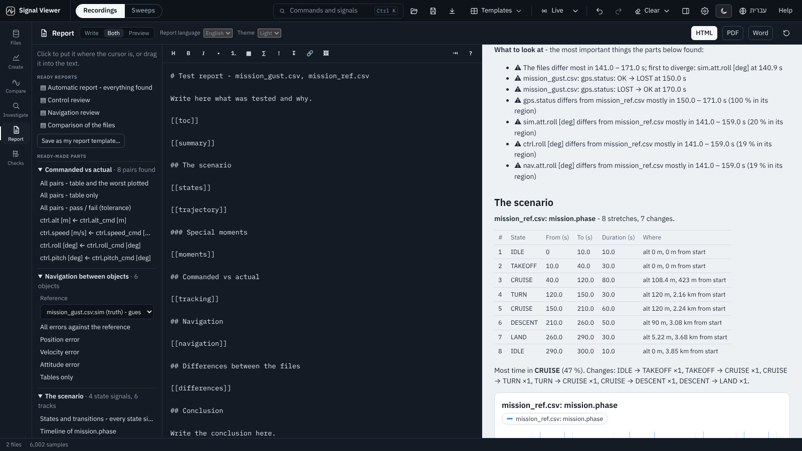
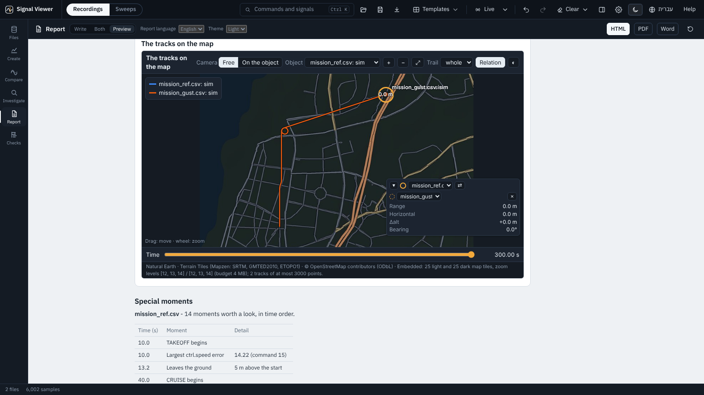
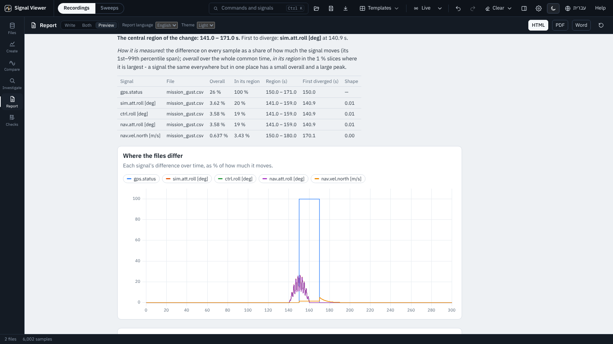
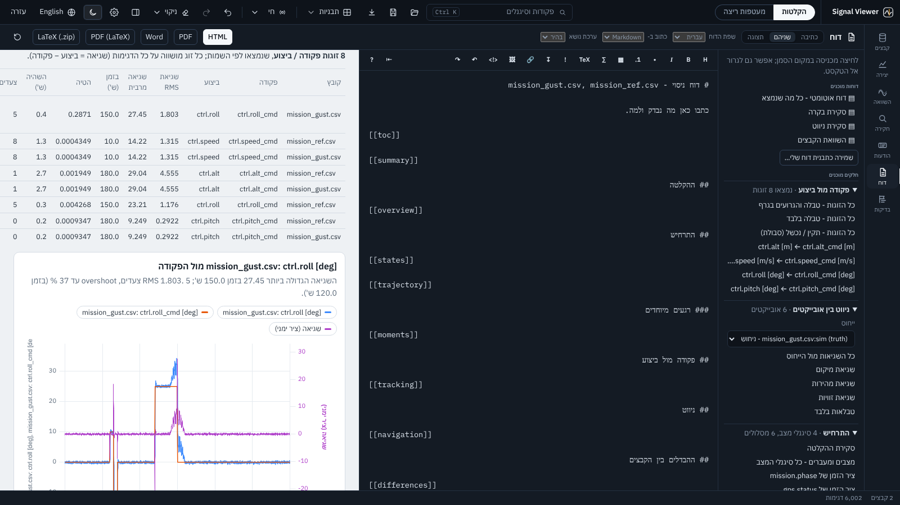
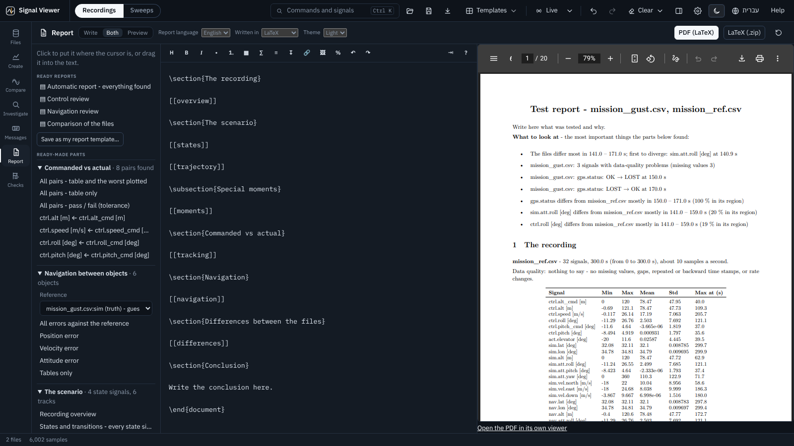

# Writing a report

Since 1.31 a report is a document you write - like Markdown - with your plots, tabs and values in it.
**Report** on the left rail opens it in place of the plots (the same button goes back); you write on the left,
the page it makes is shown on the right as you type, and **HTML**, **PDF** and **Word** save it.

```markdown
# Flight 12 - heavy payload

Roll peaked at **{{ max(Roll) :.1f }}°** at {{ tmax(Roll) :.1f }} s.
The roll error while gusting was {{ rms(Roll - DesRoll, when="Gust") :.2f }}°.

[[Attitude.Roll]]

[[Attitude.Motors | 30..60, no table]]

$$\omega_n = \sqrt{k_p / J}$$
```

A report made before 1.31 (the Report panel's title, introduction, plots and summary) opens as the document that
form made - the same parts in the same order - and only changes when you edit it.

## Plots and tabs: `[[ ]]`

| Write | Puts in |
|---|---|
| `[[Attitude]]` | every plot of the tab *Attitude* (as the old report did: plots unticked there stay out) |
| `[[Attitude.Roll]]` | the plot titled *Roll* in that tab |
| `[[tab2.plot3]]` | by position, when a tab or plot has no name |
| `[[Attitude.Roll \| 10..60]]` | only 10 - 60 s (the plot and its statistics) |
| `[[… \| all]]` | the whole recording (otherwise: the zoom the plot has now) |
| `[[… \| no table]]` / `[[… \| table only]]` | the plot without its statistics table / the table alone |
| `[[notes]]` `[[findings]]` | the notes; the findings with their status |
| `[[investigation]]` `[[process]]` `[[verdict]]` | the investigation's sections, the process in brief, Compare's verdict |

A plot goes on a line of its own. You do not have to type them: the **Insert** list on the left puts a tab or a
plot where the cursor is (click, or drag it into the text), and a plot's ⋯ menu / a tab's right-click menu have
**Add to report**. Typing `[[` offers the names (Tab takes the first).

## Values: `{{ }}`

Signals are written by name, as in formulas (`Roll`, `{Motor 3}`, `{flight_b.bin:Roll}` when two files have one).
Every value is computed on **every sample** - never on what a plot draws.

| Write | Gives |
|---|---|
| `{{ max(Roll) }}` | a statistic: `max min mean rms std range first final samples duration tmax tmin absmax integral` |
| `{{ mean(Speed, 10, 60) }}` | over 10 - 60 s |
| `{{ rms(Roll - DesRoll) }}` | of a formula (the same formulas as *Create signals*) |
| `{{ mean(Speed, when="Cruise") }}` | only while a condition (Investigate) holds |
| `{{ stretches("Gust") }}` / `{{ holds("Gust") }}` | how many times a condition held / for how many seconds |
| `{{ peak = max(Roll) }}` then `{{ peak * 2 }}` | a variable (defined silently, used further on) |
| `{{ max(Roll) :.2f }}` | a format after a colon: `.2f` two decimals, `.3g` three digits, `,d` thousands |

Without a format a value has about four significant digits. *Value…* in the Insert list writes one for you - a
signal, a statistic, the whole recording / between the cursors / what the plot shows (written as numbers, so the
report does not move with the cursors) and an optional condition.


## Ready reports and ready-made parts (1.32)

The **Insert** list on the left starts with what the open files have, found by the signals' names - any recording,
not one format:



**Ready reports** - one click writes a whole report made of parts: *Automatic report* (everything found),
*Control review*, *Navigation review*, *Comparison of the files* (offered when they fit). A report nobody wrote yet
is replaced; otherwise the parts go in where the cursor is. Edit the result like any text - delete a part, move it,
write around it. **Save as my report template…** keeps your report under a name and offers it again in any
session; **My parts** (at the end of the list) keeps any piece you select in the text - a paragraph, a table, a few
parts with their options - under a name, one click into any report; a session template saved from the template library carries the report too, and opening it on the next
recording brings the report (only when that session has no report of its own yet).

**Ready-made parts**, by category - each one click (or drag) into the text:

| Write | Puts in |
|---|---|
| `[[overview]]` | **the recording, whatever it holds** (not only flight logs): each file's signals, duration and rate, its data quality (missing values, gaps, repeated or backward time stamps, rate changes), every numeric signal's min / max / mean / std on all its samples, its state signals, and its first signals plotted - one plot each, every file's line in it. The automatic report always starts with it |
| `[[tracking]]` | **commanded vs actual**: every command and its measured value, paired by name (`DesRoll`/`Roll`, `roll_cmd`/`roll`, `alt_target`/`alt`, `x_setpoint`/`x`…) - RMS and largest error (and when), bias, delay, and for each step of the command the overshoot and settling time; a table, worst first, and the worst pairs plotted (the command dashed, the error on the right axis - the axis titled with its name and in its colour) |
| `[[tracking roll \| tol 2, outside 1%]]` | only the pairs named like *roll*; pass / fail: the error within ±2 for all but 1 % of the time |
| `[[navigation]]` | **navigation errors between objects**: each map object's position, velocity and attitude error against the reference - RMS, mean, 95 %, largest and when - and the worst plotted. The reference is guessed (a simulation's truth, else a receiver), shown in the list and changeable: `[[navigation \| ref GPS, position]]`. With several files, each file against its own reference |
| `[[states]]` `[[states Mode]]` | **the scenario**: each state signal (a mode, a phase, a status - text values) as a time line: every stretch, its duration and where it was (height, distance from the start); most time in, the changes |
| `[[trajectory]]` | the track's facts - duration, distance travelled, farthest from the start, highest, fastest - and **the tracks on a map** (every file's, on the map layer the app shows; only map tiles already kept are used, else the offline world map) |
| `[[moments]]` | **special moments** on one time line: the phases, every change of a state (*gps.status OK → LOST*), leaving and returning to the ground, highest, farthest, the largest tracking errors, a signal stuck or at its limit, a gap, a spike |
| `[[differences]]` | **the files compared** (two or more open): see below |
| `[[messages]]` | **the messages of a byte stream** (a serial link, a radio, a bus recorded byte by byte): see below |
| `[[summary]]` | **what to look at**: the most important things the other parts found, worst first - put it at the top |
| `[[toc]]` | **a table of contents**: the report's headings (`##`, `###`) - those the parts write too - as links that jump to them in the page |
| `[[plot Roll, DesRoll \| 10..60]]` | a plot made from names, in no tab; a name in several files is drawn from each; `[[plot xy Lon, Lat]]` |



Options after `|`, separated by commas: `top 5` (how many plotted), `table` (tables only), `tol 2`, `outside 1%`,
`skip yaw`, `ref NAME`, `base FILE`, `position` / `velocity` / `attitude`, `min 2s` (states shorter than that not
listed). A part that finds nothing says so in one line; an unknown option is a red ⚠ that lists the known ones.
Every number is computed on every sample.

### Messages in a byte stream

A signal that holds a link's bytes one by one (whole numbers 0..255) - or columns `byte_0 … byte_N` with one
message per row - is decoded by itself: the **header** (the 2-byte pair that recurs and frames best), how a
message's **length** is known (a length byte at offset 2-4, else its type, else one fixed length), the **type**
byte (few values, the one that decides the length), and the **checksum** in the last 1 or 2 bytes (sum8, xor8,
−sum8, ~sum8 with or without the header, CRC-16 CCITT, CRC-16 Modbus, Fletcher-16 as UBX - the one most messages
match). A message that does not end where the next header starts and fails its checksum is broken: the decoder
resyncs to the next header and counts it.

`[[messages]]` writes, for each stream: how many messages, the checksum and its errors, the broken frames;
**the packet** - a table of what every message is made of: the fixed header, the byte that gives the length, the
byte that gives the message type (and its kinds), the payload of each kind, and whether there is a checksum (which,
over which bytes); a table per message type - count, share, length, rate, period and jitter, the longest interval,
first and last, checksum errors; **the order** (the sequence that repeats, e.g. `0x20 0x10 0x20 0x20 0x20 0x20`,
else the commonest transitions) and **the messages in order** as they came (the first 40, and a plot of the type
over the first seconds); **the gaps** (no messages for 1.5 s from 18 s); and one plot per quantity with
every stream's lines: *messages per second by type* (a dropout falls to zero), *the interval between messages of
a type*, *the checksum errors*. Checksum errors and gaps go to `[[summary]]`.

**Both directions of a link** - two streams of one file (TX and RX, or one signal split by its direction column) -
are put together: **which message answers which** (a reply is a message in the other direction within 0.5 s that
echoes a byte of the request - a sequence number, an id - or, for rare messages like a handshake's, the next one that
always answers; streaming messages sent on their own clock have none), how many requests were **answered**,
**unanswered** (and when), **sent again** before an answer (a retry), replies without a request, the **reply latency**
per pair (mean, 95 %, largest and when) and a plot of it over time; and **the handshake** - the opening exchange in
order (*TX 0x01 → RX 0x81 → TX 0x02 → RX 0x82*) and every time it comes again (a reconnect).

A link recorded **both ways in one signal**, with a column beside it that says whose byte it is (`dir` with TX /
RX, `direction`, `port`, `channel`…), is split: each direction is its own stream. Anything can be forced:
`[[messages | header AA55, checksum sum8]]` (`length N` / `type N`: the offset of that byte; `checksum none`).

In the **Messages** panel (on the left; or right-click a byte signal in the list → *Decode as messages…*), open the stream and say what it
carries - **only TX**, **only RX**, **both, with a column that says the direction of each byte** (choose the
column and which of its values is TX), or - with two signals selected - **TX and RX, one signal each** - and, if you want, the header and the checksum. The definition is kept in the
session and used by `[[messages]]` (a signal not defined is still found by itself); *Add to the report* writes `[[messages <its name>]]` (several names with commas: `[[messages tx_byte, rx_byte]]`). *Plot the messages* shows in a new tab the bytes, the
message type, the length, the interval and the checksum good / bad - derived signals like any other, one line per
direction.
`[[overview]]` leaves a byte stream's bytes out of its statistics (they are not measurements).

*Help → Examples → a serial link, byte by byte* opens a demo (`examples/serial_link`): TX (header AA 55, a length
byte, sum8) and RX (header EB 90, CRC-16) as two signals, and the same link as one signal with a `dir` column -
with a handshake, commands answered by an ACK that echoes their sequence number, three commands lost, one sent
again, a few checksum errors, a broken length byte and a 1.5 s dropout followed by a reconnect - in a *Link review*
report.

### Comparing files: the main differences and the central region of the change



`[[differences]]` compares every signal the files share (by name, whatever the unit's spelling) with the
**baseline** - the file whose name says so (*ref*, *baseline*, *golden*, *nominal*), else the first; the list
lets you choose another (`| base FILE`). For each signal, the difference on every sample is measured **as a share
of how much the signal moves** (its 1st–99th percentile span - one spike does not set it):

- **overall** - over the whole common time;
- **in its region** - in the 1 % slices of time where it is largest. A signal the same everywhere but in one place
  has a small overall and a large value here: it is not lost among signals that differ a little all the time;
- its **region** (where the difference is above a quarter of its peak) and when it **first diverged** (left its
  own usual difference and stayed out).

Signals are *the same* under 2 %, *small* to 10 %, *large* above (`small 1%, large 5%` to change). Then: **the
central region of the change** - the window where the top signals' differences are largest together - and the
first signal to diverge; a table of the top signals (one per family: *IMU.AccX/Y/Z* is one row); a plot of
*where the files differ* over the whole time; each top signal **zoomed on its own region** with every file's line;
states whose sequence differs (*OK → LOST → OK*); **parameters that differ** (a log's parameters, a file's
settings, numbers in the file names - often the cause); and the rest of the differences in a table at the end.
Time and counter signals are not compared; signals in one file only are listed.



### The demo recordings

`examples/report_demo` has two recordings of one generic test mission (`tools/make_report_demo.py` writes them):
a scenario (`mission.phase`: IDLE, TAKEOFF, CRUISE, TURN, DESCENT, LAND), four commanded / measured pairs
(`ctrl.alt_cmd`/`ctrl.alt`, speed, roll with steps, pitch), three objects (`sim.*` the truth, `nav.*` the estimate,
`gps.*` the receiver) and a receiver status. `mission_gust.csv` is the same mission with a gust at 140–160 s and the
receiver lost at 150–170 s. **Help → Examples → a test report, step by step** opens both, plotted, and a line above the plots whose button writes
the automatic report; or open them yourself, *Report*, *Automatic report*.

**Other recordings:** the automatic report works on any open files - each part looks for what it needs by the
signals' names and is left out when it finds nothing. A car's, a bench's or a simulation's recording without
commands, positions or modes still gets the recording overview (signals, quality, statistics, plots), the
special moments (stuck or saturated signals, gaps, spikes, state changes) and, with two files or more, what
differs between them.

## Tables and pictures from outside

**Paste a table** from Word, Excel, LibreOffice or a web page: it becomes a Markdown table (Hebrew kept; a merged
cell is repeated in the cells it covered, and a note says so); headings, lists, bold and italic from Word come too.
Ctrl+Shift+V pastes plain text. **A picture** - paste it (a screenshot), drop it on the text, or the 🖼 button -
is kept **inside the session** (made smaller, at most 2000 px; up to 5 MB each, 20 MB in all) and written
``; it travels with the session and the template and goes into the page, the PDF and Word. A
picture can still be linked from a file: ``.

## Writing

`# Heading`, `**bold**`, `*italic*`, `` `code` ``, `- list`, `1. numbered`, tables (`| a | b |` then `|---|---|`),
`> quote`, callouts `> [!NOTE]` `> [!TIP]` `> [!WARNING]` `> [!IMPORTANT]` `> [!FINDING]`, `[a link](https://…)`,
a picture `` (put into the page; or pasted - see above), `---` a line, `\newpage` a page break (PDF, Word), and
math: `$x^2$` in a line, `$$ … $$` on its own (fractions, roots, sums, integrals, Greek letters - matplotlib's
mathtext, the same in the page, the PDF and Word). A formula mathtext cannot read - matrices, `aligned`, `cases`,
`\text{…}`, `\begin{align}` - is drawn by **this computer's LaTeX** when it has one (see below). Each paragraph reads
right-to-left when it starts in Hebrew, left-to-right in English.

**A comment** - `<!-- … -->`, on one line or several - stays in the text and is left out of the report, with any
`[[ ]]` or `{{ }}` in it. **Ctrl+/** (or `<!>` in the toolbar) makes the selected lines comments and back (`%` in a
LaTeX document).

**Keys in the editor:** **Ctrl+Z** goes back a whole run of typing, or a piece the app put in (bold, a plot from the
list, a paste), with the cursor where it was; **Ctrl+Y** (or Ctrl+Shift+Z) forward again - also ↶ ↷ in the toolbar.
**Ctrl+B** / **Ctrl+I** bold, italic; **Tab** / **Shift+Tab** indent the selected lines; **Alt+↑** / **Alt+↓** move
them; **Ctrl+Shift+D** duplicates them.

## LaTeX - as in Overleaf, offline

The report can be written in **LaTeX**, and LaTeX can go into a Markdown report. Everything runs on this computer,
with **nothing to install**: the app carries its own LaTeX (1.34) - the **Tectonic** engine (XeLaTeX) and a small bundle
of TeX Live files: what the reports need, Hebrew included, and the packages people reach for in Overleaf (`amsmath`,
`mathtools`, `graphicx`, `booktabs`, `tabularx`, `multirow`, `xcolor`, `hyperref`, `geometry`, `float`, `caption`,
`subcaption`, `enumitem`, `fancyhdr`, `titlesec`, `siunitx`, `listings`, TikZ, `microtype`…). A package it does not
have is named in the error. With **TeX Live**, **MiKTeX** or **MacTeX** on the computer the app uses that one first -
every package (MiKTeX offline: install its full set, or the packages you use, beforehand). The app finds TeX on the
PATH and where the installers put it; another folder: `SV_TEX=<folder>` or `"texDir"` in
`~/.signalviewer/settings.json`. A formula matplotlib cannot read and no TeX can draw is shown as **MathML** by the
page itself.

- **A LaTeX block in Markdown**: ` ```latex ` … ` ``` ` - anything LaTeX writes (`align`, matrices, a `tabular`, TikZ
  when installed) is drawn by TeX in the preview, the PDF and Word, and goes as it is into the LaTeX export. The
  toolbar's **TeX** button puts one in.
- **Written in → LaTeX** (the Report screen's head): the report becomes a LaTeX document (`\documentclass…`) - your
  preamble, your packages, `\section`, `tabular`, `align`, `\includegraphics`. The app's references still work in it:
  `[[Attitude.Roll]]` is a figure (the plot as a vector PDF, every point counted), `[[Attitude]]` the whole tab, a
  ready-made part (`[[tracking]]`, `[[messages]]`, `[[summary]]`…) its sections and tables, `[[toc]]`
  `\tableofcontents`, `{{ max(Roll) }}` the number. The **preview is the PDF** LaTeX makes (a moment after you stop
  typing); an error says its **line** in your text - click it to go there. The app loads `graphicx`, `booktabs`,
  `longtable`, `xcolor`, `amsmath` and `hyperref` when your preamble has not. *Written in → Markdown* goes back to the
  report made from the tabs (the LaTeX text stays in Undo).
- **PDF (LaTeX)** - the report typeset by this computer's LaTeX (XeLaTeX first: Hebrew, any system font; then
  LuaLaTeX, then pdfLaTeX - English only).
- **LaTeX (.zip)** - the report as a LaTeX project: `main.tex`, `figures/` (the plots as vector PDF, the pictures),
  `latexmkrc`. In Overleaf: *New project → Upload project* (it compiles with XeLaTeX by itself).

{ .sv-shot loading=lazy }

A Hebrew report in LaTeX uses `polyglossia` (with `bidi`) and the first Hebrew font the computer has (David CLM, Frank
Ruehl CLM, Noto Serif Hebrew, Noto Sans Hebrew, Times New Roman, Arial…); English words in a Hebrew sentence are marked
`\textenglish{…}` by themselves.

## When something cannot be filled

A plot or tab that is not there, a signal of a file that is closed, a condition that does not exist: it shows as a
red ⚠ with the reason, in the preview and in the file - never an empty cell or an old number - and the head of the
screen counts them. Saving asks first. Each edit is one Undo step (after a pause in typing).
