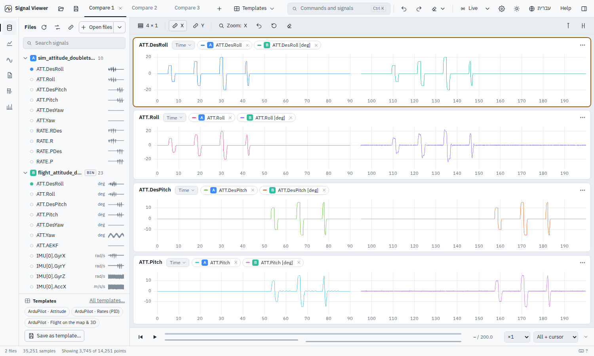
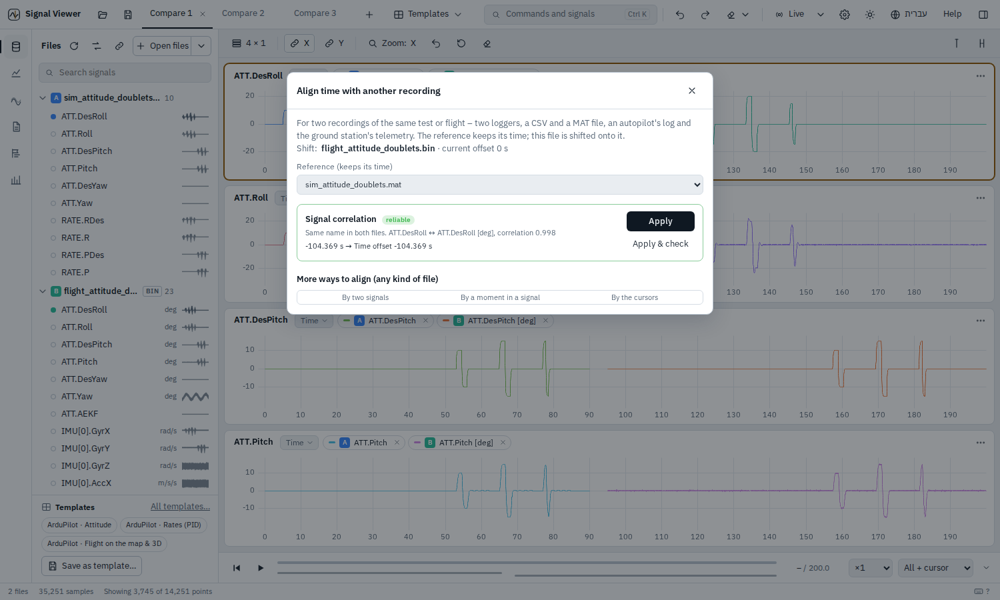
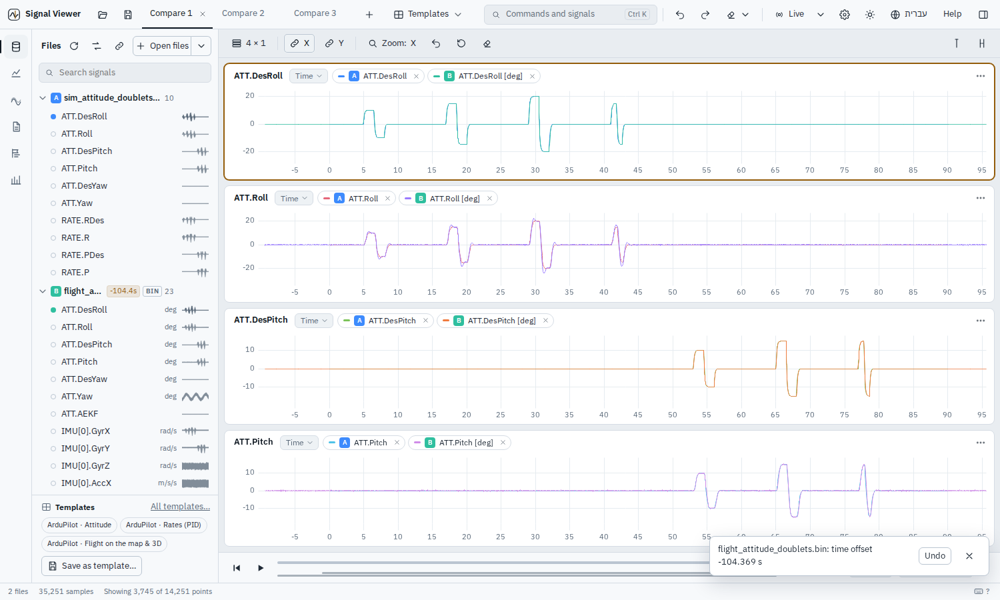
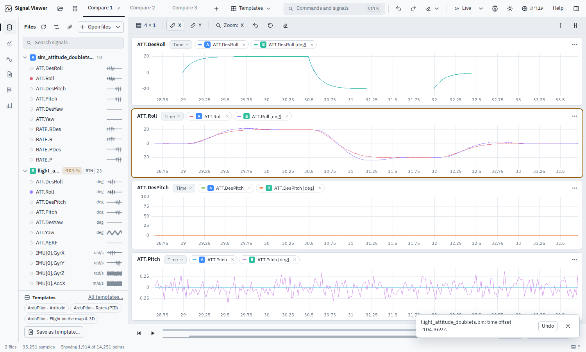
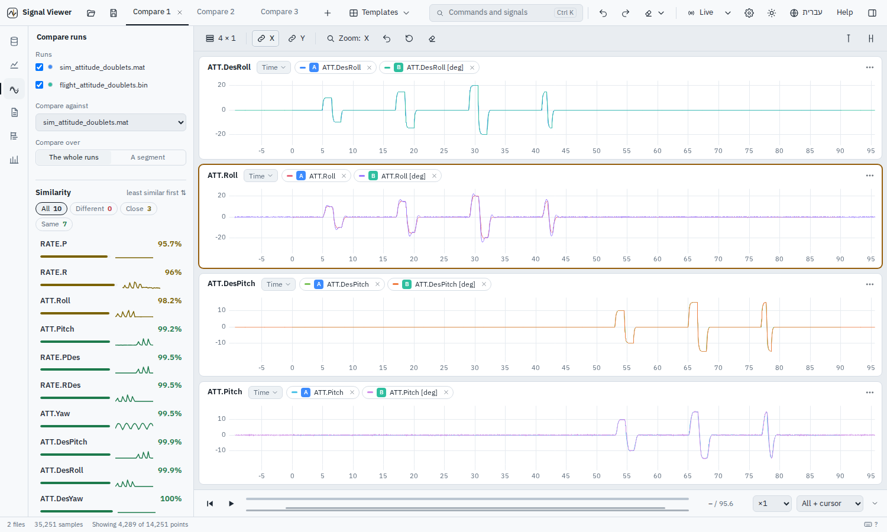

# Simulation against flight

A worked example from start to finish: the same attitude test flown in a model and on the vehicle,
lined up in time, compared signal by signal, and turned into a pass / fail check for CI.

The files are in `examples/sim_vs_flight/` (and on the welcome screen: *a simulation against its
flight*); `tools/make_sim_vs_flight.py` writes them and says exactly what was put in.

| File | What it is |
|---|---|
| `sim_attitude_doublets.mat` | the model, as a Simulink run logs it: `tout`, `ATT.*`, `RATE.*` – 100 Hz, from 0 s |
| `flight_attitude_doublets.bin` | the vehicle: an ArduPilot log – ATT / RATE at 50 Hz, IMU at 250 Hz, flight modes; time from boot |
| `tolerances.json` | the limits for the command line |

**The test.** In ALT_HOLD the pilot flies roll doublets (10°, 15°, 20°) and then pitch doublets –
the usual way to check an attitude loop against its model. Both sides follow the same commands.
Hidden in the flight, for you to find: the vehicle's roll is **less damped** than the model's, it
answers **25 ms later**, and its IMU carries an **82 Hz** motor vibration the model does not have.

## 1. Open both files

Open the two files together (or click the example). Signals of the same quantity are paired
across the files even though the names differ by their unit – the `.mat` says `ATT.Roll`, the log
`ATT.Roll [deg]` – and the start card offers *Compare open files*.

{ .sv-shot loading=lazy }

The doublets are there twice: the simulation counts from 0 s, the log from the autopilot's boot.

## 2. Align them in time

Right-click the flight file → *Align time with another file…*. The model is the reference (it
keeps its time); the flight is shifted onto it. The app correlates the commands both sides share
and proposes **−104.369 s**, correlation 0.998 (the test really began 104.37 s after boot).

{ .sv-shot loading=lazy }

*Apply*: the doublets now lie on top of each other, and the offset shows next to the file
(`−104.4s`). Align on a **command** (DesRoll), not on a response: a response carries the vehicle's
own delay, which is one of the things you want to measure, not to remove.

{ .sv-shot loading=lazy }

## 3. Look closer

Drag over the 20° roll doublet. The commands coincide; the model (red) settles at ±20°, the
vehicle (purple) overshoots to about −24° and rings once – lower damping than the model assumed.
Pitch, a few plots down, follows the model.

{ .sv-shot loading=lazy }

## 4. Rank every signal

*Compare runs* (side bar), against the simulation: every signal both files have, least similar
first, with a small curve of *where* in time they differ. The roll rate and roll angle differ at
each doublet; the commands and yaw are the same; the rates are noisier in flight (a derivative of
a noisy angle). *Table of all signals* gives the numbers; *Export CSV* takes them away.

{ .sv-shot loading=lazy }

More from here, all in the app:

- **A − B** (*Create signals* → two signals) – the difference itself, and how far apart the two
  are in each flight mode.
- **Spectrum** of `IMU[0].AccZ` – the 82 Hz line the model never had (FFT mode on the plot).
- **The same segment of each run**, when several flights are compared (*Compare over → A segment*).

## 5. The same check in CI

```bash
signalviewer-cli compare sim_attitude_doublets.mat flight_attitude_doublets.bin \
    --align auto --align-on ATT.DesRoll --tolerances tolerances.json
```

```text
flight_attitude_doublets.bin  vs  sim_attitude_doublets.mat
        (time alignment)  - flight_attitude_doublets.bin moved by -104.369 s (correlation 0.998 on ATT.DesRoll)
  FAIL  RATE.R  - 0.089 % of samples outside ±30.0; RMS 5.598 (4.04 % of range), max |Δ| 39.32, r 0.917
  FAIL  ATT.Roll  - 1.4 % of samples outside ±3.0; RMS 0.7111 (1.76 % of range), max |Δ| 6.065, r 0.993
  ... 5 more (--top 0 shows all)
5 passed, 2 failed, 0 errors, 0 skipped
```

Exit code 1: the roll loop is outside the model's tolerance – exactly the finding above; pitch,
the commands and yaw pass (`--top 0` lists them). What the
command does:

- `--align auto` lines the flight up with the model by cross-correlation (the app's *Align*);
  `--align-on` picks the signal (default: the best-correlated of the compared ones);
  `--align -104.37` gives the shift yourself. Name the signal in CI: a limit on every single
  sample is sensitive to tens of milliseconds of shift, and the default may pick another signal
  as the data changes (here `ATT.Pitch`: 26 ms away, and the commands `ATT.DesRoll` and
  `ATT.DesPitch` fail too).
- Names match with or without their unit. Where they differ otherwise, pair them in the
  tolerances: `"signals": {"phi": {"as": "ATT.Roll", "abs": 3}}`.
- `tolerances.json` sets the limits: `"default": {"abs": 3.0}` for every signal, larger for the
  rates, `"skip": true` for what is not compared. `--junit report.xml` for the CI's test view.
- A few samples outside can be allowed: `"outside_pct": 0.5` (per signal or in `default`) or
  `--allow-outside 0.5` passes a signal when at most 0.5 % of its samples are outside - for a
  spike at a step that is not the finding. Here `RATE.R` (0.089 % outside) would then pass and
  `ATT.Roll` (1.4 %) would still fail.

The numbers in the output above may differ in the last digits on your machine; the verdict does not.
